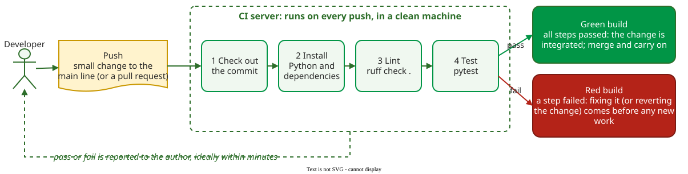

# Continuous Integration

**Continuous integration (CI)** is the practice in which every developer merges their changes into the shared main line (in git, usually the `main` branch) at least daily, and each merge is checked by an automated build that includes the tests, so that integration errors show up within minutes .

## 1. The practices

Without CI, developers work for weeks on separate branches and then spend days merging them; CI replaces that one painful merge with many small ones. Fowler lists eleven practices; four of them carry the idea :

- **Everyone pushes to the main line every day**, so no change drifts far from the others.
- **The build is automated and self-testing**: one command compiles the code (where there is a compile step), runs the tests and answers yes or no.
- **Every push to the main line triggers that build** on a separate machine, not only on the developer's laptop.
- **A broken build is fixed immediately.** In Kent Beck's words, quoted by Fowler, "nobody has a higher priority task than fixing the build"; the quickest fix is often to revert the faulty commit.

A fifth practice keeps the others workable: **keep the build fast**. Fowler takes the Extreme Programming guideline of a ten-minute build as reasonable for most projects.

**Continuous delivery** extends CI so that every change that passes the pipeline *can* be released at the push of a button; **continuous deployment** releases it automatically. Both need a trusted green build first.



_A minimal CI pipeline: any failing step turns the build red, and fixing a red build comes before new work. After_ 

## 2. Example: a pipeline for a small Python project

A team keeps a shop's price calculation in `shop/price.py` (with an empty `shop/__init__.py`), pytest tests in `tests/test_price.py`, and a `requirements.txt` listing `pytest` and `ruff`. On GitHub, CI is a workflow file, `.github/workflows/ci.yml`:

```yaml
name: CI
on:
  push:
    branches: [main]
  pull_request:
jobs:
  check:
    runs-on: ubuntu-latest
    steps:
      - uses: actions/checkout@v4
      - uses: actions/setup-python@v5
        with:
          python-version: "3.12"
      - run: pip install -r requirements.txt
      - run: ruff check .
      - run: python -m pytest   # puts the repo root on the import path
```

On every push to `main` and on every pull request, a fresh Ubuntu machine checks out the code, installs Python 3.12 and the dependencies, runs ruff, a linter that flags likely errors without running the code, and then the tests. `python -m pytest` rather than plain `pytest` lets the tests `import shop`; pytest collects only files named `test_*.py`. If any step exits with an error, the run is marked failed: GitHub shows a red cross on the commit and in the pull request's checks, and the Actions tab holds the log of the failing step.

Suppose a teammate changes `apply_discount` to round prices down to whole units. The test `test_ten_percent_off` expects a 10% discount to turn 40.00 into 36.00. It still passes, since 36.00 is already whole, but a second test expecting 19.99 to become 17.99 now gets 17.00 and fails. The teammate sees the red build typically a minute or two after pushing, and reverts it before anyone builds on it.

## When to use it — and when not

Use CI on any code that more than one person changes, and on a one-person project once it has tests. It gives little value when the build runs no tests: a build that only compiles says the code is valid, not that it works.

## Limitations

- **Flaky tests erode trust.** A flaky test passes and fails on the same code, for example because a server answered slowly. In one company's 1-million-line Java project, about one test-suite run in twenty (4.8%) had at least one flaky failure, and dealing with flaky tests took at least 2.5% of developers' productive time . When red builds are often false alarms, people stop reacting to them.
- **Slow pipelines push back toward big merges.** At Google, with 150 million test runs a day and a commit about every second, commits are tested in batches, and developers have waited up to nine hours for results .
- **A green build is only as good as the tests:** a missing test never fails.

## How solid is this?

- **Where it comes from.** The definition and practices are from Fowler's article (2000, revised 2024) . A study of 34,544 open-source projects on GitHub found that 40% used CI, and 70% of the most-starred ones; among the most popular projects, those using CI released 0.54 times a month against 0.24 for those without .
- **What is contested.** The release comparison is an association, not an experiment: the same projects released 0.34 times a month before adopting CI, so CI is part of the change but popular, active projects may also adopt CI more readily .
- **What we do not hold.** A controlled study showing that CI by itself lowers the number of defects that reach users.

---

### References



---

{: .highlight }
**Disclaimer:** AI is used for text summarization, polishing and explaining. Authors have verified all facts and claims. In case of an error, feel free to file an issue.
