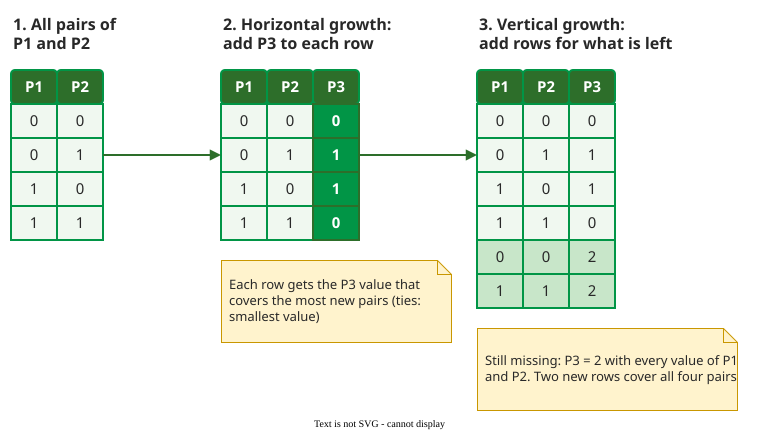

# Covering Array Generation

**Covering array generation** is the task of building a small table of tests that covers every *t*-way combination of an input model. Tools do not search for the smallest array; they use heuristics that build a good one quickly: greedy algorithms such as AETG and IPOG, and search algorithms such as simulated annealing .

## 1. AETG builds one test at a time

AETG, from Bellcore, adds tests one by one, each covering as many still-uncovered pairs as it can find . To build one test it:

1. picks the parameter value that appears in the most uncovered pairs;
2. puts the remaining parameters in a random order;
3. gives each parameter in turn the value that covers the most new pairs with the values already chosen.

It repeats this to make M = 50 candidate tests and keeps the best. Raising M barely helped; running the whole generator with 50 different random-number seeds and keeping the best suite sometimes saved 10% to 20% of the tests. At Bellcore, AETG covered all pairs of a telephone-switch model with 336 valid scenarios, each taking a few hours to run, in 30 tests; on the Unix `sort` command, 29 pairwise tests reached 90% block coverage (they executed 90% of the program's basic blocks, the straight-line stretches of code) .

## 2. IPOG covers one parameter at a time

IPOG reverses the loop: it starts with all combinations of the first *t* parameters, then adds the other parameters one by one . Each new parameter is added in two steps:

- **Horizontal growth** gives every existing test a value for the new parameter, each time the value that covers the most uncovered combinations.
- **Vertical growth** covers what is left, one combination at a time. It fills a don't-care position in an existing test if it can, and adds a new test otherwise. A **don't-care** is a position whose value no combination needs yet.

_IPOG at strength 2, traced by a script. Ties go to the smallest value._ 

For example, trace the figure. P3 must form 12 new pairs, 6 with P1 and 6 with P2. Row (0, 0) gains 2 new pairs whichever value it gets, so it gets 0. Row (0, 1) gains 1 pair with 0 but 2 with 1 or 2, so it gets 1, and so on. After horizontal growth, P3 = 2 still lacks all four of its pairs. Vertical growth first adds (0, \*, 2) for (P1 = 0, P3 = 2), then fills the don't-care with P2 = 0 to cover (P2 = 0, P3 = 2) too; (1, 1, 2) covers the last two. The result has 6 tests, the minimum, since P1 and P3 alone have 2 · 3 = 6 pairs.

Lei et al.'s IPOG tool, FireEye, beat four other generators (ITCH, Jenny, TConfig, TVG) in both test count and time, most clearly at strengths 5 and 6. NIST's ACTS tool generates with IPOG by default .

## 3. Search algorithms trade time for size

Search algorithms start from a whole array and change it step by step to remove uncovered combinations. Simulated annealing, which sometimes accepts a worse step to escape a dead end, is the best known; CASA adds a SAT solver for constraints and is covered on [Constraints and Invalid Values](advanced.md) . Zeb et al. reviewed 91 studies (2003 to 2025) and sorted search-based strategies into five kinds: standard (one search algorithm), mix (a search algorithm plus a greedy, exact or algebraic method), adaptive (tuning its own settings), hybrid (several search algorithms together) and hyper-heuristics that choose among algorithms while running. Simulated annealing stood out: it was the one search algorithm used in the best-performing strategies of four of the five kinds. The same search methods could build related structures that remain largely open, such as error-locating arrays, which also point to the failing combination .

## When to use it — and when not

- **Use** a greedy or heuristic generator (IPOG in ACTS, or PICT) by default. It is fast, and for a few parameters it can reach the lower bound (24 rows for the Find dialog); for many it stays well above it (27 rows for 40 three-valued parameters, against a bound of 9).
- **Use** simulated annealing when each test is expensive and a smaller array is worth a longer generation.

## Limitations

Every generator returns an upper bound. Two tools, or one tool with two random seeds, can return arrays of different sizes for the same model.

## How solid is this?

- **Where it comes from.** The AETG and IPOG papers, the CASA evaluation, and Zeb et al.'s systematic review .
- **What is contested.** Size comparisons between tools depend on the benchmark models; FireEye was compared with four tools available in 2007, not with AETG.

---

### References



---

{: .highlight }
**Disclaimer:** AI is used for text summarization, polishing and explaining. Authors have verified all facts and claims. In case of an error, feel free to file an issue.
