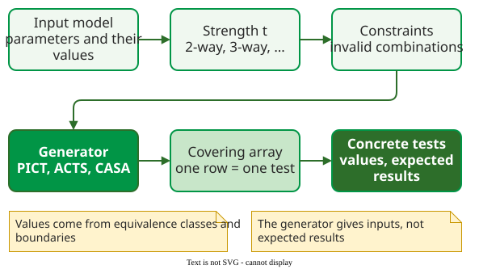

# Combinatorial Testing

**Combinatorial testing** chooses test inputs so that every combination of values of any *t* parameters appears in at least one test, instead of trying every combination of all parameters . It targets **interaction faults**: failures that appear only when two or more inputs take particular values together.

The arithmetic is the reason to use it. A system with 34 on/off switches has 234, about 17 billion, settings; at one test per second, trying them all takes 544 years. Microsoft's PICT generator covers every combination of any 3 switches in 33 tests, and of any 4 switches in 87 . No formula gives these sizes: the generator searches for a small suite, and another tool may need a few tests more or fewer.

_From input model to tests. The values come from equivalence classes and boundaries; the generator chooses the combinations but not the expected results._

## Pages in this section

| Page | What it covers | Best fit | Main cost |
|---|---|---|---|
| [Interaction Faults](interaction-faults.md) | how many inputs it takes to trigger a failure, in NASA, FDA, Mozilla and Apache data | arguing which strength *t* is enough | — |
| [Covering Arrays](foundations.md) | orthogonal and covering arrays, *t*-way coverage, how test counts grow | reading and checking generator output | — |
| [Combinatorial Input Models](practice.md) | choosing parameters and values, base choice versus pairwise, configuration versus input testing | a form, an API or a platform matrix | the model is only as good as its values |
| [Constraints and Invalid Values](advanced.md) | invalid combinations, error values that mask faults, mixed strength | models with dependencies between parameters | writing and checking constraints |
| [Covering Array Generation](algorithms.md) | AETG, IPOG and simulated annealing, traced on small examples | choosing or trusting a generator | — |
| [Combinatorial Testing Tools](tools.md) | PICT, ACTS and CASA, with a real model and its output | running CT in a pipeline | learning a model format |
| [Combinatorial Testing in Industry](effectiveness.md) | five industrial systems, Tricentis, a 3-way case, emergency braking, ML datasets | deciding whether CT pays off | reading company results critically |

Read Interaction Faults first: it gives the evidence for the strength *t* that every later page assumes.

## How solid is this?

- **Where it comes from.** Kuhn, Wallace and Gallo's fault-interaction study, the AETG and IPOG papers, Grindal, Offutt and Andler's survey of combination strategies, and the industrial studies by Hu et al. and Daoud et al. .
- **What is contested.** Whether "no failure needed more than six inputs" holds beyond the few systems studied; see [Interaction Faults](interaction-faults.md).

---

### References



---

{: .highlight }
**Disclaimer:** AI is used for text summarization, polishing and explaining. Authors have verified all facts and claims. In case of an error, feel free to file an issue.
