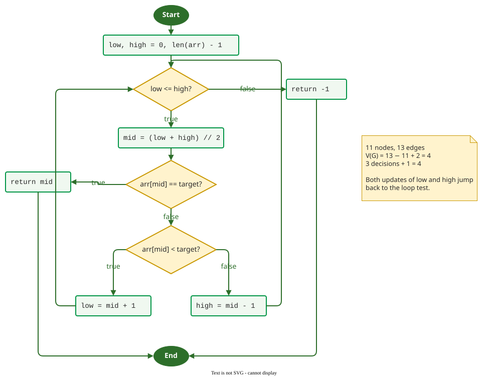

# Basis Paths for Binary Search

**This page derives a basis set of paths for a binary search, a function whose decisions sit inside a loop, and runs the resulting tests with pytest and branch coverage.** It applies the method on [Basis Path](basis.md) to code where a path passes the same decision more than once.

## 1. Worked example: the function and its graph

```python
def binary_search(arr, target):
    low, high = 0, len(arr) - 1
    while low <= high:
        mid = (low + high) // 2
        if arr[mid] == target:
            return mid
        elif arr[mid] < target:
            low = mid + 1
        else:
            high = mid - 1
    return -1
```

The loop test, the equality test and the less-than test are three two-way decisions; the `elif` is a second decision on the false side of the first `if`.



_Eleven nodes and thirteen edges as drawn: V(G) = 13 − 11 + 2 = 4, the same as 3 decisions + 1._ 

radon, which counts decisions in Python source, agrees (output from radon 6.0.1):

```text
$ radon cc -s search.py
search.py
    F 1:0 binary_search - A (4)
```

## 2. Building the basis

Start from a typical path, a search that finds the target at the first middle element, and flip one decision at a time. With a loop, a path may pass a decision several times; a flip changes the outcome on the first pass and lets later passes run as they must. All inputs use the sorted list `[1, 3, 5]`, whose first middle index is 1.

| Path | Derived from | Decisions taken | Input | Expected | New edges |
|---|---|---|---|---|---|
| P1 | start | loop enters; found | `[1, 3, 5]`, 3 | 1 | all of its edges |
| P2 | P1, flip loop | loop never enters | `[]`, 3 | −1 | loop false, `return -1` |
| P3 | P1, flip equality | not found; go right; then found | `[1, 3, 5]`, 5 | 2 | equality false, less-than true, `low` back to loop |
| P4 | P3, flip less-than | not found; go left; then found | `[1, 3, 5]`, 1 | 0 | less-than false, `high` back to loop |

Four feasible paths, equal to *V(G)*, take all thirteen edges. P2 runs the loop zero times, P1 once, P3 and P4 twice, which also meets the loop rule on [Basis Path](basis.md).

## 3. Running the tests

The tests, one per basis path:

```python
import pytest
from search import binary_search

# One test per basis path; arr is sorted
@pytest.mark.parametrize("arr, target, expected", [
    ([1, 3, 5], 3, 1),   # P1: found at the first middle
    ([], 3, -1),         # P2: loop runs zero times
    ([1, 3, 5], 5, 2),   # P3: go right once, then found
    ([1, 3, 5], 1, 0),   # P4: go left once, then found
])
def test_basis(arr, target, expected):
    assert binary_search(arr, target) == expected
```

Run with pytest 9.2.0, pytest-cov 7.1.0 and Python 3.12:

```text
$ pytest -q --cov=search --cov-branch --cov-report=term-missing
....                                                                     [100%]
Name        Stmts   Miss Branch BrPart  Cover   Missing
-------------------------------------------------------
search.py      10      0      6      0   100%
-------------------------------------------------------
TOTAL          10      0      6      0   100%
4 passed in 0.01s
```

`Branch 6` is three decisions with two outcomes each; `Stmts 10` includes the `def` line, as explained on [Measuring Coverage in Python](python.md).

## 4. What the basis does not test

Every basis path above ends with a found target or an empty list. None searches a **non-empty list for a missing value**, where the loop runs and then exits because `low` passes `high`. (Constructed example.) Replacing `high = mid - 1` with `high = mid` keeps all four tests green, yet `binary_search([1, 3, 5], 4)` never ends: once `low` and `high` meet at index 2, `high` stays at 2. A fifth test, with a time limit from the pytest-timeout plugin (2.4.0), exposes it:

```python
@pytest.mark.timeout(2)
def test_absent_in_nonempty_list():
    assert binary_search([1, 3, 5], 4) == -1
```

```text
$ pytest -q        # mutant high = mid, five tests
E       Failed: Timeout (>2.0s) from pytest-timeout.
FAILED test_search.py::test_absent_in_nonempty_list - Failed: Timeout (>2.0s)...
1 failed, 4 passed in 2.01s
```

On the correct function the same five tests pass (`5 passed in 0.00s`). A basis is a floor for structural testing, not a test design: the absent value comes from the specification, as an [equivalence class](../domain/equivalence.md) of its own.

**Where the inputs come from.** The graph comes from the source; radon gives *V(G)* per function, and `pytest --cov-branch` confirms that the basis tests take every branch. Expected values come from the specification of the search, never from running the code.

## When to use it — and when not

- **Use it** on a loop with decisions inside, where a branch-adequate suite can skip whole combinations of loop exits.
- **Do not stop at it**: add the specification's classes, such as an absent value or a one-element list, which no control-flow criterion asks for.

## Limitations

The basis is not unique: starting from P2 gives a different, equally valid set. Every path through a loop is one of infinitely many, so *V(G)* counts independent paths, not iterations; off-by-one faults in the loop bounds need the [boundary values](../domain/boundary.md) of the index.

## How solid is this?

- **Where it comes from.** *V(G)* and the basis set follow McCabe ; the tool runs were made for this page.
- **What we do not hold.** A study of how often basis-path suites miss faults in loop exits; the mutant above is one constructed case.

---

### References



---

{: .highlight }
**Disclaimer:** AI is used for text summarization, polishing and explaining. Authors have verified all facts and claims. In case of an error, feel free to file an issue.
