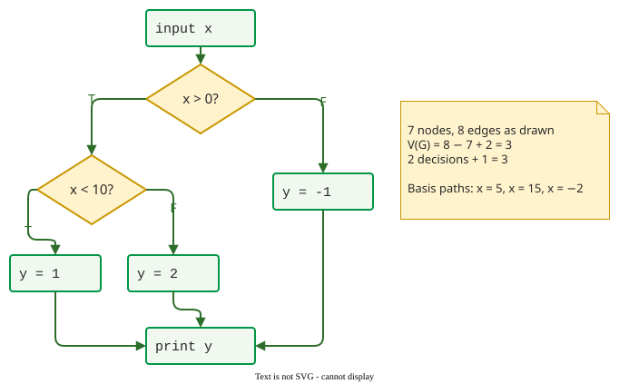
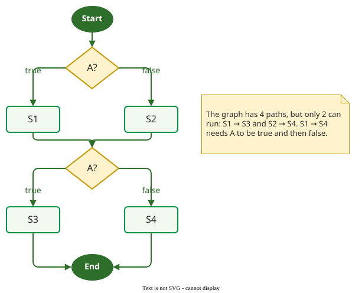

# Basis Path Coverage

**Basis path coverage** requires a test suite to run a set of *linearly independent* start-to-end paths through the control-flow graph, as many as the graph's cyclomatic complexity *V(G)*. It sits between branch coverage, too weak for interacting decisions, and all-paths coverage, usually impossible.

## 1. Independent paths and V(G)

A set of paths is **linearly independent** when no path in it can be made by adding and subtracting the edges of the others. A sufficient check: the paths can be listed in an order where each one takes at least one edge that none of the paths **before it** took. A largest such set, a **basis**, has exactly *V(G)* paths, McCabe's cyclomatic complexity :

$$
V(G) = e - n + 2
$$

where *e* is the number of edges and *n* the number of nodes. The counts depend on how the graph is drawn, but *V(G)* does not, provided the graph has one exit. For code built only from two-way decisions there is a shortcut: *V(G)* = number of decisions + 1.

Because a basis set reaches every edge when all its paths are feasible, basis path coverage **subsumes branch coverage**.

## 2. Worked example

```text
input x
if x > 0 then
    if x < 10 then y = 1
    else           y = 2
else
    y = -1
print y
```



_Seven nodes and eight edges as drawn: V(G) = 8 − 7 + 2 = 3, the same as 2 decisions + 1._

A basis needs three tests:

| Path | Decisions | Test input | Expected `y` |
|---|---|---|---|
| 1 | x > 0, x < 10 | x = 5 | 1 |
| 2 | x > 0, x ≥ 10 | x = 15 | 2 |
| 3 | x ≤ 0 | x = −2 | −1 |

Each two-way decision adds one basis path, nested or not; the saving shows with decisions **in sequence**, where the number of all paths doubles with each one: four `if` statements in a row have 2<sup>4</sup> = 16 paths but a basis of 5.

## 3. Building a basis

Pick a typical first path, then derive each next path by **flipping one decision** of a path already in the set and keeping the earlier decisions. Each flip adds **at least one** new edge: in the example, flipping `x < 10` adds both the false edge and the edge from `y = 2` to `print`. Decisions after the flipped one may change or disappear: once `x > 0` is false, `x < 10` is never reached. Loops get the boundary treatment (a loop's graph is drawn on [Measuring Coverage in Python](python.md)): a `while` or `for` loop is run zero times and once; a `do … while` loop, which always runs once, is run once and twice.

## 4. All paths, and paths that cannot run

**All-paths coverage** runs every start-to-end path; with a loop their number is unbounded, so it is a reference point, not a target.

Some paths can never run. When the same condition is tested twice and nothing in between changes it, the graph shows four paths but only two are feasible.



_Same shape as the graph on [Terminology](terminology.md), but the second decision repeats A: the graph promises more paths than the program has._

In this graph *V(G)* = 3, but only two independent paths can run, so the achievable target is 2 of 3 basis paths, with full branch coverage. Feasibility is undecidable in general, so each uncovered path needs a person's judgement.

## When to use it — and when not

- **Use it** for functions whose decisions interact, where two tests can reach full branch coverage without combining them.
- **Use V(G)** as the number of tests basis path coverage needs when every path can run, and as an upper bound on the number of tests branch coverage needs. McCabe proposed 10 as an upper limit for one module .
- **Do not expect it to test conditions.** `if (A && B)` is one decision here (some tools count each `&&` as an extra one), so a basis can miss a wrong operator inside it; see [Multiple Conditions](conditions.md).

## Limitations

Basis paths force more *combinations* of decisions than branch coverage, but guarantee no particular one. A basis is **not unique**. For two decisions in sequence, *{TT, FT, FF}* and *{FF, TF, FT}* are both valid bases (in that order, TF adds A-true and FT adds B-true), and a fault that shows only on *TF*, like the one in [Statement and Branch Coverage](code.md), is found by the second and missed by the first. Basis paths can also be infeasible (section 4), and the set must then be rebuilt by hand.

## How solid is this?

- **Where it comes from.** McCabe defined *V(G)* and the basis set in 1976 ; the method is standard in testing textbooks .
- **What we do not hold.** The coverage review behind these pages found no study that measures basis path coverage against real faults, so no detection figure is given here.

---

### References



---

{: .highlight }
**Disclaimer:** AI is used for text summarization, polishing and explaining. Authors have verified all facts and claims. In case of an error, feel free to file an issue.
