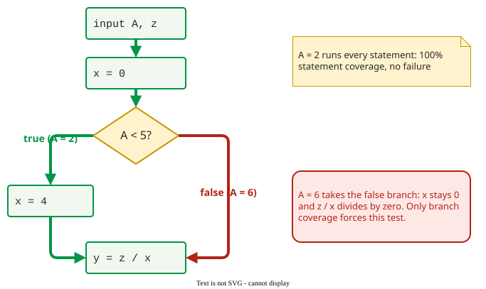

# Statement and Branch Coverage

**Statement coverage** is the fraction of a program's statements that a test suite executes at least once; **branch coverage** is the fraction of decision outcomes (each true and each false edge) that it takes. They are the two criteria every coverage tool reports, and the weakest ones on the [subsumption hierarchy](index.md).

## 1. Statement coverage

$$
\text{statement coverage} = \frac{\text{statements executed}}{\text{all statements}}
$$

It is also called line coverage, and in some standards C0. A statement that no test has executed may hide any fault at all, so 100% statement coverage is a minimum: if a line never ran, the suite cannot have checked it.

## 2. Branch coverage

$$
\text{branch coverage} = \frac{\text{decision outcomes taken}}{\text{all decision outcomes}}
$$

It is also called decision coverage or C1. Every `if` needs a test where it is true and a test where it is false, even when the false side has no statements of its own. Branch coverage **subsumes** statement coverage: taking every edge of the graph passes through every node.

In Python, `pytest --cov=fn --cov-branch --cov-report=term-missing` reports both. For this function and the single test `first_negative([3, -1])`:

```python
def first_negative(xs):
    for x in xs:
        if x < 0:
            return x
    return None
```

```text
Name    Stmts   Miss Branch BrPart  Cover   Missing
fn.py       5      1      4      1    78%   5
```

coverage.py counts the `def` line as a statement, because it runs when the module is imported.

The `for` loop and the `if` are two decisions with two outcomes each (`Branch 4`). The test never leaves the loop by running out of items, so one branch is partial (`BrPart 1`) and `return None` on line 5 never runs. Separately, statement coverage is 4/5 = 80% and branch coverage 3/4 = 75%; coverage.py's `Cover` column combines them: (4 + 3) / (5 + 4) = 78%. Adding `first_negative([])` takes the loop's exit edge and brings both to 100%.

## 3. Example: the missing `else`

```text
input A, z
x = 0
if A < 5 then
    x = 4
end if
y = z / x
```

The single test *A = 2* executes every statement, so statement coverage is 100%, and it passes. Branch coverage is 50%, because the false outcome of `A < 5` was never taken. The test that branch coverage asks for, say *A = 6*, skips `x = 4` and divides by zero.



_The false edge has no statements on it, so statement coverage cannot see it._

## 4. Where branch coverage still fails

Branch coverage treats each decision on its own. In this program the specification says *Z* should be 2 whenever *A* is true:

```text
input A, B
Z = 0
if A then Z = Z + 1
if B then Z = 2
print Z
```

The suite *{(A = T, B = T), (A = F, B = F)}* takes all four branches and passes: it prints 2 and 0, as specified. The fault shows only for *(A = T, B = F)*, which prints 1. [Data-flow coverage](data-flow.md) forces that test: the value assigned by `Z = Z + 1` reaches `print Z` only when B is false, and All-Uses requires every assignment to reach every use. [Basis paths](basis.md) may or may not include it: this graph has V(G) = 3, and whether *(T, F)* is among the three independent paths depends on which are chosen.

## 5. All paths, and paths that cannot run

**All-paths coverage** runs every start-to-end path. With *n* decisions in sequence there are up to 2<sup>*n*</sup> paths, and a loop makes the number unbounded, so the criterion is a reference point rather than a target. [Basis path](basis.md) coverage is the practical substitute.

Some paths in the graph can never run. When the same condition is tested twice and nothing in between changes it, the graph shows four paths, but only two are feasible.


_Infeasible paths: the graph promises more paths than the program has._

Deciding in general whether a path is feasible is undecidable, so a tool cannot always tell a missing test from an impossible one. A team must judge each uncovered path by hand, which is one reason 100% is rarely a sensible target.

## When to use them — and when not

- **Use** statement coverage as a floor: code that no test executes is untested, whatever else is true.
- **Use** branch coverage as the default report: it is cheap, every tool measures it, and it finds the missing-`else` class of fault.
- **Do not** read either number as test quality. A suite can reach 100% of both while checking no output at all; see [Coverage and Fault Detection](discussion.md).

## How solid is this?

- **Where it comes from.** Definitions and subsumption follow Ammann and Offutt ; the naming C0/C1 varies between standards and tools.
- **What is contested.** On 274 real faults, only 10% of the fault-revealing tests added any statement coverage, and only 19% added branch coverage . Most tests that found a fault ran code the suite already covered, so a coverage gain rarely signalled a newly found fault.

---

### References



---

{: .highlight }
**Disclaimer:** AI is used for text summarization, polishing and explaining. Authors have verified all facts and claims. In case of an error, feel free to file an issue.
