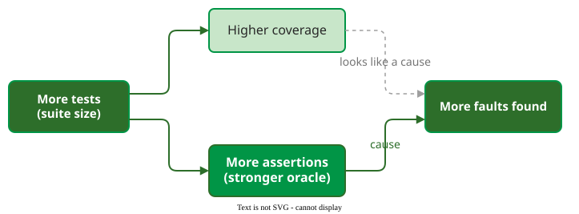
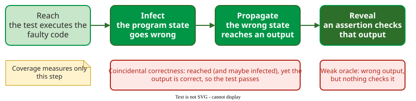

# Coverage and Fault Detection

**Does higher coverage mean a test suite finds more faults?** Only weakly, and much less than the raw correlation suggests. Thirty years of studies agree that coverage tells you what a suite has *not* tested, but says little about how well it tests what it has reached.

## 1. Faults keep coming after coverage stops rising

Wei, Oriol and Meyer ran random testing on 14 classes of a widely used library in Eiffel, an object-oriented language: 30 runs of 6 hours per class, 2,520 hours in all. Within each run they recorded, over time, the branch coverage reached and the real faults found .

```vega-lite
{
  "$schema": "https://vega.github.io/schema/vega-lite/v5.json",
  "width": "container", "height": 220,
  "data": {"values": [
    {"min": 10, "measure": "Branches exercised", "pct": 93},
    {"min": 30, "measure": "Branches exercised", "pct": 96},
    {"min": 60, "measure": "Branches exercised", "pct": 97},
    {"min": 10, "measure": "Faults found", "pct": 54},
    {"min": 30, "measure": "Faults found", "pct": 70},
    {"min": 60, "measure": "Faults found", "pct": 78}
  ]},
  "mark": {"type": "line", "point": {"size": 70}, "strokeWidth": 3},
  "encoding": {
    "x": {"field": "min", "type": "quantitative", "title": "Minutes into a 6-hour run (first data point at 10)", "scale": {"domain": [0, 60]}},
    "y": {"field": "pct", "type": "quantitative", "title": "% of the run's final total", "scale": {"domain": [0, 100]}},
    "color": {"field": "measure", "type": "nominal", "title": null,
              "scale": {"range": ["#019546", "#b42318"]}, "legend": {"orient": "bottom"}}
  },
  "config": {"font": "Tahoma", "axis": {"labelFontSize": 13, "titleFontSize": 13}, "legend": {"labelFontSize": 13}}
}
```

_Medians over all runs, as a share of what the whole 6-hour run reached; the chart shows the first hour. Between 10 and 60 minutes the share of branches exercised rises only from 93% to 97%, while the share of faults found rises from 54% to 78%, so roughly a fifth of the faults appear in the remaining five hours. These are shares of faults found, not of all faults that exist._ 

Coverage tracks fault detection while it is still climbing; once it flattens, testing keeps finding faults that the coverage number cannot register.

## 2. Suite size is the hidden variable

Inozemtseva and Holmes generated 31,000 test suites for five large Java programs and measured their effectiveness as the mutation score, the share of planted faults each suite detected . Ignoring suite size, coverage correlated strongly with effectiveness (0.79 to 0.95). With size held constant, the correlation became weak, and for two of the five programs it was close to zero.



_Why coverage looks predictive: size drives both coverage and checking._ 

Later work quantified the effect: on 565 faults from Defects4J, a public collection of real, reproducible Java bugs, suite size explained up to 69% of the apparent effect of statement coverage and up to 82% for branch coverage . Zhang and Mesbah found the missing link: the number of **assertions** correlated with effectiveness at 0.927 to 0.973, and size mattered because larger suites contain more assertions .

## 3. Reaching a fault is not revealing it

The **oracle** is the check that decides whether a test passes, usually its assertions. A test reveals a fault only if it **reaches** the faulty code, **infects** the program state, **propagates** the wrong state to an output, and an assertion **reveals** the fault by checking that output. Coverage measures only the first step.



_Where coverage-based confidence breaks down._ 

**Coincidental correctness** is common. Masri and Abou Assi seeded faults into programs, giving 148 faulty versions, and ran each version's tests . On average, 56.4% of the tests **reached** the faulty statement and still passed (*weak* coincidental correctness), and 15.7% reached it, **infected** the state, and still passed (*strict* coincidental correctness). The strict cases are a subset of the weak ones, which is why the second number is smaller. Such tests count towards coverage and pass.

**Example.** A test calls `order.total()` on a cart with one item at 10.00 and a 0% discount, and asserts that the result is 10.00. A fault that applies the discount as `price - discount` instead of `price * (1 - discount)` reaches the faulty line, but with a discount of 0 both formulas give 10.00: the test passes, and the line counts as covered. Schwartz et al. looked at the mutants that suites with at least 80% statement coverage still missed: unary arithmetic-operator deletions (for example, `-x` mutated to `x`) were detected only 12.12% of the time, and the main cause was oracles that did not check the affected values .

## 4. What the criteria catch on real faults

Hemmati compared criteria on 274 real faults from Defects4J . A criterion counted as effective for a fault when the test that exposed the fault also increased that criterion's coverage, so the figures are upper bounds.

| Criterion | Effective for |
|---|---|
| Statement | 10% of faults |
| Branch | 19% |
| MC/DC | 19% |
| Loop (each loop run zero, one and several times) | 8% |
| All four control-flow criteria together | 28% |
| Control flow + def-use pairs | 85% |

Because of this counting rule, a stronger criterion need not score higher than a weaker one: MC/DC only ties branch at 19% because, for the extra faults, the fault-revealing tests added no new condition outcomes. About 15% of faults were missed by every criterion: they were faults of omission or wrong behaviour that no structural measure can point at.

## 5. Which metric to trust

A meta-review of effectiveness studies ranks the metrics by how reliably they order suites by fault detection: **mutation score** first, branch coverage second, statement coverage last . This is not mutants predicting mutants: Lu et al. reached the same order with **real** Defects4J faults as the ground truth, after removing the effect of suite size . Marick's advice from 1997 still summarises the field: coverage gives **clues, not commands** . The rules that follow from it are on [Using Coverage in Practice](practice.md).

## How solid is this?

- **Where it comes from.** Every figure on this page is taken from the papers in the coverage literature review; the five Java systems, the Defects4J faults and the Eiffel classes are open-source code, so the results are strongest for that kind of software.
- **What is contested.** Most studies measure effectiveness with mutants, not real faults; Zhang et al. show this inflates how good the metrics look . Hemmati's percentages are upper bounds by design.
- **What is solid.** No study in the review found that coverage, with size controlled, is a strong predictor of fault detection.

---

### References



---

{: .highlight }
**Disclaimer:** AI is used for text summarization, polishing and explaining. Authors have verified all facts and claims. In case of an error, feel free to file an issue.
