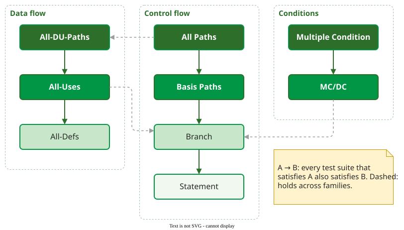

# Test Coverage Criteria

A **coverage criterion** names a set of program elements (statements, branches, paths, conditions, definition-use pairs or mutants) and measures what fraction of them a test suite exercises. It answers *"what has this suite not touched yet?"*, not *"is this suite good?"*.

A criterion is used in two ways . As a **generator**, it points at the next test to write: the branch nobody has taken yet. As a **measure**, it scores an existing suite: 87% of branches taken.

## The criteria at a glance

The table compares what each criterion demands and what drives its number of tests.

| Criterion | A test suite must… | The number of tests grows with… | Page |
|---|---|---|---|
| Statement | execute every statement at least once | the paths needed to reach every statement | [Statement and Branch Coverage](code.md) |
| Branch | take the true and the false outcome of every decision | the decisions, and how they are nested | [Statement and Branch Coverage](code.md) |
| Basis path | run *V(G)* linearly independent paths | *V(G)*, minus any paths that cannot run | [Basis Path](basis.md) |
| MC/DC | show that each condition flips its decision on its own | the conditions: *c* + 1 for most decisions with *c* conditions | [Multiple Conditions](conditions.md) |
| Multiple condition | try every combination of conditions | 2*c* for a decision with *c* conditions | [Multiple Conditions](conditions.md) |
| All-Uses | make every assignment of a variable reach each place that reads it | the data dependencies | [Data Flow](data-flow.md) |
| Mutation score | make some test fail on every planted fault (mutant) that changes behaviour | the mutants: one suite run each | [Mutation](mutation.md) |

Criteria are ordered by **subsumption**: criterion A subsumes B when every suite that satisfies A also satisfies B.

_Subsumption among the criteria on these pages. All-Uses subsumes Branch under the usual assumption that every definition reaches a use. Mutation is not in the diagram: whether it subsumes a criterion depends on which mutation operators are used._ 

Subsumption is about *requirements*, not bugs: a suite built for a weaker criterion can still find a fault that one built for a stronger criterion misses, because detection depends on the inputs chosen .

## Reading order

Start with [Terminology](terminology.md), then the criteria from statement to mutation; [Basis Paths for Binary Search](basis-binary-search.md) adds a loop. [Coverage and Fault Detection](discussion.md) shows how well coverage predicts faults, [Using Coverage in Practice](practice.md) gives team rules, [Updating and Reducing a Test Suite](suite-maintenance.md) prunes the suite, [Measuring Coverage in Python](python.md) reads pytest-cov output, and the [Worked Case](worked-case.md) takes a pull request to a CI gate.

## How solid is this?

- **Where it comes from.** The definitions and the subsumption relations are textbook material . They are proofs about what a suite must do, not measurements.
- **What is contested.** Whether higher coverage means *better* testing is an empirical question, and the answer is weaker than most teams assume. See [Coverage and Fault Detection](discussion.md).

---

### References



### Acknowledgments

The lectures behind this area took early inspiration from the *Analysis of Software Artifacts* course of Eduardo Miranda and Claire Le Goues (Carnegie Mellon University). The pages here are original, written from the literature review; any errors are ours.

---

{: .highlight }
**Disclaimer:** AI is used for text summarization, polishing and explaining. Authors have verified all facts and claims. In case of an error, feel free to file an issue.
