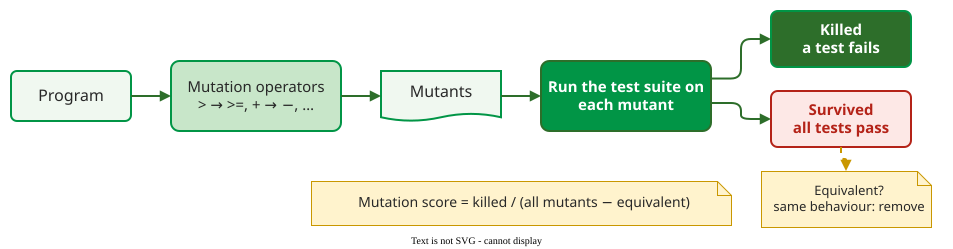

# Mutation Coverage

**Mutation coverage**, or the **mutation score**, is the fraction of deliberately faulty copies of a program, called **mutants**, that a test suite detects. Where the other criteria ask whether tests *reached* the code, mutation asks whether they would *notice* if the code were wrong: whether some test's **oracle**, the assertion that decides pass or fail, catches the change.

## 1. How it works

A tool applies **mutation operators** to the program, each making one small syntactic change, and runs the whole suite against every mutant.



_A mutant is killed when at least one test fails on it._

$$
\text{mutation score} = \frac{\text{killed mutants}}{\text{all mutants} - \text{equivalent mutants}}
$$

Typical operators imitate slips a programmer makes:

| Operator | Change |
|---|---|
| Relational | `x > 0` → `x >= 0` |
| Logical | `a and b` → `a or b` |
| Arithmetic | `x + y` → `x - y` |
| Constant | `limit = 10` → `limit = 11` |
| Statement deletion | remove `total += item` |

An **equivalent mutant** changes the code but not its behaviour, for example `i < n` → `i != n` in a loop where `i` counts up by 1 from 0 and `n` is never negative. No test can kill it, so it is removed from the denominator, which takes a person's judgement.

## 2. Worked example

```python
def ship(x):
    y = 0
    if x > 0:          # mutant: x >= 0
        y = 1
    return y
```

The test `ship(0)` **reaches** the mutated line in both versions. The original returns 0 and the mutant returns 1. Whether the mutant is killed depends on the oracle:

- `assert ship(0) == 0` kills it;
- a test that calls `ship(0)` and asserts nothing lets it survive, even though line and branch coverage both count it.

This is the point of the criterion: a surviving mutant marks a place where the suite runs code without checking its result.

## 3. Why it is trusted

The method rests on two assumptions stated by DeMillo, Lipton and Sayward : programmers write code that is *nearly* right (the **competent programmer hypothesis**), and tests that catch simple faults also catch most complex faults built from them (the **coupling effect**). Comparisons of effectiveness metrics rank the mutation score as the most reliable predictor of how many real faults a suite finds, ahead of branch and statement coverage .

## When to use it — and when not

- **Use it** to judge whether a suite's assertions are strong, on code where a missed fault is expensive.
- **Use it** to compare two suites, or to find weak tests: each surviving mutant points at a missing check.
- **Do not run it on everything, every commit.** Each mutant needs a suite run; restrict it to changed or critical code.

## Limitations

Mutation testing is **expensive**, because cost grows with mutants × tests, and the **equivalent-mutant problem** has no general automatic solution . The score also depends on the chosen operators, so scores from different tools are not comparable. Tools do the work: **mutmut** for Python and **PIT** for Java generate the mutants, run the suite and report survivors. With mutmut, `mutmut run` mutates the code and runs the tests, `mutmut results` lists the surviving mutants, and `mutmut show <name>` prints one as a diff. Cost-reduction techniques, the equivalent-mutant problem in depth and further tools are covered on the separate [Mutation Testing](../random/mutation.md) page.

## How solid is this?

- **Where it comes from.** DeMillo et al. 1978 ; Jia and Harman survey the field .
- **What the evidence says.** After removing the effect of suite size, the mutation score predicted real-fault detection better than statement coverage on 565 Defects4J faults . Zhang et al. caution that using mutants as the ground truth inflates how good other metrics look ; Lu et al. avoid that trap by using real faults, as [Coverage and Fault Detection](discussion.md) explains.

---

### References



---

{: .highlight }
**Disclaimer:** AI is used for text summarization, polishing and explaining. Authors have verified all facts and claims. In case of an error, feel free to file an issue.
