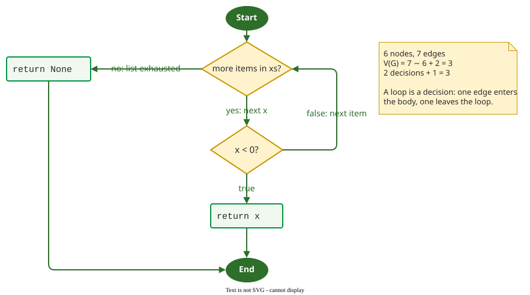

# Measuring Coverage in Python

**pytest-cov** runs a pytest suite under coverage.py and reports, per file, which statements and which branches the tests did not exercise. It measures [statement and branch coverage](code.md) only; basis paths, MC/DC and data-flow coverage need other tools or hand analysis.

## 1. The command

Replace `mypkg` with your package or module name:

```bash
pytest --cov=mypkg --cov-branch --cov-report=term-missing
```

`--cov-branch` adds branch measurement; without it you get statements only. `term-missing` prints the lines and jumps that were never run.

## 2. Worked example: a loop

For this function and the single test `first_negative([3, -1])`:

```python
def first_negative(xs):
    for x in xs:
        if x < 0:
            return x
    return None
```

```text
Name    Stmts   Miss Branch BrPart  Cover   Missing
fn.py       5      1      4      1    78%   5
```



_A loop is drawn as a decision: one edge enters the body, the other leaves the loop. V(G) = e − n + 2 is McCabe's cyclomatic complexity; see [Basis Path](basis.md)._

Reading the columns:

- `Stmts 5`: coverage.py counts the `def` line too, because it runs when the module is imported; the graph leaves it out.
- `Branch 4`: the `for` loop and the `if` are two decisions with two outcomes each.
- `BrPart 1`: one decision was only partly taken. The test never leaves the loop by running out of items.
- `Missing 5`: `return None` on line 5 never ran.
- `Cover 78%`: statement coverage is 4/5 = 80% and branch coverage 3/4 = 75%; the column combines them, (4 + 3) / (5 + 4) = 78%.

Adding `first_negative([])` takes the loop's exit edge and brings both measures to 100%.

## 3. Reading a missed jump

When the skipped side of a decision leads to a line that runs anyway, the report shows the jump itself. For this file and the single test `price(5)`:

```python
def price(qty, unit=10):
    total = qty * unit
    if qty > 1:
        total = total * 0.9
    return total
```

```text
Name      Stmts   Miss Branch BrPart  Cover   Missing
shop.py       5      0      2      1    86%   3->5
```

Every line ran, so statement coverage is 100%. `3->5` says the jump from line 3 straight to line 5, the `if` being false, was never taken; a test with `price(1)` takes it. In the loop example the missed jump was not listed, because its target line 5 was itself missing.

## 4. Only the lines a change touched

To review a pull request, write an XML report and let `diff-cover` keep only the changed lines:

```bash
pytest --cov=mypkg --cov-branch --cov-report=xml
diff-cover coverage.xml --compare-branch=main
```

## When to use it — and when not

- **Use it** on every test run in CI: the report costs a few seconds and points at untested code.
- **Use `--cov-branch` always**: statement coverage alone hides every `if` whose false side has no code of its own.
- **Do not chase the `Cover` number**: it combines two criteria and says nothing about assertions; read the `Missing` column instead.

## Limitations

coverage.py treats `if a and b:` as one decision with two outcomes, so it cannot show which condition was tried. A report with no missing lines says nothing about what the tests assert; see [Coverage and Fault Detection](discussion.md).

---

{: .highlight }
**Disclaimer:** AI is used for text summarization, polishing and explaining. Authors have verified all facts and claims. In case of an error, feel free to file an issue.
