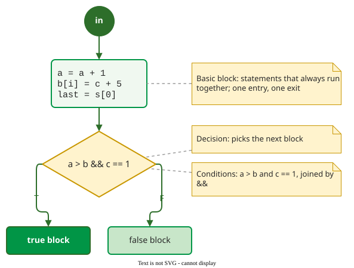
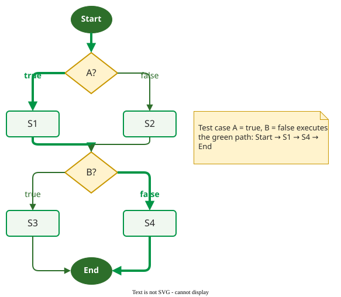

# Coverage Terminology

A **control-flow graph (CFG)** is a directed graph whose nodes are statements or basic blocks and whose edges are the possible transfers of control between them. Every control-flow criterion is defined on this graph, and data-flow criteria add definitions and uses to it, so its vocabulary comes first.

## 1. Statements, blocks, decisions and conditions

The figure labels the elements that coverage criteria count.

_The elements of a control-flow graph, adapted from Hass._ 

- A **statement** is the smallest executable unit, such as `x = y + 1` or `return z`.
- A **basic block** is a sequence of statements that always run together: control enters at the first and leaves at the last, with no branch in between.
- A **decision** is a point where the outcome selects the next block: `if`, `while`, `for`, `case`.
- A **branch** is one outgoing edge of a decision, such as its true or its false outcome.
- A **condition** is a Boolean expression with no logical operator inside it. The decision `a > b && c == 1` is made of two conditions.

Data-flow criteria add two labels to the graph: a **definition** is a node that assigns a variable, and a **use** is a node that reads it. [Mutation](mutation.md) works on copies of the code rather than the graph.

The difference between a decision and a condition matters later: branch coverage looks at decisions, while [MC/DC](conditions.md) looks at the conditions inside them.

## 2. The control-flow graph

A CFG has one start node and one end node. A node with more than one outgoing edge is a decision. Merging consecutive non-branching statements into one basic-block node gives a smaller graph with the same paths, which is how the graphs on these pages are drawn.

A **path** is a sequence of edges from start to end. A **test case** executes one path; a **test suite** is a set of test cases, so it executes a set of paths.

_One test case, one path._

## 3. Worked example

Take the graph above, with eight nodes and four branches (two per decision). The suite *{(A = true, B = false)}* executes 6 of the 8 nodes (Start, A?, S1, B?, S4, End) and 2 of the 4 branches. Adding *(A = false, B = true)* reaches all 8 nodes and all 4 branches, yet two of the four start-to-end paths, S1 → S3 and S2 → S4, are still never run. Each of the following pages turns one of these counts into a criterion: statements, branches, independent paths, conditions and data dependencies.

## 4. Where the model stops

A CFG describes the code that exists. It has no node for a check the programmer forgot, so no criterion defined on it can demand a test for missing code. These are **faults of omission**: bugs fixed by adding code, such as a missing condition or an unhandled exception. Marick notes that they are "quite common in real life" . The graph also ignores data values: two tests can take the same path while one passes and the other fails. [Data-flow coverage](data-flow.md) and [mutation](mutation.md) address the second gap; only tests derived from the specification address the first.

---

### References



---

{: .highlight }
**Disclaimer:** AI is used for text summarization, polishing and explaining. Authors have verified all facts and claims. In case of an error, feel free to file an issue.
