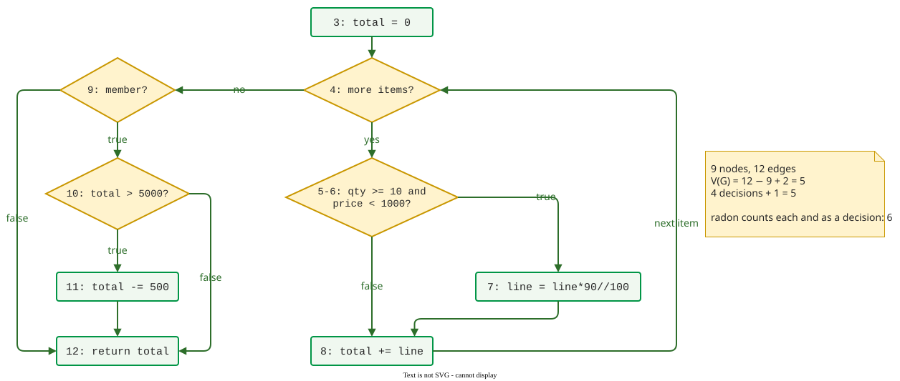

# Worked Case: Basis Paths and a Coverage Gate for a Checkout Function

This worked case takes one pull request, a new checkout function with a loop, a nested `if` and a compound condition, from its source code to two decisions: which tests make the change reviewable, and what coverage gate the project's CI should enforce. It applies [Basis Path](basis.md), [Measuring Coverage in Python](python.md) and [Using Coverage in Practice](practice.md) without re-explaining them. (Constructed example; every run below was made for this page with Python 3.12.9, pytest 9.2.0, pytest-cov 7.1.0, coverage.py 7.17.0, radon 6.0.1 and diff-cover 11.0.0.)

## Example input: a pull request and a pricing rule

The repository `shop` already has a receipt module with three tests, partly covered on purpose:

`shop/receipt.py` (and an empty `shop/__init__.py`):

```python
def format_cents(cents):
    sign = "-" if cents < 0 else ""
    cents = abs(cents)
    return f"{sign}{cents // 100}.{cents % 100:02d} EUR"


def receipt_lines(items):
    lines = []
    for name, cents in items:
        if not name:
            name = "(unnamed)"
        lines.append(f"{name:<20}{format_cents(cents):>12}")
    if not lines:
        lines.append("(empty cart)")
    return lines


def parse_coupon(code):
    code = code.strip().upper()
    if code.startswith("FIX"):
        return ("fixed", int(code[3:]))
    if code.startswith("PCT"):
        pct = int(code[3:])
        if pct > 50:
            raise ValueError("coupon above 50%")
        return ("percent", pct)
    raise ValueError("unknown coupon")
```

```python
# tests/test_receipt.py
from shop.receipt import format_cents, receipt_lines, parse_coupon

def test_format():
    assert format_cents(1234) == "12.34 EUR"
    assert format_cents(-5) == "-0.05 EUR"

def test_lines():
    assert receipt_lines([("tea", 250)]) == ["tea" + " " * 21 + "2.50 EUR"]

def test_coupon_fixed():
    assert parse_coupon(" fix300 ") == ("fixed", 300)
```

The project configuration on main (Step 6 explains the 55):

```toml
# pyproject.toml
[tool.pytest.ini_options]
pythonpath = ["."]
addopts = "--cov=shop --cov-branch --cov-report=term-missing"

[tool.coverage.report]
fail_under = 55
```

The branch `feature/bulk-discount` adds `shop/checkout.py`. The pricing rule in the ticket says: a line of 10 or more units of an item that costs under 10.00 EUR gets 10% off; a member whose total is over 50.00 EUR gets 5.00 EUR off. Prices are in cents.

```python
1  def order_total(items, member):
2      """Total in cents for a list of (unit_price, qty) pairs."""
3      total = 0
4      for price, qty in items:
5          line = price * qty
6          if qty >= 10 and price < 1000:
7              line = line * 90 // 100
8          total += line
9      if member:
10         if total > 5000:
11             total -= 500
12     return total
```

Where do the inputs come from on a real system? The code and the rule come from the pull request and its ticket; the coverage numbers from the CI job's `coverage.xml`, which pytest-cov writes on every run; the project's current coverage from the last report on the main branch; and a complexity number from a tool such as radon (Python), lizard (many languages) or the complexity column of JaCoCo (Java).

## Step 1. Draw the control-flow graph

Each decision becomes a node with two outgoing edges; the statements between decisions merge into one node, labelled with their line numbers.



_Control-flow graph of `order_total`. The `for` loop is a decision: "yes" enters the body for the next item, "no" leaves the loop._

## Step 2. Compute V(G) two ways, and check with a tool

From the graph, *V(G)* = *e* − *n* + 2 = 12 − 9 + 2 = 5. From the code, four two-way decisions (lines 4, 6, 9 and 10) give 4 + 1 = 5. The tool disagrees:

```text
$ radon cc -s shop/checkout.py
shop/checkout.py
    F 1:0 order_total - B (6)
```

**Judgement call 1: which number counts?** radon adds one for each `and`, so it sees line 6 as two decisions. Criterion: for the basis set, use the graph that matches what the coverage tool measures. coverage.py treats `if a and b:` as one decision ([Measuring Coverage in Python](python.md)), so the basis has 5 paths; the sixth comes back in Step 5.

## Step 3. Build the basis set by flipping decisions

Flip one decision at a time, as on [Basis Path](basis.md); each new path must take an edge that no earlier path took. [Basis Path](basis.md) starts from a typical path; any start gives a valid basis, and here the shortest one, the empty cart, is used because from it every later flip adds a new edge and the infeasible flip shows up at once. Expected values come from the pricing rule, worked out by hand.

| Path | Derived from | Decisions taken | Input | Expected | New edge |
|---|---|---|---|---|---|
| P1 | start | no items; member; total ≤ 5000 | `[]`, member | 0 | all of its edges |
| P2 | P1, flip loop | 1 item; not bulk; member; ≤ 5000 | `[(500, 2)]`, member | 1000 | loop body, bulk-false |
| P3 | P2, flip bulk | 1 item; bulk; member; ≤ 5000 | `[(300, 10)]`, member | 3000 − 10% = 2700 | bulk-true |
| P4 | P2, flip member | 1 item; not bulk; not member | `[(500, 2)]`, not member | 1000 | member-false |
| — | P1, flip total | no items; member; total > 5000 | none exists | — | **infeasible** |
| P5 | P2, flip total | 1 item; not bulk; member; > 5000 | `[(3000, 2)]`, member | 6000 − 500 = 5500 | total-true |

**Judgement call 2: what to do with the infeasible flip.** Flipping `total > 5000` on P1 asks for an empty cart worth more than 50 EUR: the total is still 0 when line 10 runs. Criterion: if no input can drive a path, mark it in the worksheet with the reason and derive the flip from another path that reaches the decision; here P2 reaches line 10 with a total that a bigger price can push over 5000. Five feasible paths remain, equal to *V(G)*, and together they take all twelve edges.

## Step 4. Write the tests and measure

```python
import pytest
from shop.checkout import order_total

# Basis paths of order_total; expected values from the pricing rule
# Infeasible: no items + total > 5000 (total is 0 when line 10 runs)
@pytest.mark.parametrize("items, member, expected", [
    ([],             True,  0),     # P1 empty cart, member, total <= 5000
    ([(500, 2)],     True,  1000),  # P2 flip loop: one ordinary line
    ([(300, 10)],    True,  2700),  # P3 flip bulk: 3000 - 10%
    ([(500, 2)],     False, 1000),  # P4 flip member
    ([(3000, 2)],    True,  5500),  # P5 flip total > 5000: 6000 - 500
], ids=["P1", "P2", "P3", "P4", "P5"])
def test_order_total(items, member, expected):
    assert order_total(items, member) == expected
```

```text
$ pytest -q                                 # output trimmed
Name               Stmts   Miss Branch BrPart  Cover   Missing
--------------------------------------------------------------
shop/__init__.py       0      0      0      0   100%
shop/checkout.py      11      0      8      0   100%
shop/receipt.py       23      8     12      3    57%   11, 14, 22-27
--------------------------------------------------------------
TOTAL                 34      8     20      3    72%
Required test coverage of 55.0% reached. Total coverage: 72.22%
8 passed in 0.02s
```

The new module reaches 100% statement and branch coverage (`Branch 8`: four decisions, two outcomes each). The `Cover` column counts statements and branch outcomes together: for `receipt.py`, 15 of 23 statements and 5 of 12 outcomes, (15 + 5) / 35 = 57%; the total is (26 + 13) / 54 = 72.22%.

## Step 5. Check the compound condition

Branch coverage of line 6 needs one true and one false outcome, and P2 supplies "false" through `qty < 10` alone. No test has `qty >= 10` with `price >= 1000`, so the second condition never decides anything. A quick check: delete `and price < 1000` and rerun the five tests.

```text
$ pytest -q -o addopts="" tests/test_checkout.py     # with `if qty >= 10:`
5 passed in 0.00s
```

**Judgement call 3: is the basis set enough?** Criterion: every condition in a compound decision must be shown to change the outcome on its own ([Multiple Conditions](conditions.md)). It is not met, so add a sixth test, in which `price < 1000` alone decides; it matches radon's count of 6 decisions, which counts the `and`:

```python
    ([(1500, 10)],   False, 15000), # P6 bulk qty, price too high: no 10%
```

```text
$ pytest -q -o addopts="" tests/test_checkout.py     # still `if qty >= 10:`
FAILED tests/test_checkout.py::test_order_total[P6] - assert 13500 == 15000
1 failed, 5 passed in 0.01s
```

With the condition restored, all six pass. The pull request now carries six tests: five basis paths and one condition test.

## Step 6. Set the coverage gate in CI

Main stood at 57.14% before this branch: `receipt.py` was its only module. **Judgement call 4: what number should CI enforce?** Two criteria from [Using Coverage in Practice](practice.md): a project-wide number is a **floor** set below the current value, so nobody writes tests to reach it; and the changed lines of every pull request are checked separately, so new code cannot hide in a large, average total.

The team's choice: a project floor of 55% (the current value rounded down to the next multiple of 5, a practitioner rule of thumb) and 100% of changed lines. diff-cover applies the rule to every file under `shop/` that a change touches (here only `checkout.py`); the package is small and handles money throughout, and a basis set reaches new code cheaply. Once this branch is merged, main stands at 72.22%, and the same rule raises the floor to 70% in a follow-up change. Lines that cannot be tested get `# pragma: no cover` and a comment saying why, which the reviewer reads.

To see the gate work, remove P5 and run it:

```text
$ pytest -q --cov-report=xml                # output trimmed
Required test coverage of 55.0% reached. Total coverage: 68.52%
8 passed in 0.02s
$ diff-cover coverage.xml --compare-branch=main --fail-under=100   # trimmed
Failure. Coverage is below 100%.
shop/checkout.py (90.9%): Missing lines 11
Coverage: 90%
```

The project floor still passes; only the changed-lines gate sees that the member rebate is untested. A gate at 90% would have let this pull request through.

## The artifact: configuration and worksheet to copy

The project configuration, as run above, with the floor rule in its comment:

```toml
# pyproject.toml
[tool.pytest.ini_options]
pythonpath = ["."]     # lets tests import the package without installing it
addopts = "--cov=shop --cov-branch --cov-report=term-missing"

[tool.coverage.report]
fail_under = 55        # floor: below current main (57%); 70 after this merge
```

The CI steps that run both gates (GitHub Actions syntax, not run for this page; the commands are the ones above, with the remote name of the main branch):

```yaml
- run: pip install pytest pytest-cov diff-cover
- run: pytest --cov-report=xml                       # fails below the 55% floor
- run: git fetch origin main
- run: diff-cover coverage.xml --compare-branch=origin/main --fail-under=100
```

The basis path worksheet, one row per path: *Path · Derived from (path, flipped decision) · Decisions taken · Input · Expected (from the rule) · New edge · Feasible? (reason if not) · Test id*. Steps 3 and 5 show it filled.

## Common mistakes

Five mistakes recur; each has a visible sign.

- **Reading diff-cover as branch coverage.** diff-cover 11 counts lines. In a run made for this page with three tests that skipped the `total > 5000` false outcome, pytest-cov reported `BrPart 1` and `10->12` missing, while diff-cover reported `shop/checkout.py (100%)`. Spot it: read the `Missing` column of the pytest-cov report too.
- **Running a subset with the floor switched on.** Running only `tests/test_checkout.py` measures the whole package, so all six tests pass and the run still fails with `Required test coverage of 55.0% not reached. Total coverage: 35.19%`. Spot it: a failure that names the floor, not a test; pass `-o addopts=""` or `--no-cov` for local subsets.
- **Forcing an infeasible path.** Spot it: a test that mocks or patches internal state to reach a path. Mark the path infeasible and derive the flip from another path.
- **Treating the tool's V(G) as the number of tests.** Spot it: the count includes `and`/`or`; decide which graph you test against (Step 2).
- **Setting the floor above the current value.** Spot it: the first CI run after the change fails on old code nobody touched, and the next pull request adds tests for that code that assert little.

## How solid is this?

- **Where it comes from.** *V(G)* and the basis set follow McCabe ; the condition test follows the textbook criteria ; the floor-not-target rule rests on Marick and on Inozemtseva and Holmes .
- **What we do not hold.** The 55% floor rule and the 100% changed-lines gate are practitioner choices, not measured optima; no study in the review compares gate settings.

---

### References



---

{: .highlight }
**Disclaimer:** AI is used for text summarization, polishing and explaining. Authors have verified all facts and claims. In case of an error, feel free to file an issue.
