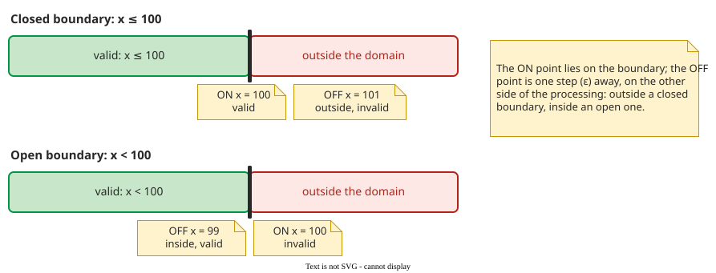

# Boundary Value Analysis

**Boundary value analysis (BVA)** tests the edges between [equivalence classes](equivalence.md): points on a boundary and points just beside it. Ambiguous class definitions and slips such as `<` for `<=` show up at boundaries .

## 1. Five kinds of boundary fault

Tian lists the faults a boundary can have :

| Fault | What is wrong | Example |
|---|---|---|
| Closure | the boundary point is on the wrong side | `x < 100` where the spec says `x ≤ 100` |
| Shift | the boundary is at the wrong value | `x ≤ 90` instead of `x ≤ 100` |
| Tilt | a coefficient is wrong (two or more inputs) | `x + 2y ≤ 10` instead of `x + y ≤ 10` |
| Missing | a boundary is not implemented | no upper limit on a quantity |
| Extra | a boundary exists that should not | a cut-off the spec never asked for |

## 2. ON and OFF points

An **ON point** lies on the boundary. An **OFF point** lies a small step ε away from it, on the side where processing differs, so the OFF point should get the other result than the ON point. The OFF point can lie in a neighbouring valid class: for "teen ≥ 13" it is 12, a child. It lies **outside** the condition's valid region for a closed boundary (`≤`, `≥`), and **inside** the condition's valid region for an open one (`<`, `>`) .

_ON and OFF points for a closed and an open boundary; ε is 1 for integers._

The pair catches a closure fault: if the code says `x < 100` where the spec says `x ≤ 100`, the ON point 100 is rejected and the test fails. The pair catches a shift as well: with `x ≤ 90`, the ON point 100 is rejected; with `x ≤ 110`, the OFF point 101 is accepted.

**Closure or shift?** A test only shows the boundary is misplaced; the type is named from the code. On integers `x < 100` equals `x ≤ 99`, so no test separates closure from a one-step shift. An *extra* boundary is targeted by no strategy: it shows only when some test, such as a class representative, falls in the extra sub-range.

## 3. How many points per boundary

The simplest strategy, [**Weak 1×1**](boundary-strategies.md) (unrelated to *weak* EP), takes one ON and one OFF point per boundary condition; it detects closure, shift and missing boundaries. A missing boundary shows because ON and OFF points should be processed differently: without the boundary, both get the same result and one test fails. Boundaries over several inputs, non-numeric inputs and decimals are covered on [Boundary Testing Strategies](boundary-strategies.md).

Boundaries come from where specified behaviour changes, not from every partition line: in the [city-tax tree](classification-tree.md), the family 30,000 edge needs no test, since the rate stays 1%.

## 4. Worked example: the age fare

For the age classes on [Equivalence Partitioning](equivalence.md) (child 0–12, teen 13–19, adult 20–64, senior 65–120), every class limit is closed: eight limits, from 0 up to 120. Neighbouring limits share a pair: 12 and 13 serve both "child ≤ 12" and "teen ≥ 13". So Weak 1×1 needs five pairs, −1/0, 12/13, 19/20, 64/65 and 120/121, ten values. −1 is already a class representative, and 121 can stand in for 130 as the representative of "above 120", so the whole suite is the ten boundary values plus the representatives 6, 16, 40 and 80: 14 tests, plus three format tests (not a number, missing, null).

**Fault example.** The specification says senior means `age ≥ 65`; the code says `age > 65`. This is a closure fault, and the ON point catches it: a test with 65 expects the senior fare and gets the adult one. A shift fault, `age ≥ 70`, is caught by the same test, and for integers `age > 65` behaves exactly like a one-step shift to `age ≥ 66`.

## When to use it — and when not

- **Use it** wherever a specification compares: ranges, limits, sizes, dates.
- **Use [stronger strategies](boundary-strategies.md)** when a boundary involves two or more inputs, such as `x + y ≤ 10`, or for non-numeric inputs.
- **Do not use it alone** for combined conditions; see [decision tables](decision-tables.md).

## Limitations

Boundary testing assumes "case-like" processing; loops that change the input break this model . Coincidental correctness is common: a wrong boundary can still give the right output. ε is hard to choose for floating point, and for a bounded type, such as a byte or an enum, the OFF point may not exist.

## How solid is this?

- **Where it comes from.** The fault types, ON/OFF points and strategies follow Tian's *Software Quality Engineering*, chapter 9 .
- **What we do not hold.** No study in the review measures how many real faults sit at boundaries; that claim is practitioner experience.

---

### References



---

{: .highlight }
**Disclaimer:** AI is used for text summarization, polishing and explaining. Authors have verified all facts and claims. In case of an error, feel free to file an issue.
