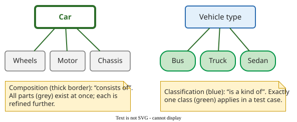
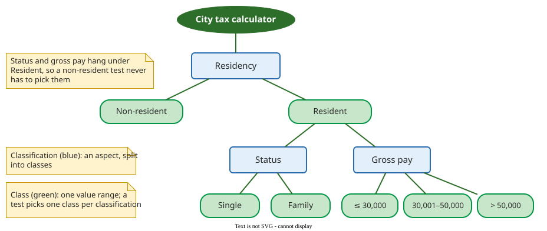

# Classification Tree Method

The **classification tree method (CTM)** models the input domain of a test object as a tree of test-relevant aspects and their classes, then specifies each test case as one row of a **combination table** that picks a class from each aspect. Grochtmann and Grimm introduced it in 1993 as a graphical successor to the category-partition method .

## 1. Why a tree

Category-partition writes categories, choices and constraints as text and generates all permitted combinations; CTM calls categories **classifications** and choices **classes**. CTM draws the same information as a tree, so hierarchy is visible: an aspect that only matters for some inputs hangs below the class it depends on. And instead of generating everything and then restricting, the tester starts from a minimal set of rows and adds rows until the test is sufficient .

## 2. Notation

The tree uses four kinds of node :

- the **root** is the test object;
- a **classification** is an aspect that splits into disjoint, complete classes ("is a kind of");
- a **class** is one value or range; only classes are selected in test cases;
- a **composition** groups aspects that exist together ("consists of").

_The basic modelling decision: parts that exist together, or alternatives of which exactly one applies._

## 3. Worked example: city tax

A city charges non-residents 1% of gross pay. Residents who are single pay 1% up to 30,000, 5% from 30,001 to 50,000 and 15% above 50,000; residents with a family pay 1% up to 50,000 and 5% above. The rate applies to the whole gross pay, not to the part above each limit. Non-residents pay one rate whatever their status or pay, so the tree gives them no further classifications.

_Status and gross pay are refined under "Resident" only. Invalid values such as negative pay, normally a separate invalid branch, are left out for brevity._

The combination table picks one class per classification:

| Test | Residency | Status | Gross pay | Expected rate | Example input → tax |
|---|---|---|---|---|---|
| 1 | non-resident | n/a | n/a | 1% | 45,000 → 450 |
| 2 | resident | single | ≤ 30,000 | 1% | 25,000 → 250 |
| 3 | resident | single | 30,001–50,000 | 5% | 40,000 → 2,000 |
| 4 | resident | single | > 50,000 | 15% | 75,000 → 11,250 |
| 5 | resident | family | ≤ 30,000 | 1% | 20,000 → 200 |
| 6 | resident | family | 30,001–50,000 | 1% | 48,000 → 480 |
| 7 | resident | family | > 50,000 | 5% | 60,000 → 3,000 |

The method starts from few rows and adds rows until every class appears and every rule or output of the specification is covered. Here all six resident combinations are needed, because the family limit differs from the single limits; with the non-resident row that makes seven. Rows 5 and 6 have the same rate but different classes, so both are tested: the family rule has its limit at 50,000, not at 30,000, and only a test inside 30,001–50,000 checks that. Applying [boundary value analysis](boundary.md) to the edges where the specified rate changes then adds, for single residents, 30,000/30,001 and 50,000/50,001, and for family residents 50,000/50,001: six more tests. The family 30,000/30,001 edge comes from the tree's shared pay classes, not from the family rule: it needs no extra test, because the rate does not change there.

## 4. The process

Grochtmann and Grimm describe the method in detail ; Buechner reduces it to two main steps, **draw the tree** and **fill the combination table**, with optional constraints and concrete values . His summary of the method: "guidance for thinking, not replacement of thinking" .

## When to use it — and when not

- **Use it** when a test object has several aspects that interact, such as configuration options or form inputs, and the test design must be reviewed or documented.
- **Use a separate branch for invalid values**, listing concrete invalid exemplars, when the system rejects them one at a time; a first split into valid and invalid values is good practice .
- **Do not use it** for a single numeric range ([BVA](boundary.md) is enough) or for logic that is mostly condition-action rules ([decision tables](decision-tables.md) fit better).

## Limitations

The tree depends on the tester: different people build different trees from the same specification, which Chen et al. tried to reduce with systematic construction . Large input spaces still produce impossible combinations, which [Classification Trees in Practice](classification-tree-practice.md) handles with constraints and tools.

## How solid is this?

- **Where it comes from.** Grochtmann and Grimm define the method ; Buechner describes current notation and tool support .
- **What the evidence says.** A student study found CTM preferred and more thorough; industrial reports come from its developers; see [Classification Trees in Practice](classification-tree-practice.md).

---

### References



---

{: .highlight }
**Disclaimer:** AI is used for text summarization, polishing and explaining. Authors have verified all facts and claims. In case of an error, feel free to file an issue.
