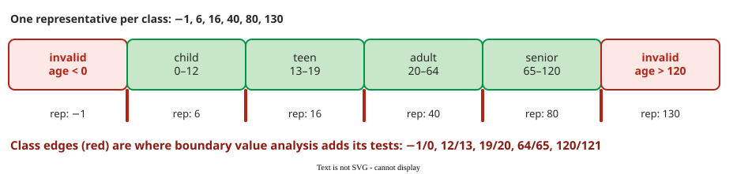

# Equivalence Partitioning

**Equivalence partitioning (EP)** divides the input domain into classes whose members the specification says should be processed the same way, and tests one representative of each class. If the program handles one member correctly, it is assumed to handle the whole class correctly .

## 1. Rules for a good partition

A partition has two properties: it is **complete**, so every possible input belongs to some class, and **disjoint**, so no input belongs to two classes. Classes come from the specification: one class per stated case, one per kind of error, and one per range below, inside and above each limit.

**Invalid classes are classes too.** Testers favour inputs they expect to be accepted, the *positive test strategy* , so invalid classes must be listed on purpose. Each invalid class gets its own test, with all other inputs valid, so that a rejection can be traced to that one input.

## 2. Worked example: an age-based fare

A ticket service charges by age, an integer number of years: child 0–12, teen 13–19, adult 20–64, senior 65–120. Each range gives one class below, one inside and one above; here the valid range is split further by fare. The age **range** has four valid classes and two invalid ones, below 0 and above 120. Format errors, a value that is not a number, missing or null, are checked on the field before the range applies; they are not part of the range model, and each gets one test of its own.

_The range model: six classes, six tests: −1, 6, 16, 40, 80 and 130; the three format checks add three more. The red edges are where [boundary value analysis](boundary.md) adds more, using 121 in place of 130._

For a function that validates an e-mail address, the classes include "one `@`", "no `@`", "two `@`", "empty local part" and "empty domain", with one representative each: `user@example.com`, `userexample.com`, `user@@example.com`, `@example.com` and `user@`.

## 3. Weak and strong EP

With several inputs, the classes have to be combined.

- **Weak EP** uses each class of each input at least once; in combination-strategy terms this is *each choice*. With inputs of 3, 4 and 2 classes it needs max(3, 4, 2) = 4 tests, filling the shorter lists by repeating classes.
- **Strong EP** tests every combination (*all combinations*): 3 × 4 × 2 = 24 tests.

Both counts use **valid** classes only. Each invalid class adds one test of its own, with all other inputs valid. **Example:** the age range has 4 valid and 2 invalid classes; ticket type has 2 valid classes (single, return) and 1 invalid (unknown type). Ticket type also gets missing and null tests. Weak EP needs max(4, 2) + 3 = 7 tests; strong EP needs 4 × 2 + 3 = 11. The five format tests (age 3, ticket type 2) add 5: 7 + 5 = 12 and 11 + 5 = 16. (The word *weak* here is unrelated to the Weak 1×1 boundary strategy.)

Weak EP assumes a fault depends on one input at a time; strong EP also catches faults that need two classes together, at a cost that multiplies with every input. Between the two, the [combination strategies](integration.md) choose how many combinations are enough.

## 4. The category-partition method

Ostrand and Balcer turned EP into a procedure : list the parameters and environment conditions, split each into **categories** (characteristics that matter) and **choices** (the classes), mark constraints between choices, such as `[error]` (an error case: tested once, never combined), then combine the choices into test frames, abstract test cases that name one choice per category (the frame "age: teen; ticket type: return" becomes, for example, the test "age 16, return ticket"), and give each frame concrete values. Current tools automate the frame generation and check the constraints .

## When to use it — and when not

- **Use it** first, on every specification: other techniques build on it.
- **Use it** to make invalid inputs visible, so negative tests are planned instead of forgotten.
- **Do not stop at one value per class** for numeric ranges: off-by-one faults sit at the edges, which [boundary value analysis](boundary.md) tests.

## Limitations

The "same behaviour" assumption holds only if the code really treats a class alike. If the implementation adds a case the specification does not mention, for example a discount for age 18, one representative per class misses it. Partitions also depend on the tester: two people can draw different classes from the same text.

## How solid is this?

- **Where it comes from.** EP is a textbook technique ; category-partition is from Ostrand and Balcer .
- **What we do not hold.** The literature review did not obtain the full text of Teasley et al. ; only their conclusion that testers prefer confirming inputs is used here, without their figures.

---

### References



---

{: .highlight }
**Disclaimer:** AI is used for text summarization, polishing and explaining. Authors have verified all facts and claims. In case of an error, feel free to file an issue.
