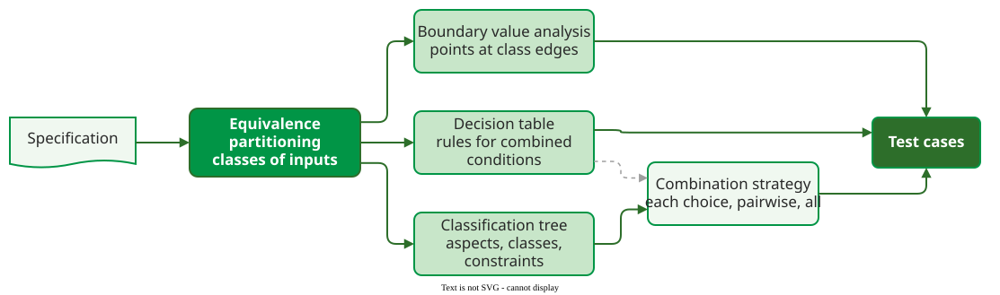

# Input Domain Testing

**Input domain testing** selects test inputs from the specification by dividing the set of all possible inputs into sub-domains that the program should treat alike, then testing a few chosen points from each. It needs no source code, so it can be designed before the code exists.

Exhaustive testing is impossible even for small functions: two 32-bit integer arguments already give 264 input pairs. The techniques below reduce that space on a stated assumption, that inputs in the same sub-domain "trigger a similar behaviour" , and each adds a different kind of test.

## The techniques at a glance

| Technique | What it adds | Best fit | Page |
|---|---|---|---|
| Equivalence partitioning | one test per class of inputs, valid and invalid | discrete categories, ranges | [Equivalence Partitioning](equivalence.md) |
| Boundary value analysis | tests on and just off each class edge | numeric ranges, comparisons | [Boundary Value Analysis](boundary.md) |
| Decision tables | one test per rule of combined conditions | business rules, permissions | [Decision Tables](decision-tables.md) |
| Boundary strategies | how many points per boundary, several inputs, text and decimals | boundaries over several inputs | [Boundary Testing Strategies](boundary-strategies.md) |
| Classification tree | a visual model of aspects, classes and constraints | many interacting aspects | [Classification Tree Method](classification-tree.md), [in practice](classification-tree-practice.md) |
| Combination strategies | how many class combinations to test | many parameters | [Combining Techniques](integration.md) |

_How the techniques build on each other: equivalence classes come first, the others refine or combine them. The dashed arrow: a decision table with many rules can itself be thinned out by a combination strategy._

## Reading order

Start with [Equivalence Partitioning](equivalence.md), [Boundary Value Analysis](boundary.md) and [Boundary Testing Strategies](boundary-strategies.md), which every other technique uses. [Decision Tables](decision-tables.md) handle conditions that combine; the [Classification Tree Method](classification-tree.md) and [Classification Trees in Practice](classification-tree-practice.md) model larger input spaces; [Combining Techniques](integration.md) shows how many combinations are worth testing.

## How solid is this?

- **Where it comes from.** The techniques are textbook material ; the boundary formalism follows Tian , the classification tree method Grochtmann and Grimm .
- **What is contested.** The "similar behaviour" assumption is a hypothesis about the code, not a fact: a class drawn from the specification can hide a branch the specification never mentions. Input domain testing finds missing and wrong behaviour; [coverage](../coverage/index.md) shows what code the tests never reached.

---

### References



---

{: .highlight }
**Disclaimer:** AI is used for text summarization, polishing and explaining. Authors have verified all facts and claims. In case of an error, feel free to file an issue.
