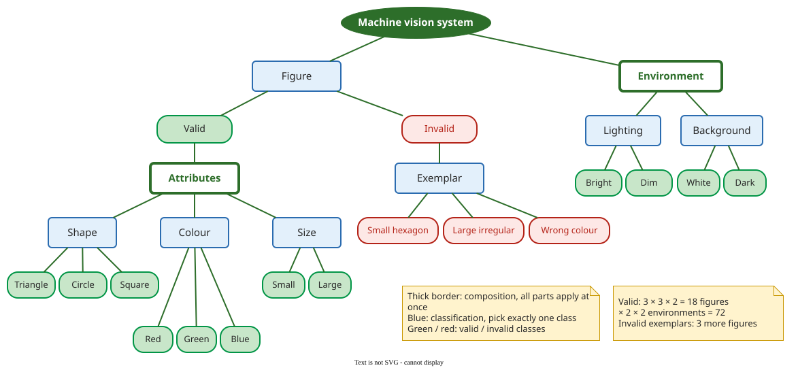

# Classification Tree Example: Machine Vision

**This example applies the [classification tree method](classification-tree.md) to a camera system that recognises building blocks on a conveyor belt, and counts how many test cases the tree allows: 72 combinations of valid figures and environments, 84 once invalid figures are included, and a minimum of 6.** The counting rules matter more than the system: compositions multiply, classifications choose.

## 1. The test object

A computer vision system watches building blocks pass its camera on a conveyor belt and must recognise them. Lehmann and Wegener used it to introduce the method: size, colour and shape of a block are the test-relevant aspects, with two sizes, three colours and three shapes, the triangle split further by its kind . Asking what else could change the result adds the **environment**: the lighting, and the background behind the belt. Lehmann and Wegener note the risk behind it: on a blue background, blue blocks are hard for the camera to see . The tree below models it as low contrast, with a white and a dark background.

## 2. Worked example: the tree

(Constructed example, extending Lehmann and Wegener's tree with an environment and an invalid branch, and without the triangle's kinds.)



_A test case picks one class from each classification it reaches. Under Valid, the composition Attributes applies all three of shape, colour and size; under Invalid, one exemplar is picked._

The figure is a **classification**: a block is valid or invalid, never both. Valid blocks are described by a **composition** of three classifications, while invalid blocks are listed as concrete exemplars, as recommended for inputs the system must reject one at a time . The environment is a composition too: every test has some lighting and some background.

## 3. Counting the test cases

The counts follow two rules: under a composition, the number of choices **multiplies**; under a classification, it **adds**.

| Part of the tree | Rule | Count |
|---|---|---:|
| Valid figure: shape × colour × size | composition | 3 × 3 × 2 = 18 |
| Invalid figure: one exemplar | classification | 3 |
| Figure: valid or invalid | classification | 18 + 3 = 21 |
| Environment: lighting × background | composition | 2 × 2 = 4 |
| Valid figures in every environment | composition | 18 × 4 = **72** |
| All figures in every environment | composition | 21 × 4 = 84 |

The often-quoted 3 × 3 × 2 × 2 × 2 = 72 is correct for **valid** figures only. Combining each invalid exemplar with all four environments as well gives 84. If the invalid exemplars are tested once each, in one standard environment, the full set is 72 + 3 = 75.

The **minimum** that uses every class at least once (Lehmann and Wegener's minimality criterion, against the maximality criterion of all combinations ) is 6. Shape and colour have three classes each, so at least three rows must be valid; the three exemplars need three invalid rows; the two lighting and two background classes fit into those six rows, because each needs only two rows and 2 ≤ 6. The script enumerates the maximal counts; the minimum is computed from this formula (largest valid classification plus the exemplars), not enumerated:

```python
# machine_vision.py
from itertools import product
shape, colour, size = ["triangle", "circle", "square"], ["red", "green", "blue"], ["small", "large"]
lighting, background = ["bright", "dim"], ["white", "dark"]
invalid = ["small hexagon", "large irregular shape", "wrong colour"]

valid = list(product(shape, colour, size))          # Figure = Valid
env = list(product(lighting, background))
print("valid figures:", len(valid))
print("environments:", len(env))
print("valid x environment:", len(valid) * len(env))
print("figure classes (valid + invalid):", len(valid) + len(invalid))
print("all figures x environment:", (len(valid) + len(invalid)) * len(env))
# minimality: each class at least once; a row is either valid or invalid
print("minimum rows:", max(len(shape), len(colour), len(size)) + len(invalid))
```

```text
$ python3 machine_vision.py
valid figures: 18
environments: 4
valid x environment: 72
figure classes (valid + invalid): 21
all figures x environment: 84
minimum rows: 6
```

Between 6 and 84, the tester chooses. Lehmann and Wegener's advice for this system is to combine size and shape completely, because recognising a square does not imply recognising a triangle, and to spread the colours over those rows : 3 × 2 = 6 valid rows. Adding the three exemplars and a low-contrast row (a blue block on the dark background), with both lighting levels spread across the rows, gives about ten tests.

**Where the inputs come from.** The aspects come from the specification (what the camera must recognise) and from probing questions about the environment the specification leaves out; the classes come from the product's range (the blocks actually made) and from failures seen in the field.

## When to use it — and when not

- **Use the counting rules** to check any classification tree before filling the combination table: the maximum tells you whether full combination is affordable.
- **Do not test the maximum by default**: in some of Lehmann and Wegener's industrial applications, dependency rules cut the theoretical number of test cases by more than 90% .

## Limitations

The counts assume every combination is possible. If, as in Lehmann and Wegener's own example, the factory makes no red circles, the constraint "circle ⇒ not red" removes rows, and the tree's product overstates the space ; [Classification Trees in Practice](classification-tree-practice.md) shows how tools handle such constraints.

## How solid is this?

- **Where it comes from.** The vision system, the minimality and maximality criteria and the combination advice are Lehmann and Wegener's ; the environment and invalid branches are added here.
- **What we do not hold.** A measurement of faults found by the minimal and maximal suites on this or any vision system.

---

### References



---

{: .highlight }
**Disclaimer:** AI is used for text summarization, polishing and explaining. Authors have verified all facts and claims. In case of an error, feel free to file an issue.
