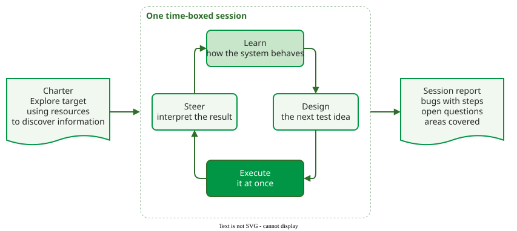

# Exploratory Testing

**Exploratory testing (ET)** is testing in which the tester learns the system, designs the next test and executes it at the same time, so that each result shapes the next test . It is not ad hoc testing, which has no mission, time limit or report: an exploratory session has a mission (at least the part of the product to test), a time limit and a report .

_One exploratory session. The loop runs many times, each test chosen from what the last one showed._ 

Scripted testing separates the two activities: test cases are designed first, from the specification, and executed later, possibly by someone else. The difference is when the thinking happens, not whether it happens. The table shows where each approach stands.

| | Ad hoc | Exploratory | Scripted |
|---|---|---|---|
| Plan | none | a charter per session | test cases written in advance |
| Record | none | a session report, bug reports | test case results |
| Repeatable | no | partly, from the notes | yes |
| Depends on | luck | the tester's skill and knowledge | the quality of the test design |

Exploration is a matter of degree: between "here is the app, find problems" and a fully scripted test there are levels that give the tester more or less freedom .

## Pages in this section

| Page | What it covers | Best fit | Main cost |
|---|---|---|---|
| [Charters, Heuristics and Tours](techniques.md) | How a tester decides what to try next | new or changed features, unclear specifications | needs a skilled tester |
| [Exploratory Testing Tours](tours.md) | Whittaker's six districts and the tours in each | giving a session one clear strategy | knowing the product a little |
| [Session-Based Test Management](session-based.md) | Time-boxed sessions, debriefs, choosing the level of exploration | making exploration plannable and reportable | a test lead's time for debriefs |
| [Exploratory Session Report](session-report.md) | One session from charter to report, with a template | writing up a session | writing time after every session |
| [Exploratory Testing: Evidence](effectiveness.md) | Experiments comparing ET with scripted testing | deciding how much to explore | reading the study designs |

Exploratory testing complements [Operational Profile](../operational-profile/index.md) testing. An operational profile lists the operations a system performs with the probability of each in real use; testing by profile spends effort where users spend their time, while exploration looks for what usage statistics cannot predict.

---

### References



---

{: .highlight }
**Disclaimer:** AI is used for text summarization, polishing and explaining. Authors have verified all facts and claims. In case of an error, feel free to file an issue.
