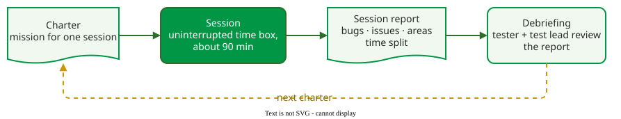
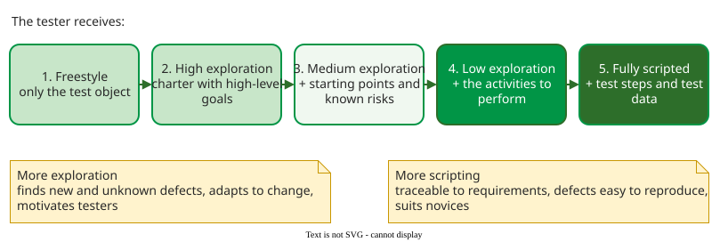

# Session-Based Test Management

**Session-based test management (SBTM) organises exploratory testing into chartered, time-boxed sessions, each ending in a written report and a short debriefing, so that exploration can be planned, counted and reviewed like any other test work** . It answers the manager's objection to exploration: "how do I know what was tested?"

## 1. The four parts of a session

A session has four parts :

_The SBTM cycle: the debriefing decides the next charter._ 

1. **Charter.** One mission, in the form *explore target using resources to discover information* (see [Charters, Heuristics and Tours](techniques.md)).
2. **Time box.** An uninterrupted block of testing. A **normal session** lasts about 90 minutes (this handbook counts 60 to 120 minutes as normal, under 60 as short and over 120 as long); Afzal et al. used Bach's 90 minutes in their experiments , and Hendrickson recommends one to two hours . Recording the type keeps session counts comparable.
3. **Reviewable result: the session report.** Bach calls the written outcome the session sheet; this handbook calls it the **session report**. Its fields are described on [Exploratory Session Report](session-report.md).
4. **Debriefing.** The tester and the test lead go through the report in a few minutes: what was done, what was found, what was not reached, and what the next charter should be.

From such reports a test lead can count sessions, bugs and hours per area, and see which areas no session has visited yet. The report's fields and a filled-in example are on [Exploratory Session Report](session-report.md).

## 2. Choosing the level of exploration

A charter can give more or less freedom. Ghazi et al. describe five levels, from freestyle to fully scripted, each adding one element to what the tester receives .

_Levels of exploration and what each end is good for._ 

In Ghazi's scale every level is defined by a type of charter; at freestyle it names only the test object, so freestyle still has a mission, a time box and a report, which ad hoc testing lacks. A charter in the three-part form *explore … using … to discover …* starts at level 2, high exploration . Each level has a typical use:

| Level | The tester receives | Use it when |
|---|---|---|
| 1. Freestyle | only the test object | learning a new product, hunting for unknown problems |
| 2. High exploration | a charter with high-level goals | finding defects fast, under time pressure |
| 3. Medium exploration | + starting points and known risks | known risks must be checked, but the path is open |
| 4. Low exploration | + the activities to perform | traceability matters, but the tester may still react |
| 5. Fully scripted | + test steps and test data | conformance must be shown, defects must be reproducible, testers are new |

For example, at Ericsson practitioners rated the five levels against 17 criteria they elicited themselves. The top-weighted criteria were checking requirements, reproducing defects and finding unknown defects, which pull in opposite directions. The resulting recommendation was to spend 16% of test time freestyle, 18% at high, 23% at medium, 22% at low exploration and 21% fully scripted. The team's current practice put about 20% of test time at the two most exploratory levels (freestyle and high) and 80% at the others; the method recommended 34% (16% + 18%) . The point is not the numbers but the mix: one team, several levels.

## When to use it — and when not

Use SBTM when:

- exploratory work must be planned, estimated or reported to someone outside the team;
- several testers explore the same product and need to avoid overlap.

It adds little when:

- one developer explores their own feature for half an hour; a short note is enough.

## Limitations

The report records what the tester *says* they covered; there is no automatic coverage measure, so a debrief is only as good as the report. Debriefs also cost the test lead time for every session, which limits how many sessions one lead can manage.

## How solid is this?

- **Where it comes from.** Bach's 2000 article defines SBTM ; the five levels and the Ericsson recommendation come from two studies by Ghazi et al., one focus group each .
- **What is contested.** No controlled study compares sessions with and without SBTM; its value is reported from practice.
- **What we do not hold.** We do not hold Bach's article itself; the four parts and the 90-minute norm are taken from the studies and books that cite it .

---

### References



---

{: .highlight }
**Disclaimer:** AI is used for text summarization, polishing and explaining. Authors have verified all facts and claims. In case of an error, feel free to file an issue.
