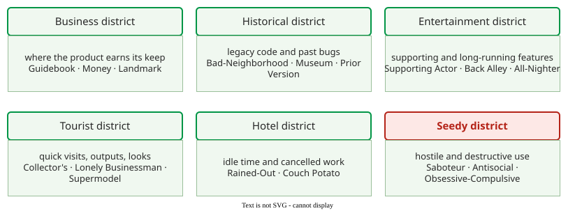

# Exploratory Testing Tours

**A tour is a named strategy for a whole exploratory session, borrowed from a tourist visiting a city: the tester picks one goal, such as "follow the money" or "break things on purpose", and explores the product with that goal in mind** . Where a heuristic suggests the next single input, a tour sets the direction for the whole time box. Tours are used as the *resources* part of a [charter](techniques.md).

## 1. Six districts

Whittaker compares the product to a city a tourist explores, and groups his tours into six districts .

_Whittaker's tourist metaphor: pick a district for its goal, then a tour inside it. The Seedy district is marked red because its tours attack the software on purpose._ 

## 2. The tours

Each tour, in one line:

| District | Tour | What the tester does |
|---|---|---|
| Business | Guidebook | follows the user manual and checks the product does what it says |
| Business | Money | exercises the features that sell the product |
| Business | Landmark | visits the key features in many different orders |
| Historical | Bad-Neighborhood | returns to areas where many bugs were found before |
| Historical | Museum | exercises old code nobody has changed for a long time |
| Historical | Prior Version | reruns what worked in the previous release |
| Entertainment | Supporting Actor | tests the features next to the main ones |
| Entertainment | Back Alley | tests the least used features |
| Entertainment | All-Nighter | keeps the application open and data growing for a long time |
| Tourist | Collector's | tries to make the product produce every output it can |
| Tourist | Lonely Businessman | goes to the feature farthest from where the user starts |
| Tourist | Supermodel | looks only at the interface |
| Hotel | Rained-Out | starts operations and cancels them midway |
| Hotel | Couch Potato | does as little as possible: defaults, empty fields |
| Seedy | Saboteur | takes resources away: files, network, memory |
| Seedy | Antisocial | enters what the software least expects |
| Seedy | Obsessive-Compulsive | repeats the same action again and again |

## 3. Worked example: two tours on one shop

The following is constructed for illustration. On the coupon system, the **Obsessive-Compulsive tour** suggests repeating each action: applying the same coupon twice reveals that the discount doubles. On checkout, the **Saboteur tour** suggests taking resources away: cutting the network just after "Pay" is pressed reveals that the order is charged but not recorded. The same feature, explored under two tours, yields different bugs, which is why a session names its tour in the charter: *explore checkout using the Saboteur tour to discover lost or double payments*.

## When to use it — and when not

Use tours to give a session a clear goal when the tester knows the product a little, and to spread several sessions over different kinds of risk. They do not replace domain knowledge: a tour says where to look, not what the right result is.

## Limitations

Tours name strategies, not inputs, so two testers on the same tour still try different things. There is no measure of how well a tour has been "completed"; what was covered is known only from the [session report](session-report.md).

## How solid is this?

- **Where it comes from.** Whittaker's book .
- **What is contested.** No experiment compares tours with each other or with untoured exploration; the catalogue is distilled experience.
- **What we do not hold.** We have a summary of the book, not its full text; tour names follow the book, and some secondary sources assign tours to different districts.

---

### References



---

{: .highlight }
**Disclaimer:** AI is used for text summarization, polishing and explaining. Authors have verified all facts and claims. In case of an error, feel free to file an issue.
