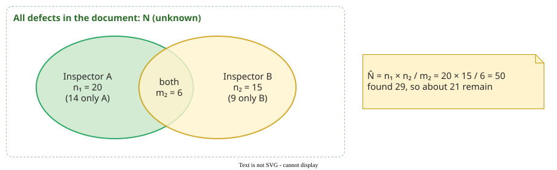

# Capture-Recapture Estimation

**Capture-recapture** estimates how many defects a document contains, found and not yet found, from how much independent inspectors' findings overlap: the smaller the overlap, the more defects remain . The method comes from ecology, where it estimates the size of an animal population from marked and recaptured animals.

## 1. Two inspectors: the Lincoln–Petersen estimate

Suppose a document contains *N* defects. Inspector A finds *n*1 of them and inspector B, working independently, finds *n*2; *m*2 defects are found by both. If B finds A's defects at the same rate as all the others, then the share of A's defects that B also found, *m*2 / *n*1, estimates B's share of all defects, *n*2 / *N*. Solving for *N* gives the **Lincoln–Petersen estimate**:

$$\hat{N} = \dfrac{n_1 \times n_2}{m_2}$$

_Two inspectors' findings as overlapping samples of the unknown population._ 

Biologists do the same with fish: the share of tagged fish in a second catch estimates the share of all fish that the first, tagged catch took.

**Example.** A finds 20 defects, B finds 15, and 6 are on both lists: $$\hat{N}$$ = 20 × 15 / 6 = 50. Together they found 20 + 15 − 6 = 29 distinct defects, so about 21 are still in the document. A small overlap inflates the estimate: with *m*2 = 3 instead of 6 it doubles to 100.

## 2. Defects differ in how hard they are to find

Lincoln–Petersen allows the two inspectors to differ in skill (A found 20, B 15): a weaker B finds fewer of A's defects and fewer of all defects in the same proportion, so the ratio still holds. It does assume that, for a given inspector, every defect is equally likely to be found: no defect is harder than another. That is rarely true, and when some defects are harder, both inspectors tend to find the same easy ones, so Lincoln–Petersen underestimates. Briand and colleagues compared four models on requirements inspections at NASA Goddard . The subscripts name what varies: 0 nothing, *t* the inspector (each inspector is one capture occasion), *h* the defect (heterogeneity).

| Model | Detection probability varies by | Is Lincoln–Petersen valid? |
|---|---|---|
| M0 | nothing | yes |
| Mt | inspector | yes: this is its model |
| Mh | defect | no, biased low |
| Mth | inspector and defect | no, biased low |

Differences between defects mattered most; modelling differences between inspectors as well did not help much once Mh was used. Their recommendation: model Mh with the **jackknife estimator**, and at least four inspectors, because no model was accurate enough with fewer.

The jackknife rests on one intuition: many defects found by only one person mean many found by nobody. It needs only *S*, the number of distinct defects found, and *f*1, the number found by exactly one of the *k* inspectors. Its simplest, **first-order** form corrects the count with *f*1 alone :

$$\hat{N} = S + f_1 \times \dfrac{k-1}{k}$$

## 3. Worked example: four inspectors

Four inspectors examine a 20-page requirements document (the data are constructed). After the moderator has matched duplicates and the meeting has confirmed which issues are major defects, they have found *S* = 16 distinct major defects:

| Found by | Defects | Count |
|---|---|---|
| all four | D1, D2, D3 | 3 |
| three (ABC, ABD, ACD) | D4, D5, D6 | 3 |
| two (AB, AC, BD, CD) | D7, D8, D9, D10 | 4 |
| one (A, A, B, C, D, D) | D11 to D16 | *f*1 = 6 |

Individually: A 10, B 8, C 8, D 9. The first-order jackknife gives $$\hat{N}$$ = 16 + 6 × 3/4 = 20.5, so 20.5 − 16 = 4.5 major defects are estimated to remain, 0.225 per page. Whether that is good enough is decided on [Capture-Recapture in Practice](capture-recapture-practice.md).

Lincoln–Petersen on single pairs shows why two inspectors are not enough:

| Pair | AB | AC | AD | BC | BD | CD |
|---|---|---|---|---|---|---|
| *n*1, *n*2, *m*2 | 10, 8, 6 | 10, 8, 6 | 10, 9, 5 | 8, 8, 4 | 8, 9, 5 | 8, 9, 5 |
| Estimate | 13.3 | 13.3 | 18.0 | 16.0 | 14.4 | 14.4 |

Four of the six pairs estimate fewer defects than the 16 the team already found. Pairs overlap mostly on the easy defects, so they underestimate.

**Where the inputs come from.** *S* and *f*1 come from the inspectors' individual preparation logs after the moderator has matched duplicates: a defect log with a *found by* column holds everything the estimate needs. [Worked Case: Inspecting a Refund Change](worked-case.md) computes it from such a log.

## When to use it — and when not

Use it with four or more independent inspectors, to decide whether to reinspect or to plan test effort; the steps are on [Capture-Recapture in Practice](capture-recapture-practice.md). Do not use it with two or three inspectors, with inspectors who shared notes before logging, or when nothing overlaps: Lincoln–Petersen divides by zero, and the jackknife (*f*1 = *S*) returns *S* × (1 + (*k* − 1)/*k*), 1.75 times what four inspectors found, a number with no support: reinspect instead.

## Limitations

- **Underestimation.** All models tend to estimate too few defects; read the result as a lower bound .
- **Closure and independence.** No defects may be added or fixed during the inspection, and inspectors must not influence each other.

## How solid is this?

- **Where it comes from.** Briand and colleagues' evaluation of capture-recapture models on NASA requirements inspections, and the jackknife estimator from ecology .

---

### References



---

{: .highlight }
**Disclaimer:** AI is used for text summarization, polishing and explaining. Authors have verified all facts and claims. In case of an error, feel free to file an issue.
