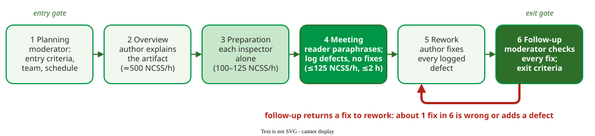

# Fagan Inspection Process

A **Fagan inspection** is a formal inspection in six fixed steps, run by a trained moderator with four roles, that only *finds* defects in a design or code module; fixing them happens afterwards . Michael Fagan defined it at IBM in 1976, and every later inspection method starts from it.

## 1. Six steps, none skipped

_Fagan's six steps with the rates he recommended; NCSS are non-commentary source statements._ 

1. **Planning.** The moderator checks the **entry criteria** (for code: it compiles cleanly; the design it implements is available), forms the team and schedules the meeting.
2. **Overview.** The author explains the product and its context to the team.
3. **Preparation.** Each inspector studies the product alone, using a [reading technique](reading-techniques.md), and notes possible defects.
4. **Meeting.** The reader paraphrases the product piece by piece; the team agrees which issues are defects and the recorder logs them. Nobody discusses solutions.
5. **Rework.** The author fixes every logged defect.
6. **Follow-up.** The moderator checks every fix and the **exit criteria**, and decides whether the product passes or is inspected again. An exit criterion can be quantitative: Malotaux allows at most 0.25 **major** defects per page estimated to remain . The held sources do not define "major"; this course uses: a major defect would probably cause a failure or a wrong implementation if left in (a missing error case), a minor one would not (a spelling mistake). With that limit, so a 40-page specification passes with at most 40 × 0.25 = 10; the estimate comes from [capture-recapture](capture-recapture.md) or [defect seeding](defect-seeding.md).

Skipping or merging steps lowers effectiveness, and the follow-up matters: about one fix in six is wrong or introduces a new defect .

## 2. Four roles

| Role | Does | Why it is separate |
|---|---|---|
| **Moderator** | plans, leads the meeting, follows up | Fagan's "key person": keeps the meeting on detection |
| **Author** | gives the overview, answers questions, reworks | knows the product best, so must not steer the reading |
| **Reader** | paraphrases the product in the meeting | a non-author's reading exposes what the text actually says |
| **Tester** | inspects from the testing viewpoint | asks how each part would be tested |

A **recorder** logs each defect the meeting agrees on; Dodd and Wiegers list it as a separate role , and in a team of four it is an extra duty, for example the moderator's.

Fagan recommended four people ; Wiegers gives three to seven . Fagan's 1986 update extended inspection to requirements, documentation and test plans, and added causal analysis: find out why defects were made so the process stops making them; Wiegers makes causal analysis an optional seventh step .

## 3. Rates and limits

Effectiveness falls when material is covered too fast. For code, Fagan's rates are about 500 NCSS per hour for the overview, 100–125 for preparation, and at most 125 for the meeting, which lasts no more than two hours because participation is "extremely taxing" . For documents, Malotaux's checking rate is about one page per hour ; the held sources give no session size in pages.

**Example.** A team of four inspects a 400-NCSS module. Overview: 400 / 500 = 0.8 h for each of the four people, 3.2 staff-hours. Preparation at Fagan's top rate, 125 NCSS/h: 3.2 h each, 12.8 staff-hours. Meeting at 100 NCSS/h, mid-range, as paraphrasing aloud is slower: 4 h, which the two-hour limit splits into two sessions, 16 staff-hours. Before rework, the inspection costs 3.2 + 12.8 + 16 = 32 staff-hours.

## When to use it — and when not

Use a Fagan inspection where a missed defect is expensive: requirements, architecture, safety- or security-critical code, interfaces between teams. For small code changes, [modern code review](modern-code-review.md) gives most of the benefit at a fraction of the cost.

## Limitations

- **The meeting finds little that preparation missed.** Later studies found 90–95% of defects in individual preparation; the meeting adds only about 5–10% new ones and mainly removes false positives . Fagan saw synergy instead, a "phantom inspector" that makes the team more than the sum of its members .
- **It is expensive.** Design and code inspections typically cost about 15% of the project .
- **It fails when its data is misused.** When a manager counted more than five defects found against the author, Wiegers expects developers to stop submitting work and inspectors to report defects privately .

## How solid is this?

- **Where it comes from.** Fagan's 1976 paper and his 1986 ten-year update, both from IBM practice .
- **What is contested.** The value of the meeting: Fagan's synergy against the later finding that preparation does nearly all the detecting .
- **What we do not hold.** IEEE Std 1028, the inspection standard.

---

### References



---

{: .highlight }
**Disclaimer:** AI is used for text summarization, polishing and explaining. Authors have verified all facts and claims. In case of an error, feel free to file an issue.
