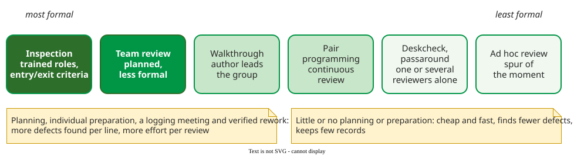

# Software Inspection

**Inspection** is a structured examination of a work product (requirements, design, code, test plan) by people other than its author, with the single goal of finding defects before the product moves on . It needs no running program, so it can start long before testing. The word means both structured peer review in general and the most formal review type below.

## The review spectrum

Peer reviews range from a planned inspection with trained roles to a colleague glancing at a screen . The more formal the review, the more defects it finds per line and the more effort it costs.

_The formality spectrum, redrawn from Wiegers' peer-review guide._ 

The two types most often confused differ in who leads and why. In a **walkthrough** the author presents the product to the group to explain it and collect comments; in an **inspection** a trained **moderator** (who plans and leads it, and is not the author) runs it, a **reader** (also not the author) paraphrases the product aloud, and every participant prepares alone beforehand. For example, one telecommunications company found 16 to 20 defects per thousand lines of code by inspection against 3 with informal reviews .

## Pages in this section

| Page | What it covers | Best fit | Main cost |
|---|---|---|---|
| [Fagan Inspection Process](fagan-process.md) | six steps, four roles, rate limits | high-risk designs and code | about four people for several hours per module |
| [Reading Techniques](reading-techniques.md) | ad hoc, checklist, scenario-based and perspective-based reading | individual preparation, where most defects are found | training and up to 30% more preparation |
| [Modern Code Review](modern-code-review.md) | tool-based review of small changes at Cisco, Google and Microsoft, and LLM reviewers | every change in a team using version control | a reviewer's attention on each change |
| [Defect Seeding](defect-seeding.md) | estimating remaining defects from planted ones | experiments, calibrating inspectors | planting and removing realistic defects |
| [Capture-Recapture Estimation](capture-recapture.md) | estimating remaining defects from inspector overlap | deciding whether to reinspect | four or more independent inspectors |
| [Capture-Recapture in Practice](capture-recapture-practice.md) | the steps from preparation lists to an exit decision | any inspection whose exit depends on an estimate | matching and classifying every report |
| [Inspection Effectiveness](effectiveness.md) | detection rates, effort per defect, cost ratios, company results | arguing for or against inspection | reading the evidence critically |
| [Worked Case](worked-case.md) | one code inspection, plan to exit decision | a first inspection | five people, about ten staff-hours |

Read the Fagan page first: the others refine one of its steps or replace it with something lighter.

## How solid is this?

- **Where it comes from.** Fagan's IBM papers, the inspection surveys by Laitenberger and DeBaud and by Aurum and colleagues, Wiegers' practitioner guide, and studies of modern code review at Google and Microsoft .
- **What is contested.** How much the meeting adds beyond individual preparation, and how far industrial success stories generalize: most effectiveness figures come from companies reporting on their own programs. See [Inspection Effectiveness](effectiveness.md).

---

### References



### Acknowledgments

The lectures behind this area took early inspiration from the *Analysis of Software Artifacts* course of Eduardo Miranda and Claire Le Goues (Carnegie Mellon University). Its lecture on checklists also drew on Jonathan Aldrich. The pages here are original, written from the literature review; any errors are ours.

---

{: .highlight }
**Disclaimer:** AI is used for text summarization, polishing and explaining. Authors have verified all facts and claims. In case of an error, feel free to file an issue.
