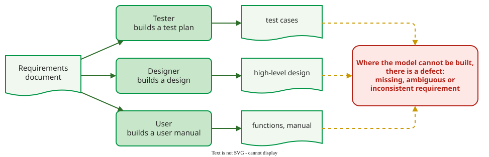

# Inspection Reading Techniques

A **reading technique** tells an inspector how to examine a product during individual preparation: what to look for, and in what order . It matters because preparation is where most defects are found: 90–95% of them, with the meeting adding only about 5–10% new ones .

## 1. Four techniques, from no guidance to a task

| Technique | The inspector | Reported effect |
|---|---|---|
| **Ad hoc** | reads with no guidance, relying on experience | the baseline; varies with the person |
| **Checklist** | answers a list of questions about the product | better than ad hoc; says *what* to check, not *how* |
| **Scenario-based** | follows a procedure aimed at one aspect: in **defect-based reading** each inspector gets a different defect class; other variants are organized around inputs, files and outputs | about 35% more defects than ad hoc and checklist reading in some experiments  |
| **Perspective-based (PBR)** | takes a stakeholder's role and builds that stakeholder's work product from the document | 21–30% better individual detection than NASA's usual technique  |

The two percentages come from different experiments with different baselines, so they cannot be added or ranked against each other.

## 2. Checklists catch omissions

A checklist works best when it is short and targets the organization's own common mistakes: Cohen recommends 10 to 20 items . Typical items for code: are parameters validated at the start of each function; are locks and memory released on every error path; are units of measurement documented for numeric values. Checklists are strongest at **omissions**, the defects hardest to see because there is nothing on the page to look at: each item names something that should be present, so its absence becomes visible.

A security review is a scenario: Howard reviews first old or legacy code, code running by default or with elevated privileges, anonymously accessible or network-listening code, code in memory-unsafe languages (C, C++, assembly) and code with past vulnerabilities, then traces input from each entry point through its validation .

## 3. Perspective-based reading builds a model

In PBR each reviewer reads a requirements document as one of its consumers and builds what that consumer needs :

_The three PBR perspectives; a defect shows up as a step where the reviewer cannot continue._ 

**Example** (constructed). The requirement reads: "After three failed login attempts the account is locked." The **tester** writes test cases and gets stuck: do the three attempts have to be consecutive, and does a successful login reset the count? The **designer** needs to store the counter and cannot tell whether a lock expires or needs an administrator. The **user** writes the manual page "What to do when your account is locked" and finds nothing to write. Three perspectives find three kinds of defect: the tester a requirement with no testable value or rule, the designer missing or inconsistent data and interfaces, the user a missing user task. The rule behind all three: where the model cannot be built, there is a defect. For [capture-recapture](capture-recapture-practice.md), count one defect per needed fix: these three gaps need three separate additions to the requirement, so they are three defects, each found by one inspector; had one rewrite fixed all three, it would be one defect found by three. Basili's procedures give each perspective its own questions to answer while building its model . ("Tester" here is a perspective, not Fagan's tester role nor a person who runs tests.)

## When to use it — and when not

Use PBR for requirements and other documents read by several roles, especially in a domain the reviewers do not know well, and to train new reviewers . Teams using PBR covered more of the document between them than teams using NASA's usual technique, and the method gives a definite procedure: less experienced reviewers who followed it closely often did better than seniors who fell back on their own habits . Use a focused checklist for code and for short reviews. Ad hoc reading is acceptable only when nothing else fits the time available.

## Limitations

- **PBR costs more time:** up to 30% more effort than the usual approach, partly repaid because the test plan and design sketches are useful later .
- **Experts may not gain.** Reviewers with well-developed personal heuristics may see no significant benefit .
- **Checklists go stale.** A list that is never pruned turns into box-ticking and misses defects that are not on it.

## How solid is this?

- **Where it comes from.** The PBR experiments at NASA Goddard's Software Engineering Laboratory, Shull's implementation guide, and the inspection surveys .
- **What is contested.** Effect sizes vary between experiments, documents and reviewer populations; the 35% and 21–30% figures are single results, not general constants.

---

### References



---

{: .highlight }
**Disclaimer:** AI is used for text summarization, polishing and explaining. Authors have verified all facts and claims. In case of an error, feel free to file an issue.
