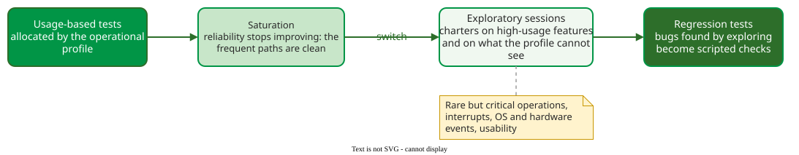

# From Profile to Exploration

**Combining profile-based and exploratory testing means testing by the operational profile first, until new usage-based tests stop finding failures, and then moving the remaining effort to exploratory sessions aimed at what the profile cannot see.** The two approaches fail in different places, so each covers the other's gap.

## 1. Why the profile comes first

Tests allocated by the profile find the failures users would meet most often, in the order of how often they occur. If testing must stop early, for example because of a release date, the most used operations have had the most testing, and reliability is as high as the time allowed . This holds when usage data exists or is cheap to get, from logs or telemetry. Without it a profile costs effort, about a staff-month for a mid-sized project in Musa's estimate; under time pressure, start with high-exploration charters aimed at the features users are expected to use most, and build the profile as usage data arrives.

## 2. Saturation

Profile-based testing has a known weakness: once the frequent paths are clean, reliability "achieves some stable level that becomes difficult to improve further", because new tests keep repeating the same paths . More of the same tests then cost time and find little. Two remedies exist:

- **Steer by coverage.** The **covrel** approach, an adaptive method that combines the profile with coverage to raise reliability, uses the coverage of each operation's code to choose the next test. The target was reliability 1: every fault the test pool can reveal has been revealed. On 18 versions of four small C programs (grep, gzip, sed, flex), under six configurations and 50 repetitions each, covrel reached it with fewer tests than pure profile-based testing in 77 of 96 version-configuration scenarios .
- **Switch to exploration.** Spend the remaining effort on [exploratory testing](../exploratory/index.md).

## 3. The two-phase strategy

_Profile first, then exploration; what exploration finds becomes scripted regression tests._

Exploratory charters in the second phase aim at two targets: the high-usage features, explored with heuristics and tours for subtle defects that a usage-shaped test mix does not provoke; and what a profile cannot express, such as rare but critical operations, interrupts and operating-system events , and usability. Every bug found is turned into a scripted regression test, so the next release's profile-based run checks it.

## 4. Worked example: deciding to switch

The numbers are constructed for illustration. A web-shop team runs profile-based tests in batches of 500. The first batch finds 12 failures, the second 5, the third 1, the fourth none. The failures found per batch have flattened: the frequent paths are clean. The team stops adding usage-based tests and plans three exploratory sessions instead: *explore checkout using interrupted payments to discover lost or double charges*, *explore coupons using unusual combinations to discover pricing errors*, *explore the admin report using a year of data to discover wrong totals*. The second session finds the coupon bugs; each becomes a regression test.

## When to use it — and when not

Use the strategy when a profile exists and testing time is limited. When safety-critical operations are rare, do not wait for saturation: test them from the start, by risk.

## Limitations

When to switch is a judgement: no study gives a threshold, and a flat batch can be chance. The strategy also assumes the profile is right; if real use differs, phase one tested the wrong mix.

## How solid is this?

- **Where it comes from.** Musa's argument for profile-first testing , the saturation effect and covrel .
- **What is contested.** The two-phase strategy is a recommendation built from these sources, not a technique evaluated as a whole.
- **What we do not hold.** A study that compares switching rules or measures the gain of the second phase.

---

### References



---

{: .highlight }
**Disclaimer:** AI is used for text summarization, polishing and explaining. Authors have verified all facts and claims. In case of an error, feel free to file an issue.
