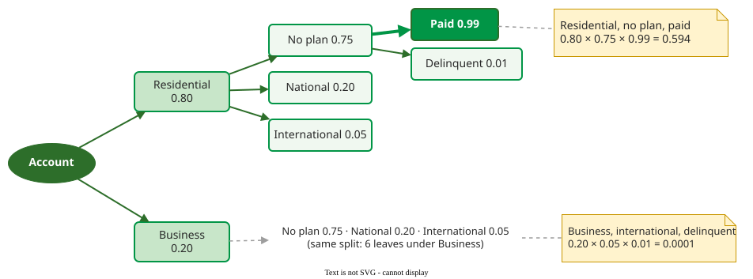

# Developing an Operational Profile

**Developing an operational profile means listing the mutually exclusive operations a system performs and estimating, for each one, the probability that the next operation in the field is that one.** Musa's procedure narrows from usage situations to single operations, and ends with probabilities that sum to 1 .

## 1. Terms

- A **run** is one execution of a task started from outside, such as one bill being processed.
- An **operation** is a class of similar runs that the design treats alike, for example "process a residential account with no calling plan".
- A **function** is the same kind of task seen from the requirements; one function may map to several operations, as "relocate a phone" maps to removing it and installing it . In short: a function is what users ask for, an operation is how the design does it.
- An **operational mode** is a distinct pattern of use that deserves its own profile, such as peak hours against night batch, or normal against degraded operation.

## 2. The six steps

This handbook uses a six-step arrangement of Musa's procedure; Musa's 2004 book lists five steps (see *How solid is this?*) :

1. **Determine the operational modes** that need separate profiles.
2. **Identify the initiators**: users, external systems, and the system itself (timers, backups).
3. **Choose a representation**: a flat table of operations, or a tree when operations are combinations of independent attributes.
4. **Create the operations list** for each mode and initiator, from use cases, logs and expert interviews.
5. **Determine occurrence rates** (operations per hour), best from field data or logs of a similar system, otherwise from estimates.
6. **Compute occurrence probabilities**: each rate divided by the total rate.

## 3. Worked example: from rates to probabilities

A web shop's logs give the following rates in normal daytime use. The numbers are constructed for illustration.

| Operation | Rate per hour | Probability |
|---|---|---|
| Browse catalogue | 6,000 | 6,000 ÷ 10,000 = 0.60 |
| Search | 2,400 | 0.24 |
| Add to cart | 1,200 | 0.12 |
| Check out | 300 | 0.03 |
| Admin sales report | 100 | 0.01 |
| **Total** | **10,000** | **1.00** |

Of 1,000 test runs, 600 would browse and 10 would run the admin report. Night-time batch processing would be a separate mode with its own table.

## 4. Worked example: a profile as a tree

When an operation is a combination of attributes, a tree (Musa's graphical representation) multiplies the branch probabilities. Musa's billing system classifies accounts by service (80% residential, 20% business), calling plan (75% none, 20% national, 5% international) and payment (99% paid, 1% delinquent), which gives 2 × 3 × 2 = 12 operations, 6 leaves under each service . In a tree, the probabilities on a branch may depend on the branch above it; in this example they happen to be the same under each parent.

_The billing profile as a tree; each operation's probability is the product along its path. Only two leaves are drawn; the other ten follow the same multiplication._ 

The most frequent operation has probability 0.594 and the rarest 0.0001, a ratio of almost 6,000 to 1. Such skew is typical, and it is the reason to allocate tests by profile.

## When to use it — and when not

Build a profile when:

- reliability in the field matters and you want test effort to follow real use;
- you need a failure rate estimate that means something to users.

Do not rely on it alone when:

- rare operations are critical (an emergency shutdown runs almost never); test them separately, whatever their probability.

## Limitations

A profile is only as good as its rates, and new products have no field data. Usage changes over time, so profiles go stale. Profiles also model what users initiate, and miss events such as hardware interrupts or operating-system signals .

## How solid is this?

- **Where it comes from.** Musa's 1993 article and his book . Musa estimated about one staff-month to build a profile for a project of ten developers, 100,000 source lines and 18 months.
- **What is contested.** The number of steps differs between sources: Musa's 2004 book lists five: identify initiators, create the operations list, review it, determine occurrence rates, determine probabilities. The six-step arrangement here adds the choice of modes and of representation as explicit steps and folds the review into the list step; the work is the same. A literature review of 30 studies lists open problems: realistic inputs, scalability and non-user factors .
- **What we do not hold.** Measured comparisons of profile accuracy built from estimates against field data.

---

### References



---

{: .highlight }
**Disclaimer:** AI is used for text summarization, polishing and explaining. Authors have verified all facts and claims. In case of an error, feel free to file an issue.
