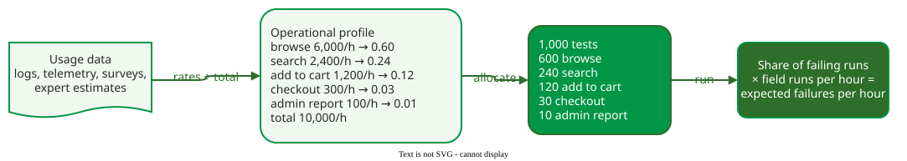

# Operational Profile

An **operational profile** is the set of operations a system performs, each with the probability that it is the next one users run: "a quantitative characterization of how a system will be used" . The probabilities are mutually exclusive and sum to 1. Testing with a profile allocates tests in proportion to use, so the failures users would meet most often are found first.

_From usage data to allocated tests, for a constructed web-shop example._

A **run** is one execution of a task started from outside, such as one search; an **operation** is a class of similar runs that the design treats alike, such as *search*. In a test driven by the profile, each test run picks its operation with the profile's probability, so the test mix matches the field mix. The share of test runs that fail then estimates the share of field runs that will fail; multiplied by the field's rate of runs (10,000 per hour in the example), it gives the expected failures per hour in use. For example, if 2 of 1,000 test runs fail, the share is 0.002, and 0.002 × 10,000 runs per hour = 20 failures per hour expected in use. This is what links the profile to [reliability measurement](../../attributes/reliability/index.md): without it, a failure rate measured in test describes the tests, not the product.

## Pages in this section

| Page | What it covers | Best fit | Main cost |
|---|---|---|---|
| [Developing an Operational Profile](development.md) | Operations, modes, the six steps, from rates to probabilities | planning system and acceptance tests | usage data, or estimates when none exist |
| [Operational Profile: Industrial Evidence](case-studies.md) | AT&T and HP results; Android Cloud Profiles | arguing for usage-based testing | two old self-reported projects |
| [Operational Coverage](modern.md) | Coverage weighted by use, a stopping rule | deciding when usage-based testing is enough | code-level usage data |
| [From Profile to Exploration](bridge.md) | Saturation; switching from profile-based to exploratory testing | planning the end of a test phase | judging when to switch |
| [Worked Case: A Profile from an Access Log](worked-case.md) | Log to profile, weighted driver, failure intensity, release decision | a first profile for a web system | a day of logs and a test driver |
| [Operational Profile Case: UAV Mission Planning](uav-case.md) | Modes, prototype usage data, merging operations | a new interactive application | instrumenting a prototype |

A profile directs effort to what users do most, so it underweights rare operations, which may be the critical ones, and it cannot model events users do not initiate . [Exploratory Testing](../exploratory/index.md) covers that gap.

---

### References



---

{: .highlight }
**Disclaimer:** AI is used for text summarization, polishing and explaining. Authors have verified all facts and claims. In case of an error, feel free to file an issue.
