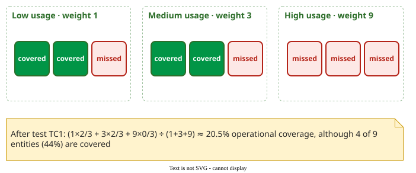

# Operational Coverage

**Operational coverage is code coverage in which each program element counts according to how often users exercise it, so that missing a heavily used branch lowers the score more than missing one users never reach** .

## 1. Why weight coverage by use

Profile-based testing cannot tell which used code its tests missed; plain [coverage](../coverage/index.md) treats an admin screen used monthly like the login every user passes. Operational coverage tells the tester which *frequently used* code is still untested.

## 2. Worked example: usage-weighted coverage

The simplest form, called here **usage-weighted coverage**, weights each method's branch coverage by its share of usage; *operational coverage* names the published rule (section 3). The numbers are constructed.

| Method | Branches | Covered | Share of usage |
|---|---|---|---|
| `login()` | 4 | 3 | 0.50 |
| `search()` | 6 | 2 | 0.30 |
| `checkout()` | 4 | 4 | 0.15 |
| `admin_panel()` | 6 | 0 | 0.05 |

Plain branch coverage is (3 + 2 + 4 + 0) ÷ 20 = **45%**. Weighted by use it is 3/4 × 0.50 + 2/6 × 0.30 + 4/4 × 0.15 + 0/6 × 0.05 = 0.375 + 0.100 + 0.150 + 0 = **62.5%**.

## 3. The published definition

Miranda and Bertolino define it in three steps :

1. **Count.** Run the program under the profile and count how often each entity (statement, branch or function) executes. Entities the profile never executes are **out of scope**: they do not count at all.
2. **Group.** Rank the in-scope entities by their count and split the list into thirds: the most executed third is the **high** group, the next third **medium**, the last third **low**. The groups get weights 9, 3 and 1.
3. **Average.** Operational coverage is the weighted mean of the covered fraction in each group: (1 × low + 3 × medium + 9 × high) ÷ (1 + 3 + 9).

_The paper's own example after its first test: plain coverage 44%, operational coverage 20.5%, because no high-usage entity is covered yet._ 

Applying the published rule to the table above is a simplification: it treats each method as one element, and it counts all of a used method's branches, where the published rule would leave out branches users never execute. Four methods cannot be cut into three equal parts, so the split is a judgement. Two ways to round it are shown below; where a band holds two methods, their branches are pooled by count.

| Split | High (weight 9) | Medium (3) | Low (1) | Calculation | Result |
|---|---|---|---|---|---|
| A | login 3/4 | search 2/6 | checkout + admin 4/10 | (9 × 0.75 + 3 × 0.333 + 1 × 0.40) ÷ 13 | 62.7% |
| B | login + search 5/10 | checkout 4/4 | admin 0/6 | (9 × 0.5 + 3 × 1 + 1 × 0) ÷ 13 | 57.7% |

Either is correct if the split is stated.

**When it comes out higher than plain coverage.** When the most used elements are better covered than average, as in the method table (62.5% against 45%). When they are worse covered, it is lower: the paper's first test misses the high band, so operational coverage is 20.5% against 44% plain. Uncovered code that nobody uses has weight 0, so it does not pull the weighted figure down. Suppose the program also had an `export_xml()` method with 10 branches that no user ever runs. Plain coverage falls to 9 ÷ 30 = 30%, while operational coverage does not change, because `export_xml()` is out of scope. Real programs contain much such code, which is why the published results are higher "by construction" .

The **profile coverage** of the [Android study](case-studies.md) is the unweighted version .

On three C programs (grep, gzip and sed), test suites built to reach operational coverage were smaller than those built for plain coverage, significantly in every case . In an earlier study, after an average of 57 profile-selected tests, plain branch coverage was 31.3% and operational branch coverage 87.0%; operational coverage also correlated better with the reliability the tests achieved in most comparisons . That makes it a candidate **stopping rule**: stop when the code users exercise is covered.

## When to use it — and when not

Use it with code-level usage data, as a stopping rule tied to users. Do not use it to excuse untested rare code that is critical: weight such code by risk, not by use.

## Limitations

The score depends on how entities are grouped and weighted; the weights 1, 3, 9 are a choice, not a law. It says nothing about code users never run.

## How solid is this?

- **Where it comes from.** The Miranda–Bertolino studies ; the general theory of coverage relative to a usage scope is in .
- **What is contested.** All results come from the same small C programs from one research group, with simulated profiles.
- **What we do not hold.** Industrial use of operational coverage as a release criterion.

---

### References



---

{: .highlight }
**Disclaimer:** AI is used for text summarization, polishing and explaining. Authors have verified all facts and claims. In case of an error, feel free to file an issue.
