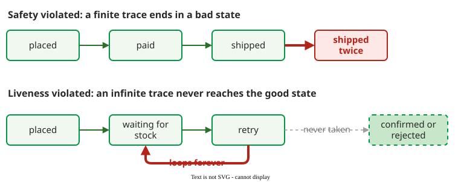

# What Analysis Can Prove

**A property is a precise condition that must hold in a state or along a sequence of states; analysis tries to show that it holds on every execution, and it can only check properties someone has written down.** A property says *what* must be true, not how the code achieves it .

## 1. Generic and application-specific properties

**Generic** properties apply to any program: no array index out of bounds, no division by zero, no deadlock, no race condition, no null dereference, no uncaught exception. Tools can check them without knowing the application. **Application-specific** properties use the domain's terms, such as "the pitch rate ratio shall be between 0 and 1" . Someone with domain knowledge has to state them.

## 2. Safety, liveness and fairness

The NASA practitioner's guide defines three kinds by what they promise :

- A **safety** property asserts that nothing bad ever happens, such as a deadlock or taking an item from an empty buffer. Safety properties keep the program state consistent.
- A **liveness** property asserts that something good eventually happens. It guarantees progress, and rules out starvation, processes that are never woken, and processes killed too early.
- A **fairness** property is a liveness property that holds infinitely often: each process gets a turn again and again.

**Example.** (Constructed example.) An online shop's order service has a safety property "an order is never shipped twice" and a liveness property "every placed order is eventually confirmed or rejected". A fairness property for the same shop: two worker threads share the stock database, and each of them gets the database lock again and again, so neither waits forever while the other keeps it busy:

_A safety violation is a finite trace that ends in a bad state; a liveness violation is an infinite trace that never reaches the good state. (Constructed example.)_ 

The difference matters for tools. To refute a safety property, a checker needs one finite path to a bad state. To refute a liveness property, it must find a reachable cycle in which the good event never happens, which is harder .

## 3. Temporal properties

A **state property** holds in one state; a **temporal** property relates states along a path, for example "every message that is sent is later received" . Linear temporal logic (LTL), the language of the SPIN model checker, writes them with three operators :

| Operator | Also written | Meaning |
|---|---|---|
| `[]P` | G P | P holds now and in every later state (always) |
| `<>P` | F P | P holds now or in some later state (eventually) |
| `P U Q` | | P holds until a state where Q holds |

The shop's properties become `[] !shipped_twice` (safety), `[] (placed -> <> (confirmed || rejected))` (liveness) and `([] <> worker1_has_lock) && ([] <> worker2_has_lock)` (fairness: each worker gets the lock infinitely often). `!account U login` says that no account page is shown before a login, and also that a login eventually happens: U requires Q to arrive.

## 4. What analysis cannot prove

Four limits apply to every tool:

- **Unwritten properties.** A checker verifies only the properties it is given. In practice properties are often "reverse engineered" late, during verification, instead of being captured with the requirements .
- **The model is not the program.** A model checker's verdict holds for the model; a fault the model leaves out is not checked.
- **Undecidability.** No analysis decides every property for every program, so tools approximate and report false alarms, miss bugs, or both . See [Soundness and Completeness](../../static/limits.md).
- **Run-time qualities.** Response time under real load, usability and behaviour in the real environment depend on things outside the code; they are left to [testing](../testing/index.md) and [demonstration](../techniques.md).

## When to use it — and when not

- Use property checking for rules that must hold on every path: locking, protocols, absence of a class of crash.
- Prefer testing when the question is whether one output is right for one input, and nobody has written the rule.

## Limitations

A proved property is only as good as its statement. The shop's liveness property above is flawed as written: it omits "cancelled", so a correct order service that lets customers cancel fails the check. The fix is in the property, not the code: `[] (placed -> <> (confirmed || rejected || cancelled))`. Equally, a wrong service that never ships could still pass `[] !shipped_twice`, because never shipping never ships twice.

## How solid is this?

- **Where it comes from.** The property kinds and the LTL operators are from NASA's program model checking guide ; the counterexample shapes from Ben-Ari's model checking primer .
- **What is contested.** Nothing here; the definitions are standard.
- **What we do not hold.** Some LTL texts add a "next" operator; SPIN's notation omits it, and no held source defines it.

---

### References



---

{: .highlight }
**Disclaimer:** AI is used for text summarization, polishing and explaining. Authors have verified all facts and claims. In case of an error, feel free to file an issue.
