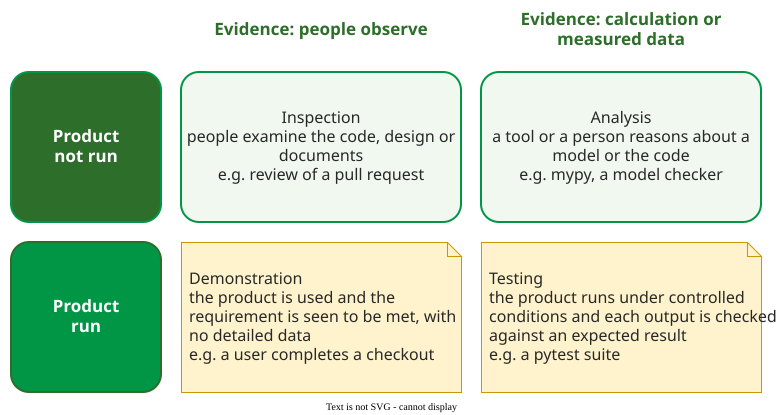

# Four Verification Methods

**A verification method is the kind of evidence used to show that a requirement is met: inspection (people examine the product), analysis (calculation or reasoning about a model), testing (running the product and measuring the result) or demonstration (using the product and seeing that it works)** .

## 1. Verification and validation

The NASA handbook separates the two by their question. **Verification** is "proof of compliance with specifications" and answers *did we build the product right?* **Validation** shows that the product "accomplishes the intended purpose" for its stakeholders and answers *did we build the right product?*  Ammann and Offutt give the software version: verification checks that the products of one development phase meet the requirements set in the previous phase; validation evaluates the finished software against its intended use, and usually needs domain knowledge . A program can pass verification and fail validation: it does what the specification says, and the specification was wrong.

## 2. The four methods

_The four methods sorted by two questions: is the product run, and what kind of evidence is produced? Definitions after the NASA handbook, software examples added._ 

- **Inspection** is the visual examination of the product, including its drawings and documents . In software, people other than the author read code, designs or requirements; see the [Inspection](../inspection/index.md) area.
- **Analysis** uses models and calculation to predict whether the product will meet its requirements, and is generally used when no working product is available yet . In software this is static analysis, model checking and theorem proving; see [Verification by Analysis](analysis/index.md).
- **Testing** uses the product to obtain detailed data at discrete points, under controlled conditions, and is the most resource-intensive method . See the [Testing Overview](testing/index.md).
- **Demonstration** shows that using the product achieves a requirement. It is a basic confirmation of capability, and differs from testing by the lack of detailed data gathering .

## 3. Example: one checkout, four methods

(Constructed example.) A web shop's checkout has four requirements, and each is best verified by a different method:

| Requirement | Method | How |
|---|---|---|
| Card numbers are never written to the log | Inspection | a reviewer reads every logging call in the pull request |
| No SQL query is built by string concatenation | Analysis | a security analyzer such as Bandit or CodeQL checks all the code on every commit |
| A 10% discount code turns a 40.00 total into 36.00 | Testing | a pytest test calls the price function and asserts 36.00 |
| A first-time customer can complete a purchase | Demonstration | five users try it on the staging site while the team watches |

The analyzer covers paths no test reaches but cannot know that 36.00 is right; the test knows the expected value, but only for the inputs it tries; the demonstration gives a yes or no, not a measurement. A requirement can also be verified by a combination of methods .

## 4. Why combine them

Different methods find different faults. At Nortel, Zheng and colleagues classified the faults found by each method: static analysis tools found mostly checking faults (a missing or wrong validation) and assignment faults (a wrong initial value), while testing and customers found mostly function and algorithm faults . A team that relies on one method leaves whole classes of faults to the next one, or to the customer. Customers do find them: across 109 projects in published studies, the mean post-release defect density was 7.47 defects per thousand lines of code, and the median 4.3 .

## When to use each — and when not

- Use inspection early, before anything runs, and for omissions: a missing requirement has no code to execute.
- Use analysis for rules that must hold on every path; it does not know the right output.
- Use testing when the expected result is known; it cannot show a fault is absent.
- Use demonstration for "can a person do the job", not where a number must be met.

## Limitations

The table in §3 is a judgement, not a rule: choosing the method is engineering judgement . No method, alone or combined, proves a program free of faults. Testing in particular "can be used to show the presence of bugs, but never to show their absence" .

## How solid is this?

- **Where it comes from.** The four methods and the verification–validation distinction are standard systems-engineering terms, quoted here from the NASA handbook . The fault-type comparison is one industrial study ; the defect densities come from a scoping study whose projects counted lines and defects in different ways .
- **What is contested.** The boundary between testing and demonstration: many teams call any run of the product a test.
- **What we do not hold.** The INCOSE handbook, which earlier versions of this page quoted, is not held; its wording could not be checked, so the NASA definitions replace it.

---

### References



---

{: .highlight }
**Disclaimer:** AI is used for text summarization, polishing and explaining. Authors have verified all facts and claims. In case of an error, feel free to file an issue.
