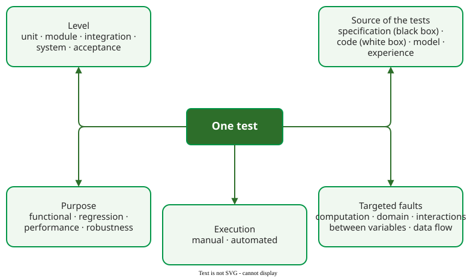

# Testing Overview

**Testing evaluates software by running it and observing what it does** . It is the verification method that produces detailed data under controlled conditions , and the only one of the four that checks the real program's output against an expected result. It cannot show that faults are absent .

Every test can be described along five independent dimensions:

_Five ways to classify one test. A unit test can be white-box, functional, aimed at domain faults and automated, all at once._

| Page | What it covers | Best fit | Main cost |
|---|---|---|---|
| [What Testing Is](testing_definitions.md) | fault, error and failure; test cases and oracles | understanding why a test fails or passes | — |
| [Testing Levels](testing_levels.md) | unit, module, integration, system and acceptance testing | planning who tests what, and when | setting up each level's environment |
| [Test Doubles](test-doubles.md) | stubs, fakes and mocks | unit tests of code with slow or external dependencies | brittle tests if overused |
| [The Test Pyramid](test-pyramid.md) | how many tests of each size, and the ice cream cone | balancing speed against realism | maintaining large tests |
| [Black-Box and White-Box Testing](testing_bb_wb.md) | tests from the specification or from the code | every suite needs both | specification or code access |
| [Testing by Purpose](testing_purpose.md) | functional, regression, performance and robustness testing | deciding what a test is meant to show | load environments, fault injection |
| [Test-Driven Development](tdd.md) | writing the test before the code; the evidence | new code with clear requirements | discipline and training |

Choosing the inputs is a topic of its own: [input domain testing](../../domain/index.md) partitions inputs and tests their boundaries, [combinatorial testing](../../combinatorial/index.md) covers interactions between parameters, [random testing](../../random/index.md) samples inputs and needs an automatic oracle, and [exploratory testing](../../exploratory/index.md) lets a tester design tests while running them. [Coverage criteria](../../coverage/index.md) measure how much of the code or input space a suite exercised.

---

### References



### Acknowledgments

The lectures behind this area took early inspiration from the *Analysis of Software Artifacts* course of Eduardo Miranda and Claire Le Goues (Carnegie Mellon University). The pages here are original, written from the literature review; any errors are ours.

---

{: .highlight }
**Disclaimer:** AI is used for text summarization, polishing and explaining. Authors have verified all facts and claims. In case of an error, feel free to file an issue.
