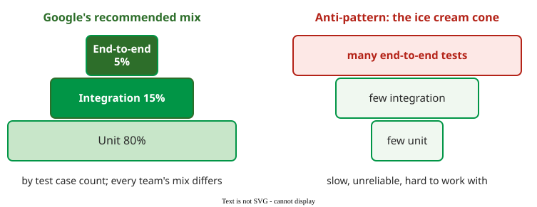

# The Test Pyramid

**The test pyramid is a rule of thumb for the mix of tests in a suite: many narrow unit tests at the base, fewer integration tests above them, and a few end-to-end tests at the top.** Google's version, after Mike Cohn, aims for about 80% unit, 15% integration and 5% end-to-end tests, counted by number of test cases .

## 1. Why the base is wide

Narrow tests are fast, deterministic and point at the faulty code; broad tests are slow, break for reasons unrelated to the change, and leave a long search from failure to fault. Google says its mix is a loose rule and that every team's will differ .

_Google's recommended mix and the ice cream cone anti-pattern, after_ Software Engineering at Google. 

The opposite shape is the **ice cream cone**: many end-to-end tests and few integration or unit tests. Such suites "tend to be slow, unreliable, and difficult to work with" .

## 2. Size and scope

Google classifies tests on two axes . **Scope** is how much code a test validates: unit, integration, end-to-end. In terms of the [testing levels](testing_levels.md), unit scope roughly covers unit and module tests, integration scope integration tests, and end-to-end scope system and acceptance tests. **Size** is what it needs to run: a **small** test runs in a single process, a **medium** test on a single machine and may call `localhost`, a **large** test may span machines. Narrow tests are usually small and broad ones medium or large, but not always: a unit test that opens a real database connection is narrow in scope but no longer small.

## 3. Example: the pyramid at Google scale

At Google, the Test Automation Platform (TAP) integrates and tests more than 13,000 projects a day, with 800,000 builds and 150 million test runs; developers commit about once a second, too often to test every commit on its own . In one month in 2016, 5.5 million test targets were affected by changes, and only about 63,000 of them, roughly 1.1%, ever failed . A second figure counts something else: after flaky targets were filtered out, 1.23% of targets had a history showing a real breakage or fix introduced by a developer . The paper takes the two figures from different analyses, so they do not nest neatly; both say that almost every test run passes. At that volume every slow or flaky test is paid for millions of times, which is why the base must be fast.

(Constructed example.) A team of six has 1,000 tests. Google's mix would make about 800 of them unit tests, 150 integration tests and 50 end-to-end tests. If the team instead has 200 unit tests, 300 integration tests and 500 end-to-end tests that each start a browser, the suite has become a cone.

## When to use it — and when not

- Use the pyramid to decide where to add the next test: at the narrowest scope that can show the failure.
- Do not chase the percentages: a thin service that mostly connects other services may need more integration tests than unit tests.

## Limitations

The 80/15/5 mix is advice from one company, not a measured optimum, and it counts tests, not effort or faults found. No held source shows that a pyramid-shaped suite finds more faults than another shape; the argument is speed, reliability and cost of diagnosis.

## How solid is this?

- **Where it comes from.** The mix, the anti-pattern and size versus scope are from the testing chapters of *Software Engineering at Google* ; the TAP figures from Memon and colleagues .
- **What is contested.** The ratio itself: a 2015 post on Google's testing blog (Mike Wacker, "Just Say No to More End-to-End Tests") proposed 70/20/10 as a starting point; the 2020 book says 80/15/5. Both are rules of thumb.
- **What we do not hold.** Mike Cohn's original pyramid and any study comparing suite shapes.

---

### References



---

{: .highlight }
**Disclaimer:** AI is used for text summarization, polishing and explaining. Authors have verified all facts and claims. In case of an error, feel free to file an issue.
