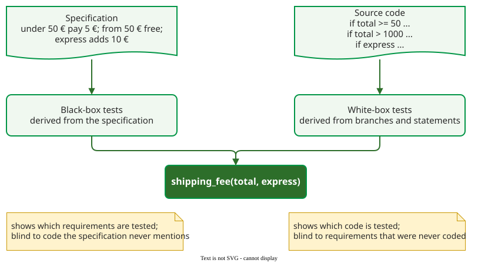

# Black-Box and White-Box Testing

**Black-box testing derives tests from external descriptions of the software (specifications, requirements, design); white-box testing derives them from the source code, its statements, branches and conditions** . The two differ in where the tests come from, not in how they are run.

## 1. What each can tell you



_Two sources of tests for one function. (Constructed example.)_

A black-box suite can show which requirements have a test, but not which code ran: code that the specification never mentions stays untested. A white-box suite can show which code ran, measured as [coverage](../../coverage/index.md), but not which requirements were checked: a requirement that was never implemented has no code to cover. Black-box techniques include [equivalence partitioning and boundary values](../../domain/index.md); white-box techniques are the [coverage criteria](../../coverage/code.md). Ammann and Offutt treat both as ways to build a model of the software, a graph or an input domain, and call the distinction dated ; it remains useful for asking what a suite cannot see.

## 2. Example: a shipping fee

(Constructed example.) The specification says: orders under 50 € pay 5 € shipping, orders from 50 € ship free, and express delivery adds 10 €. The code has a rule the specification does not mention:

```python
def shipping_fee(total, express):
    """Return the shipping fee in euros for an order."""
    fee = 0 if total >= 50 else 5
    if total > 1000:
        fee = 20             # freight surcharge, not in the specification
    if express:
        fee += 10
    return fee
```

**Black box.** Four tests from the specification, with boundary values: `(20, False)` gives 5, `(50, False)` gives 0, `(49.99, False)` gives 5, and `(20, True)` gives 15. All pass. Measured with pytest-cov (coverage.py, branch mode), they cover 6 of 7 statements and 3 of 4 branches. A **branch** is one way out of a decision: each `if` has two, taken when the condition is true and when it is false. The seven statements include the `def` line, which runs when the module is imported; the docstring does not count. coverage.py adds statements and branches together, so the total is (6 + 3) / (7 + 4) = 9/11, or 82%. The surcharge line never runs, because nothing in the specification leads to an order above 1,000 €.

**White box.** Reading the code, a tester writes `(60, True)` expecting 10 and `(1200, False)` expecting 20. These two tests reach 100% statement and branch coverage. But where did 20 come from? From the code itself: the specification is silent, so the test checks that the code does what the code does. If the surcharge is a mistake, this test protects it. The suite also never tries an order under 50 €, because coverage.py does not count the two sides of `0 if ... else 5` as separate branches.

Together the six tests cover all the code and every rule in the specification, and they raise a question for the product owner: is the surcharge a requirement?

## When to use each — and when not

- Use black-box tests first: they check what the user was promised, and can be written before the code exists.
- Add white-box tests to reach code the specification does not explain, and then ask whether that code should exist.
- Do not treat 100% coverage as proof of correct behaviour: coverage counts code that ran, not results that were checked.

## Limitations

Neither source finds a requirement that nobody wrote down. Had the product owner wanted free shipping for members and forgotten to say so, there would be no specification for a black-box test and no code for a white-box test; only review of the requirements, or [exploratory testing](../../exploratory/index.md) by someone who knows the domain, can find it.

## How solid is this?

- **Where it comes from.** The definitions from Ammann and Offutt ; the example was run for this page with pytest 9.1.1 and coverage.py in branch mode.
- **What is contested.** Whether the distinction is still useful: Ammann and Offutt build both kinds of test from the same graph and input-domain models.
- **What we do not hold.** Studies comparing the fault detection of black-box and white-box suites are covered in the [coverage](../../coverage/discussion.md) area.

---

### References



---

{: .highlight }
**Disclaimer:** AI is used for text summarization, polishing and explaining. Authors have verified all facts and claims. In case of an error, feel free to file an issue.
