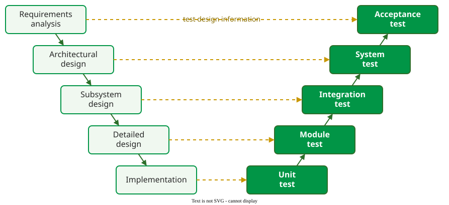

# Testing Levels

**A testing level is the scope of what a test exercises, from one function (unit testing) to the whole system in use (acceptance testing); each level checks the product against a different development artifact** .

## 1. Five levels and the V model

Ammann and Offutt pair each level with the development activity whose output it checks :

_Development activities and testing levels, the "V model", redrawn from Ammann and Offutt. The diagram does not imply a waterfall process._ 

- **Unit testing** assesses the units the implementation produces: functions and methods. Programmers usually do it, and tools such as pytest or JUnit keep the tests next to the code.
- **Module testing** assesses a module (a file, package or class) in isolation, including how its units work together.
- **Integration testing** assesses whether the interfaces between modules make consistent assumptions and communicate correctly. It assumes the modules work; developers usually do it.
- **System testing** assesses whether the assembled system meets its specification, and looks for design and specification problems. A separate test team usually does it; it is an expensive place to find low-level faults.
- **Acceptance testing** assesses whether the completed software does what the users want, and must involve users or people with strong domain knowledge.

**Regression testing** is not a level: it re-runs tests after a change, at any level, to check that what worked still works . The arrows across the V carry a further piece of advice: design each level's tests while doing the matching development activity, because writing a test early often exposes a design mistake .

## 2. Example: one shop, five levels

(Constructed example.) An online shop has an `Item` class that looks up prices, an `Order` class that adds them up, and a web front end. A price fault could be found at each level, but each level finds a different kind:

| Level | Test | Fault it can find |
|---|---|---|
| Unit | `Order.total()` with a stub (a stand-in that returns fixed prices; see Test Doubles) | a wrong sum, a discount applied twice |
| Module | the `Order` class with its own helper methods | a helper that leaves the order in a wrong state |
| Integration | `Order` with the real `Item` price lookup | `Item` returns cents, `Order` assumes euros: 2.50 becomes 250 |
| System | the whole shop through its web API on a staging server | the basket page shows the total before tax, against the specification |
| Acceptance | a customer buys three items | customers wanted the delivery cost shown before the last step |

The integration fault is invisible at unit level: each class is correct on its own assumptions. The acceptance finding is invisible to every other level: the system met its specification, and the specification missed what users needed.

## When to use each level — and when not

- Test at the lowest level that can show the fault: unit tests are fast and point at the faulty line.
- Do not stop at unit tests when modules come from different people or teams; interface faults appear only when they meet.
- Do not use system tests to find logic faults in one function: the run is slow and the failure is far from its cause.

## Limitations

The levels describe scope, not test size. Google separates the two: a test's **size** is the resources it needs (one process, one machine, or many), its **scope** the code it validates . A narrow unit test can still be slow if it touches a real database; see [The Test Pyramid](test-pyramid.md). Some literature also uses "integration testing" and "system testing" interchangeably .

## How solid is this?

- **Where it comes from.** The levels, the V model and the advice to design tests early are from Ammann and Offutt ; size and scope from *Software Engineering at Google* .
- **What is contested.** The number of levels: many sources merge module into unit testing, or add a thread or function level between integration and system testing.
- **What we do not hold.** No held source measures which level finds which share of faults.

---

### References



---

{: .highlight }
**Disclaimer:** AI is used for text summarization, polishing and explaining. Authors have verified all facts and claims. In case of an error, feel free to file an issue.
