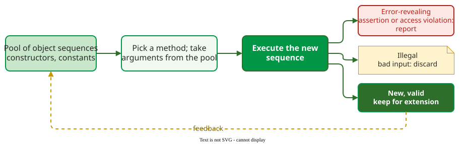

# Feedback-Directed Random Testing

**Feedback-directed random testing** builds tests for object-oriented code as random sequences of method calls, executes each sequence as soon as it is built, and uses the result to decide whether to keep, discard or report it. Pure random generation ignores what happened; feedback lets later tests build on earlier valid ones.

## 1. How Randoop works

Randoop keeps a pool of call sequences that produced valid objects, meaning they ran without any error behaviour and without being rejected as illegal input . Its checks act like **contracts**, rules that a correct run never breaks: no assertion fails, no access violation, no unexpected termination. Each step picks a method at random, takes its arguments from the pool, runs the extended sequence and classifies it.

_Valid new sequences go back into the pool, so later calls start from objects that earlier calls built correctly._

The oracle is a set of error behaviours that are wrong in any program: assertion violations, access violations and unexpected termination. Sequences that show one are reported; sequences that only trigger an argument check, such as an `ArgumentException` for a null input, are discarded as illegal, so the pool fills with legal objects .

## 2. Worked example: a .NET component

At Microsoft, Pacheco et al. applied Randoop to a core .NET library component that about 40 testers had tested for five years with manual, system and partition testing . Randoop generated about 4 million test sequences and revealed 30 serious, previously unknown errors. The team spent 15 hours of their own time on it; the tool itself used 150 hours of CPU time, partly on many machines in parallel. For comparison, a test engineer on that code typically found about 20 errors in a year.

The results also showed the method's limit. Measured in the team's hours of using it, Randoop found 10 errors in the first two hours, then about 2 per hour for ten hours, then none, even with different random seeds and several hundred machines . The authors traced this **plateau** to unfair selection: Randoop picks methods uniformly at random, so classes with a no-argument constructor, or with many constructors, are explored heavily while classes whose objects are hard to build are barely reached.

## 3. Contracts as the oracle: AutoTest

AutoTest applies the same idea to Eiffel, whose classes carry **Design by Contract** annotations . Preconditions filter out invalid random inputs; postconditions and class invariants are the oracle, so every random call is checked without a hand-written assertion.

A study ran 375 sessions per class, 30 minutes each, on 8 classes, 1,500 CPU hours in total, and read the results at five points in each session (1, 2, 5, 10 and 30 minutes), giving 1,875 results per class. It found two practical lessons :

- **Most bugs come early.** The number of bugs found rises steeply in the first few minutes of a session.
- **The seed matters.** For one class, one random seed found 5 bugs and another found 23 in the same 30 minutes, with everything else equal.

**Where the inputs come from.** Randoop needs only the compiled classes under test and a time limit: it finds their public methods by reflection and builds every argument from earlier calls. The oracle comes from the code itself, so the assertions and argument checks the developers already wrote decide what counts as an error and what as illegal input; code with few assertions gets a weak oracle.

## When to use it — and when not

- **Use it** to stress a library's public API, where valid objects must be built by calling other methods first.
- **Use it** where contracts or general rules (no assertion violation, no crash) can serve as the oracle.
- **Do not expect it to find wrong results** that break no contract: without a specification of the expected value, a plausible but wrong answer passes.

## Limitations

Feedback-directed generation saturates: once the reachable object states are explored, new random seeds add little . Results vary strongly with the random seed, so a single run proves little . The oracle is only as strong as the contracts; code without them gets only the generic checks.

## How solid is this?

- **Where it comes from.** One industrial case study (Randoop at Microsoft) and one controlled study on eight Eiffel classes .
- **What is contested.** Both studies use code the authors' teams chose; the error counts show what the method can do, not its average yield.

---

### References



---

{: .highlight }
**Disclaimer:** AI is used for text summarization, polishing and explaining. Authors have verified all facts and claims. In case of an error, feel free to file an issue.
