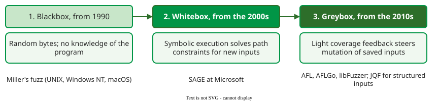

# Fuzz Testing

**Fuzz testing** (fuzzing) runs a program on large numbers of random or mutated inputs, deliberately including inputs outside what the program expects, and watches for crashes, hangs and other detectable failures. Manes et al. define it as executing the program with inputs sampled from a space that "protrudes the expected input space" .

## 1. Where it started: Miller's fuzz studies

In 1990 Miller, Fredriksen and So piped random characters into almost 90 UNIX command-line utilities on seven versions of UNIX. They crashed or hung between 24% and 33% of the utilities on each system, including editors and shells . The oracle was the simplest possible: did the program crash or hang?

The group repeated the experiment as platforms changed:

```vega-lite
{
  "$schema": "https://vega.github.io/schema/vega-lite/v5.json",
  "width": "container", "height": 200,
  "data": {"values": [
    {"study": "1990 UNIX utilities (worst system)", "pct": 33},
    {"study": "2000 Windows NT GUI apps (crash + hang)", "pct": 45},
    {"study": "2006 macOS command-line utilities", "pct": 7},
    {"study": "2006 macOS GUI apps", "pct": 73}
  ]},
  "mark": {"type": "bar", "color": "#019546", "cornerRadiusEnd": 3},
  "encoding": {
    "y": {"field": "study", "type": "nominal", "sort": null, "title": null},
    "x": {"field": "pct", "type": "quantitative", "title": "% of programs that crashed or hung", "scale": {"domain": [0, 100]}}
  },
  "config": {"font": "Tahoma", "axis": {"labelFontSize": 13, "titleFontSize": 13, "labelLimit": 320}}
}
```

_Random keyboard and mouse events crashed 21% of Windows NT applications and hung another 24% ; on macOS, 7% of 135 command-line utilities crashed while 22 of 30 GUI applications crashed or hung ._

Command-line tools improved, GUI applications did not, and the same kinds of programming errors, such as unchecked pointers and array bounds, kept recurring across the studies .

## 2. Worked example: a blind fuzzer in Python

A fuzzer can be a dozen lines. This one feeds random bytes to a header parser and treats any exception as a crash:

```python
import random

def parse_header(data: bytes) -> tuple[str, int]:
    """Parse b'Content-Length: 42' into ('Content-Length', 42)."""
    name, value = data.decode("ascii").split(":")
    return name.strip(), int(value)

random.seed(0)
crashes = {}
for i in range(1_000):
    data = bytes(random.randrange(256) for _ in range(random.randint(0, 20)))
    try:
        parse_header(data)
    except Exception as e:                 # the oracle: any exception is a crash
        crashes.setdefault(type(e).__name__, data)
for kind, example in crashes.items():
    print(f"{kind:20} first input: {example[:12]!r}")
```

```text
UnicodeDecodeError   first input: b'\xd7\x14\x84\xf8\xcf\x9b\xf4\xb7oG\x90G'
ValueError           first input: b'aq'
```

Both are real robustness bugs: the parser does not handle non-ASCII bytes or a missing colon. The `ValueError` bucket also hides several distinct bugs (no colon, two colons, a non-number after the colon), because the fuzzer groups crashes only by exception type; counting buckets is not counting bugs. But random bytes almost never form `name:` followed by digits, so the code after the split is barely exercised. That is the motivation for the later generations of fuzzers.

## 3. Three generations

Later fuzzers add knowledge of the program step by step.



_Each generation adds knowledge of the program to reach code that blind bytes do not._

Whitebox and greybox fuzzing are covered on [Coverage-Guided Fuzzing](greybox.md).

## When to use it — and when not

- **Use it** on anything that parses untrusted input: file formats, network protocols, command lines.
- **Use it** with sanitizers in C and C++: compiler-added checks that turn silent memory errors into crashes (see [Coverage-Guided Fuzzing](greybox.md)).
- **Do not expect it to check correctness.** A crash oracle never notices a wrong but plausible result; that needs [properties](property-based.md) or a reference implementation.

## Limitations

Blind fuzzing stays near the surface: inputs that fail the first validity check never reach deeper logic, as the example shows. The crash oracle also misses every failure that does not crash.

## How solid is this?

- **Where it comes from.** The crash rates are from Miller's three studies ; the definition is from the survey by Manes et al. .
- **What is contested.** The studies tested different program sets with different input types, so the rates show a trend, not a controlled comparison between platforms.

---

### References



---

{: .highlight }
**Disclaimer:** AI is used for text summarization, polishing and explaining. Authors have verified all facts and claims. In case of an error, feel free to file an issue.
