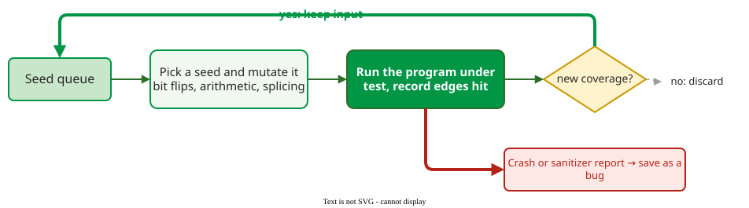

# Coverage-Guided Fuzzing

**Coverage-guided (greybox) fuzzing** mutates saved inputs at random and keeps any mutant that makes the program execute code no earlier input reached; the queue of interesting inputs grows towards deeper code. It sits between blackbox fuzzing, which knows nothing about the program, and whitebox fuzzing, which analyses it symbolically .

## 1. Whitebox: solving for new paths

Whitebox fuzzing reasons about the program's code instead of only running it.

SAGE, Microsoft's whitebox fuzzer, uses **symbolic execution**: it runs the program on an input while recording the branch conditions along the path as formulas, negates one, and asks a **constraint solver** (a program that finds values satisfying a set of formulas) for an input that takes the other side . Over 400 machine-years of runs on hundreds of Windows applications it found one third of all file-fuzzing bugs during the development of Windows 7, and its monitoring system recorded over 3.4 billion constraints solved. Symbolic execution is powerful but expensive per input.

## 2. Greybox: cheap feedback, many inputs

AFL-style fuzzers replace symbolic reasoning with lightweight instrumentation that records which control-flow edges (jumps from one block of code to the next) an input executed. The trade is depth for speed: a greybox fuzzer cannot solve its way past a hard check, but it runs thousands of inputs in the time a whitebox fuzzer analyses one.

Fuzzers call the saved inputs **seed inputs**, not to be confused with the seed of a random-number generator.

_Coverage is not the oracle here; it only decides which inputs are worth mutating further. Crashes and sanitizer reports are the oracle._

Because the oracle is still a crash, C and C++ fuzzing usually adds **sanitizers**, compiler instrumentation that turns silent errors into crashes. AddressSanitizer, which detects out-of-bounds and use-after-free memory accesses, slows a program down by about 73% on average .

## 3. Worked example: directed fuzzing finds Heartbleed

A plain greybox fuzzer explores wherever coverage leads. **Directed greybox fuzzing** (AFLGo) gives each seed input an *energy*, the number of mutated children the fuzzer will generate from it, based on its distance to a target location, such as recently changed code, so the fuzzer spends its time near the target . Aimed at the code of Heartbleed, the 2014 OpenSSL bug that leaked server memory, AFLGo exposed it in less than 20 minutes, while Katch, a directed tool based on symbolic execution, could not expose it in 24 hours. Integrated into Google's OSS-Fuzz, AFLGo found 26 previously unknown bugs, 10 of them serious enough to receive CVE identifiers, the public catalogue numbers for security vulnerabilities .

## 4. Evaluating a fuzzer honestly

Klees et al. reran published fuzzer comparisons and found the methods weaker than the claims :

- **Crashes are not bugs.** 57,142 crashing inputs that AFL's coverage profile called "unique" were fixed by only 9 distinct patches.
- **One run is not a result.** Performance varies widely between runs, yet nearly two thirds of the papers they examined appeared to compare single runs. Use many trials and a statistical test such as Mann–Whitney U, which checks whether one fuzzer's results tend to be larger than the other's without assuming a distribution.
- **Short runs mislead.** On one program AFL beat AFLFast, a variant of AFL that schedules seed inputs differently, after 6 hours and lost to it after 24. They recommend campaigns of at least 24 hours and evaluating with different seed inputs.

**Where the inputs come from.** A greybox fuzzer needs three things from the team: a harness, a small function that passes the fuzzer's bytes to the code under test; a build with coverage instrumentation (AFL's compiler wrapper `afl-clang-fast`, or `-fsanitize=fuzzer` for libFuzzer); and a seed corpus of valid inputs taken from tests or real traffic.

## When to use it — and when not

- **Use it** continuously on parsers and protocol handlers; services such as OSS-Fuzz run it for open-source projects.
- **Use directed fuzzing** to test a patch or reproduce a reported crash.
- **Do not judge a fuzzer** by its count of unique crashes, or by a single short run.

## Limitations

Coverage guidance helps only where coverage changes: checks such as a 32-bit magic number are hard to pass by mutation, which is what whitebox techniques solve. And like all fuzzing, it finds only failures its oracle can see.

## How solid is this?

- **Where it comes from.** SAGE and AFLGo are reported by their authors ; the survey by Manes et al. organises the field .
- **What is contested.** Many fuzzing claims rest on weak evaluations; Klees et al. show how crash counts and single runs inflate them .

---

### References



---

{: .highlight }
**Disclaimer:** AI is used for text summarization, polishing and explaining. Authors have verified all facts and claims. In case of an error, feel free to file an issue.
