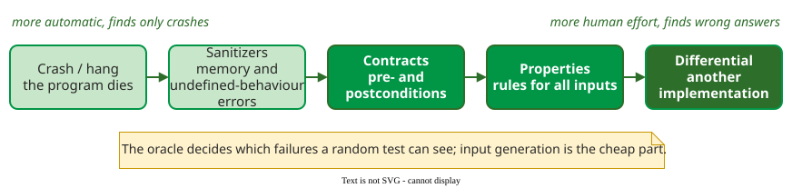

# Random Testing

**Random testing** chooses test inputs by sampling them from the input space instead of deriving them from the specification or the code; a program, not a person, picks the inputs. Its cost lies elsewhere: deciding automatically whether each output is correct.

## The techniques at a glance

The four families differ in what generates inputs and what judges outputs.

| Technique | Inputs come from | The oracle is | Typical finding | Page |
|---|---|---|---|---|
| Plain random testing | a distribution, ideally the operational profile (how often real users supply each kind of input) | an assertion or a reference | wrong answers; a reliability estimate | [Fundamentals](fundamentals.md) |
| Feedback-directed | random method calls, extended when valid | contracts and exceptions | API misuse, broken invariants | [Feedback-Directed](feedback.md) |
| Fuzzing | random or mutated bytes, often steered by coverage | crashes, hangs, sanitizers (compiler checks that turn memory errors into crashes) | memory errors, security bugs | [Fuzz Testing](fuzzing.md) |
| Property-based | typed generators, deliberately biased towards edge values | a property that must hold for all inputs | logic errors, with a minimal example; no reliability figure | [Property-Based](property-based.md) |

[Fundamentals](fundamentals.md) states what it takes for random tests to predict reliability: a system-level test, inputs drawn independently from the operational profile, and an automatic oracle. Only plain random testing on the profile meets all three. Guided tools choose later inputs because of earlier results, and property-based tools bias the distribution towards edge values; both find bugs better but give up the reliability claim.

[Mutation testing](mutation.md) belongs to the same lecture for a different reason: it plants many small faults, generated systematically by mutation operators (and sometimes sampled at random), to measure how good a test suite is.

## The oracle sets the ceiling

Generating a million inputs is easy; knowing which outputs are wrong is not. Each technique above is defined as much by its oracle as by its generator .

_A crash oracle needs no human effort but sees only crashes; a property or a second implementation sees wrong answers but must be written._

## Reading order

[Fundamentals](fundamentals.md) covers what random testing lets you claim about reliability; [Random versus Partition Testing](partition.md) and [E-measure and P-measure](measures.md) weigh it against systematic test design. The tool pages follow: [Feedback-Directed Random Testing](feedback.md), [Fuzz Testing](fuzzing.md), [Coverage-Guided Fuzzing](greybox.md), [Property-Based Testing](property-based.md) and [Property-Based Testing of Web Services](pbt-web.md). [Mutation Testing](mutation.md) closes the section, and [the worked case](worked-case.md) applies both to one function.

## How solid is this?

- **Where it comes from.** Every page is built from the random-testing literature review: Hamlet's theory papers, Miller's fuzz studies, the QuickCheck, Hypothesis and JQF papers, and the mutation testing survey .
- **What is contested.** Whether random testing beats systematic partitioning has been argued since 1984; the answer depends on cost and on how well the partitions fit the faults. See [Random versus Partition Testing](partition.md).

---

### References



---

{: .highlight }
**Disclaimer:** AI is used for text summarization, polishing and explaining. Authors have verified all facts and claims. In case of an error, feel free to file an issue.
