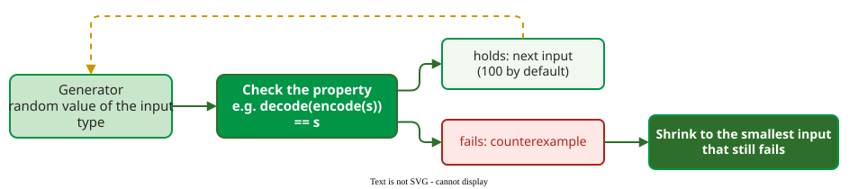

# Property-Based Testing

**Property-based testing (PBT)** replaces hand-picked examples with a *property*, a statement that must hold for every input, and lets a tool generate many random inputs to look for one that breaks it. When it finds one, it **shrinks** it to a small failing case before reporting it. QuickCheck introduced the approach for Haskell in 2000 .

## 1. Three parts

Every PBT tool combines the same three ideas .

- A **property** is code that returns true or asserts for any valid input: "decoding an encoded string gives the string back". A property may have a *precondition* that filters inputs, such as "for any non-empty list, the first element of the sorted list is its minimum".
- A **generator** produces random values of the input type, from small to large, with a deliberate bias towards edge values such as 0, empty strings and very large numbers; by default Hypothesis tries 100 of them per test.
- A **shrinker** reduces a failing input step by step while it keeps failing, so the report shows the essence of the bug.



_The property is the oracle; the generator replaces the tester's choice of inputs._

## 2. Worked example with Hypothesis

Hypothesis is the main PBT library for Python . This run-length encoder has a bug that drops the last run; the round-trip property finds it:

```python
from hypothesis import given, strategies as st

def encode(s):
    out = []
    for ch in s:
        if out and out[-1][0] == ch:
            out[-1] = (ch, out[-1][1] + 1)
        else:
            out.append((ch, 1))
    # bug: drops the last run when there are two or more runs
    return out[:-1] if len(out) > 1 else out

def decode(runs):
    return "".join(ch * n for ch, n in runs)

@given(st.text())
def test_round_trip(s):
    assert decode(encode(s)) == s
```

```text
E       AssertionError: assert '0' == '01'
E       Failing test case: test_round_trip(
E           s='01',
E       )
```

Hypothesis tried random strings, found a failing one, and shrank it to `'01'`: `encode('01')` returns `[('0', 1)]`, which decodes to `'0'`, not `'01'`. Shrinking removes and simplifies characters while the test still fails: a string with one run, such as `'0'`, never fails, because the bug only drops the last run when there are two or more, so the smallest failing input has exactly two different characters. Hypothesis can shrink any input type without a hand-written shrinker because it records every test case in a single universal representation and shrinks that instead .

## 3. Where the bugs turn out to be

The QuickCheck authors found the errors divided "roughly evenly" between generators, the property and the program : writing a property checks what you think the code should do. They also warned of false security: in one case study over 95% of generated inputs met a property's precondition only trivially, so tools report how inputs were distributed.

## 4. PBT in practice

Interviews with 30 developers at Jane Street show where PBT pays off . The most common properties compared two implementations (*differential*, 17 of 30 participants), checked that a value survives a round trip such as serialise-then-parse (11 of 30), or simply that nothing crashes (7 of 30); one participant could report several kinds, so the counts overlap. Property tests ran within budgets of 50 milliseconds to 30 seconds, and 16 of 30 participants said writing specifications slowed them down. Several valued properties as documentation that "never fall out of date".

Coverage feedback can also drive PBT generators. Zest, part of the JQF tool for Java, mutates the random choices behind a generator and keeps those that reach new code: on a property about a trie (a prefix tree for string keys), it found a failing input after about 5,000 test executions, where pure random generation found none in over 7 million ; see [Coverage-Guided Fuzzing](greybox.md).

## When to use it — and when not

- **Use it** for round trips (encode/decode), for a fast implementation checked against a slow obvious one, and for invariants such as "the output is sorted".
- **Use it** on pure functions and data structures, where properties are easy to state, and on web services (see [Property-Based Testing of Web Services](pbt-web.md)).
- **Do not force it** where no property is known; a property that restates the code proves nothing.

## Limitations

The hardest part is finding properties: one experienced user called "not knowing what properties to test" the most common failure mode . Generators for complex inputs are tedious to write, and a skewed generator can leave most of the input space untried.

## How solid is this?

- **Where it comes from.** The QuickCheck paper's case studies , the Hypothesis paper , and an interview study at one company .
- **What is contested.** The Jane Street study describes a company with strong PBT habits and OCaml tooling; the counts describe that culture, not industry in general.

---

### References



---

{: .highlight }
**Disclaimer:** AI is used for text summarization, polishing and explaining. Authors have verified all facts and claims. In case of an error, feel free to file an issue.
