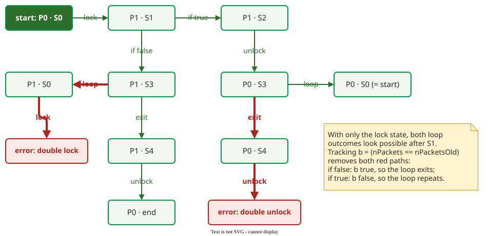
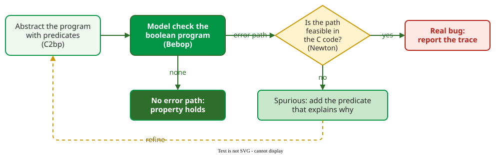

# Abstraction Refinement (CEGAR)

**Counterexample-guided abstraction refinement (CEGAR)** model-checks a coarse abstraction of a program, checks whether each counterexample is possible in the real code, and, when it is not, adds the one fact that rules it out and checks again. Microsoft's SLAM used it to check Windows drivers against locking rules .

## 1. Worked example: a driver's locking rule

A driver must follow three locking rules: never acquire a lock it already holds, never release a lock it does not hold, never finish while holding it. The lock is an automaton with three states: P0 unlocked, P1 locked, and an error state. This loop, with the driver calls shortened to `lock` and `unlock`, is the running example of the SLAM papers :

```c
do {
    lock(&devExt->writeListLock);          // S0
    nPacketsOld = nPackets;
    request = devExt->WriteListHeadVa;
    if (request && request->status) {      // S1
        devExt->WriteListHeadVa = request->Next;
        unlock(&devExt->writeListLock);    // S2
        nPackets++;
    }
} while (nPackets != nPacketsOld);         // S3
unlock(&devExt->writeListLock);            // S4
```

Does it follow the rules?

## 2. First check: the lock state only

The cheapest model keeps the program points S0 to S4 and the lock state, and drops every data variable. Without `nPackets`, both the `if` at S1 and the loop test at S3 can go either way. A state P · S means "lock in state P, about to execute the statement at S", in the trace and in the figure alike. A breadth-first search of this product (program point × lock state), written in Python for this page, reports:

```text
predicate b tracked: False; reachable states: 11; error states: 2
  counterexample: P0·S0 -> P1·S1 -> P1·S3 -> P1·S0 -> ERR·S1
  counterexample: P0·S0 -> P1·S1 -> P1·S2 -> P0·S3 -> P0·S4 -> ERR·END
```



_The abstract product: with only the lock state, a double lock and a double unlock both look reachable. P0 · S0 is drawn twice (start, and the target of the loop), so the 12 boxes are the 11 reachable states._ 

In the output, `ERR·S1` is the figure's "error: double lock" box and `ERR·END` its "error: double unlock" box. The first path skips the `if` and loops back to lock again: a **double lock**. The second takes the `if`, which releases the lock, then leaves the loop and releases it again: a **double unlock**.

## 3. Are the counterexamples real?

Each path must be checked against the real code:

- **Path 1** skips the `if`, so `nPackets` is unchanged and equals `nPacketsOld`; the loop condition is false and the loop exits instead of repeating. The path is impossible.
- **Path 2** takes the `if`, so `nPackets++` makes it differ from `nPacketsOld`; the loop repeats instead of exiting. Also impossible.

Both are **spurious**: products of the abstraction, not of the program. SLAM's feasibility checker, Newton, turns the path into a logical condition (verification condition generation) and checks whether any input can satisfy it; it reached the same verdict and returned one predicate that explains it: b ≡ (`nPackets == nPacketsOld`) .

## 4. Refine and check again

The refined model also tracks b. It has no value at the start; the assignment `nPacketsOld = nPackets` sets it true, `nPackets++` sets it false, and the loop repeats exactly while b is false. Re-running the same search:

```text
predicate b tracked: True; reachable states: 8; error states: 0
```

The eight states, in the order the search reaches them:

| # | State | How it is reached |
|---|---|---|
| 1 | P0 · S0 | start; b not yet set |
| 2 | P1 · S1, b true | lock, then `nPacketsOld = nPackets` |
| 3 | P1 · S2, b true | the `if` is taken |
| 4 | P1 · S3, b true | the `if` is skipped |
| 5 | P0 · S3, b false | unlock, then `nPackets++` |
| 6 | P1 · S4, b true | from 4: b is true, so the loop exits |
| 7 | P0 · S0, b false | from 5: b is false, so the loop repeats; the lock is free, so locking is legal |
| 8 | P0 · end, b true | from 6: unlock, the lock is free at the end |

State 7 leads back to state 2. No double lock (P1 at S0) and no double unlock (P0 at S4) is reachable.

No error state is reachable, so the locking rules hold for this loop. SLAM's model checker, Bebop, reached the same result on its refined boolean program . The code was correct all along; the first model was too coarse to show it.

## 5. The loop



_The CEGAR loop as SLAM implements it: C2bp abstracts, Bebop model-checks, Newton tests feasibility._ 

Starting coarse keeps the first model small and cheap to check; detail is added only where a spurious counterexample shows it is needed. Each turn either proves the property, reports a real bug with a feasible trace, or adds predicates and tries again. Because the question is undecidable in general, the loop is not guaranteed to stop; on the driver properties SLAM checked, it converged . SLAM became Microsoft's Static Driver Verifier, shipped to driver developers  and in use for a decade by 2011 .

## When to use it — and when not

- Use it for rules about the order of operations (lock and unlock, open and close, acquire and release) in code with a narrow interface, such as drivers.
- Do not expect it on properties that depend on many data values: each refinement adds predicates, and the abstraction grows back toward the full state space.

## How solid is this?

- **Where it comes from.** The example and the predicate are from Ball and Rajamani's SLAM toolkit paper ; the two searches above were run for this page and agree with it.
- **What is contested.** The example is sometimes taught as code with two real bugs. It is not: in the paper both counterexamples are spurious, which is the point of the example and the reason CEGAR exists.

---

### References



---

{: .highlight }
**Disclaimer:** AI is used for text summarization, polishing and explaining. Authors have verified all facts and claims. In case of an error, feel free to file an issue.
