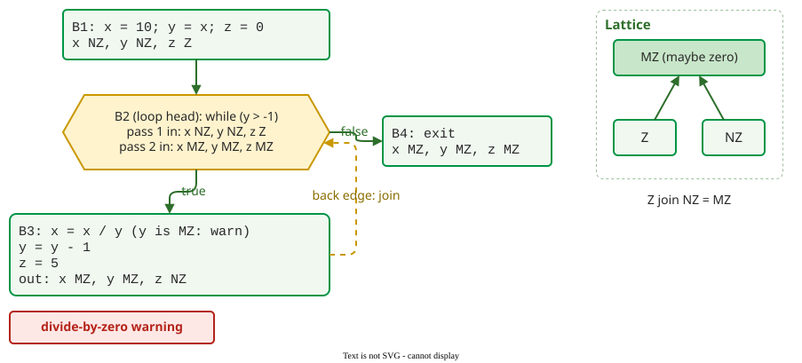

# Dataflow Analysis

**Dataflow analysis** computes, for every point of a program, a fact about each variable, such as "may be zero" or "may be null", by pushing facts along the control flow graph until they stop changing. It reasons about all paths at once, where AST checks see one statement at a time .

## 1. Abstract values instead of numbers

**Zero analysis** finds divisions whose divisor may be zero. It tracks only three abstract values per variable:

| Abstract value | Meaning |
|---|---|
| **Z** | definitely zero |
| **NZ** | definitely not zero |
| **MZ** | maybe zero: could be either |

The values form a small **lattice**: Z and NZ sit below MZ. Where two paths meet, the analysis takes their **join**, the lowest value above both: Z join NZ = MZ, and any value joined with itself stays the same. Replacing integers with three values is what makes every path checkable ([Soundness and Completeness](limits.md)).

## 2. Transfer rules

Each statement maps the abstract values before it to those after it. These are the rules for integer variables:

| Statement | Result |
|---|---|
| `x = 0` | x is Z |
| `x = c`, constant c ≠ 0 | x is NZ |
| `x = y` | x takes y's value |
| `x = y + c` or `x = y - c`, constant c ≠ 0 | Z gives NZ; NZ or MZ gives MZ (5 − 1 is not zero, but 1 − 1 is) |
| `x = a * b` | Z if either is Z; NZ if both are NZ; otherwise MZ |
| `x = a / b` | Z if a is Z; otherwise MZ (integer division: 1 / 2 is 0) |

A division `a / b` is reported when b is not NZ.

## 3. Worked example: a loop that divides

```c
x = 10; y = x; z = 0;        // B1
while (y > -1) {             // B2
    x = x / y;               // B3
    y = y - 1;
    z = 5;
}                            // B4: exit
```

Dataflow analysis works on the program's **control flow graph (CFG)**: each node is a **basic block**, a run of statements that always execute together from first to last, and each edge is a possible jump from one block to the next. Here B1 is the code before the loop, B2 the **loop head** where `y > -1` is tested, B3 the loop body and B4 the exit; the edge from B3 back to B2 is the back edge. The analysis enters the loop with the facts from B1, runs B3, then joins what comes round the back edge with what came from B1, and repeats until nothing changes. A short Python implementation of the rules above produces these passes:

| Pass | Entering B2 | Divisor y at `x / y` | Leaving B3 |
|---|---|---|---|
| 1 | x NZ, y NZ, z Z | NZ: no warning | x MZ, y MZ, z NZ |
| 2 | x MZ, y MZ, z MZ (joined) | **MZ: warning** | x MZ, y MZ, z NZ (unchanged) |



_The example's control flow graph with the facts at the fixed point; the dashed back edge is where Z join NZ turns into MZ._ 

The second pass leaves B3 unchanged, so the analysis has reached a **fixed point** and stops, with one warning at the division. The warning is real: y counts down from 10, the loop condition `y > -1` still holds at y = 0, and the eleventh iteration divides by zero. The analysis also correctly treats x as maybe zero after the first pass: x is 10 / 10 = 1, then 1 / 9 = 0 in integer arithmetic.

## 4. Why it terminates

Every variable can only move up the lattice, from Z or NZ to MZ, never back. With three variables, each changing at most once, the loop is re-analysed at most a few times before nothing changes. Any finite lattice gives the same guarantee, which is why dataflow analyzers always finish, at the price of the precision lost in each join.

## 5. The same idea for null

Null analysis uses the values **None**, **not None** and **maybe None**, and adds **branch refinement**: inside `if user is not None:`, the analysis knows `user` is not None.

```python
def show(name: str) -> int:
    # lookup(name) returns (id, name) or None; log(msg) prints a message
    user = lookup(name)            # maybe None
    if user is None:
        log("unknown user")
    else:
        print(user[1])             # refined to not None: no warning
    return user[0]                 # after the join: maybe None, warning
```

Type checkers apply exactly this refinement to `Optional` values: run on this code, mypy 2.4.0 accepts `user[1]` and reports only the `return user[0]` line, as a value that "is not indexable" because it may be `None` ([Pattern, Type and Taint Checks](techniques.md)).

## 6. Live variables and reaching definitions

Zero, null and taint analysis are **forward** analyses: facts flow from definitions toward uses. **Backward** analyses run the other way. **Live-variable analysis** asks, at each point, which variables will still be read later; an assignment to a variable that is not live after it is a **dead store**, the fault flake8 reports as "assigned to but never used". **Reaching definitions**, a forward analysis, asks which assignments can reach each use of a variable without being overwritten. Compilers use the same facts for constant propagation and dead-code removal.

**Where the inputs come from.** Nobody draws the control flow graph by hand: the analyzer builds it from the source or the compiler's intermediate code while the project builds, which is why industrial tools such as Coverity and Infer wrap the build command. What a team supplies is a working build, and models of library functions whose code the analyzer cannot see.

## When to use it — and when not

- Use it for value properties along paths: division by zero, null use, uninitialised or unused variables, resource leaks.
- Do not expect it to understand correlations between variables. If `y` is zero only when a flag is false, and the division is guarded by that flag, the join forgets the link and the analysis raises a false alarm.

## How solid is this?

- **Where it comes from.** Dataflow analysis, lattices and taint propagation are described by Chess and West ; the example is a classic teaching case, and its passes were recomputed with the rules above.
- **What we do not hold.** No study in the review measures false-alarm rates of zero or null analysis by itself; tool-level precision is on [Comparing Static Analysis Tools](tools.md).

---

### References



---

{: .highlight }
**Disclaimer:** AI is used for text summarization, polishing and explaining. Authors have verified all facts and claims. In case of an error, feel free to file an issue.
