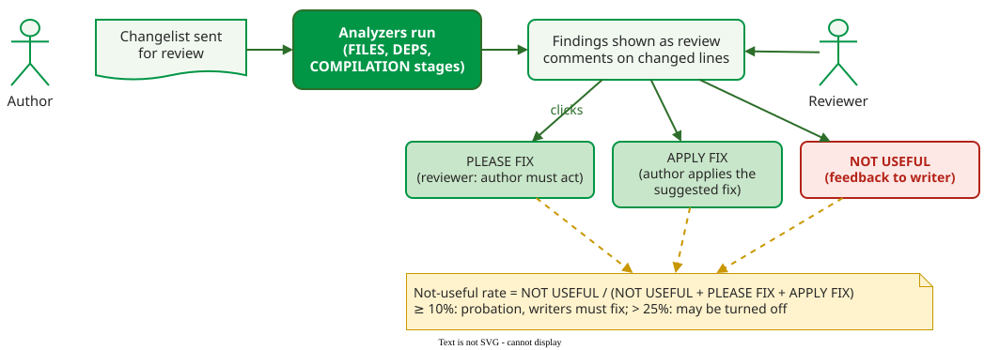

# Deploying Static Analysis

**Deploying** a static analysis tool means making developers act on its findings, which is mainly an organisational task: the tool must run where developers already work, show few false alarms, and be tuned to the code base. Google and eBay reached the same lesson by different routes  .

## 1. Example: Google puts findings in code review

Google's **Tricorder** runs about 30 analyzers, written by teams across the company, on every changelist sent for code review, and posts their findings as review comments on the changed lines. A team of two or three people maintains the platform .

_Tricorder's feedback loop: reviewers mark findings PLEASE FIX or NOT USEFUL, authors can APPLY FIX, and the not-useful rate decides whether an analyzer stays._ 

Averaged over 90 days, it reported about 93,000 findings a day; on an average day reviewers clicked PLEASE FIX on 716 of them and NOT USEFUL on 48, a daily not-useful rate of 48 / (48 + 716 + APPLY FIX), at most 6.3%. The paper gives no daily count of APPLY FIX clicks, only that they were "much lower"; the authors suspect many developers fixed the code in their own editor instead. Most findings were never shown, because they sat on lines the change did not touch . Four choices made this work:

- **Workflow integration.** Results appear at review time, when the author is ready to change the code and the reviewer sees whether a warning was ignored. A tool developers have to run themselves "just will not be run as frequently as intended".
- **A measured false-alarm budget.** Each analyzer's not-useful rate is NOT USEFUL / (NOT USEFUL + PLEASE FIX + APPLY FIX). At 10% or more the analyzer goes on probation and its writers must show progress in fixing it; above 25% the platform team may switch it off, though in practice it usually works with the writers on a fix instead. On the weekly chart for 2014, the rate across all analyzers was typically about 5% in recent months, and under 4% without the analyzers on probation; that 5% comes from a different chart from the daily 716 and 48 above, so the two cannot be combined into one rate. Google measures clicks rather than true false-positive rates on purpose: "developers will decide whether an analysis tool has high impact, and what they consider a false positive to be".
- **Fixes, not just findings.** Analyzers attach a suggested fix the author can preview and apply in the review tool.
- **Project-level settings.** Customisation is per project, never per developer, so a team does not argue about whose settings count.

## 2. Example: eBay tunes before rollout

eBay evaluated FindBugs for its Java code base of millions of lines . Its out-of-the-box settings were a poor fit: some checkers that were on by default found nothing of interest, while some that were off found more. Switching checkers on and off, sometimes per package, removed 75% of the original warnings, which developers judged mostly false; on the customised version the evaluators estimated 10% false positives. Developers who had tried a tool once, unaware it could be tuned, had dismissed all static analysis as "useless"; the customised results won them over.

eBay then gave each checker a priority with a fixed rule:

| Priority | Policy | eBay example |
|---|---|---|
| High | purge every instance from the whole code base | possible null pointer exception |
| Medium | no new instances; old ones fixed only when the code is refactored | high McCabe complexity (many independent paths through a function) |
| Low | a cap on how many new instances each release may add | mostly style issues |

To decide whether the tool was worth it, the team compared its yearly cost, two engineers to run it, with the bugs two manual testers of the same cost found per week, and concluded FindBugs gave better value. The paper's cost figures are deliberately "completely faked", keeping only their order of magnitude, so only the method transfers, not the numbers. Part of the argument was an estimate from earlier literature that a defect found during development costs about ten times less than one found in testing .

## 3. A rollout that works

Both experiences, with Chess and West's review cycle (set goals, run the tool, review its output, fix) , give one order of steps:

1. Decide which faults matter for this code base, and pick tools that look for them.
2. Run the tools on a sample, review the warnings with the developers, and switch off checkers that produce noise.
3. Set a policy per priority: what must be fixed now, what may not be added, what is only counted.
4. Show results where developers already work (code review, the build) and only for changed code.
5. Measure how often developers act on findings, and retire analyzers they keep rejecting.

**Where the inputs come from.** The not-useful rate needs a record of what developers do with each finding: Tricorder took it from clicks in the review tool. Without such a tool, a team can count, per analyzer, the findings fixed and the findings suppressed, from its version history and suppression comments.

## When to use this — and when not

- Use this order for any new analyzer, from a linter to a commercial security scanner.
- Do not start by enforcing an untuned tool on all legacy code: a flood of irrelevant warnings is how eBay's developers came to call static analysis "useless".

## How solid is this?

- **Where it comes from.** Tricorder's design and numbers ; eBay's evaluation ; the review cycle .
- **What is contested.** Both cases come from large companies with dedicated tool teams, reported by the people who built the systems. The 10% threshold is Google's choice; the paper notes it matches other platforms such as Coverity's, not that it is optimal.

---

### References



---

{: .highlight }
**Disclaimer:** AI is used for text summarization, polishing and explaining. Authors have verified all facts and claims. In case of an error, feel free to file an issue.
