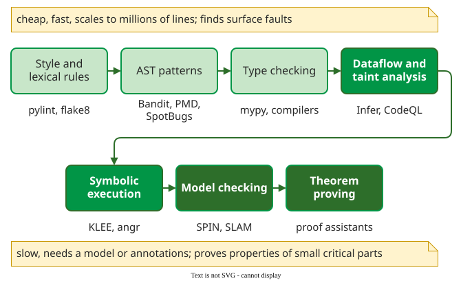

# Static Analysis

**Static analysis** examines a program without running it and reports code that may break a rule: a type error, a value that may be zero at a division, untrusted input that reaches a database query, a lock that is never released. It reasons about every path at once, where a test sees only the path its input takes .

The price of covering every path is approximation. No analysis can decide every interesting property of every program, so each tool either raises false alarms or misses bugs, and in practice does both. The techniques form a spectrum: cheap checks scale to millions of lines and find surface faults; deep ones prove properties of small, critical parts.

_The technique spectrum, from cheap and shallow (top left) to costly and deep (bottom right); the grouping follows Chess and West._ 

## The techniques compared

| Technique | What it finds | Best fit | Main cost | Read more |
|---|---|---|---|---|
| Style rules, AST patterns, types | unused variables, risky calls, a value that may be `None` | every project, on every commit | noise if not tuned | [Pattern, Type and Taint Checks](techniques.md) |
| Dataflow analysis | values that may be zero or null where they are used | compilers, bug finders | false alarms where paths merge | [Dataflow Analysis](dataflow.md) |
| Taint analysis | untrusted input reaching a query or a shell | web and security code | specifying sources and sanitizers | [Pattern, Type and Taint Checks](techniques.md) |
| Symbolic execution | inputs that reach a given branch or crash | parsers, command-line tools | path explosion | [Symbolic Execution](symbolic-execution.md) |
| Model checking | deadlocks, races, protocol violations | concurrent and safety-critical parts | state explosion; building the model | [Model Checking](model-checking.md), [Abstraction Refinement](cegar.md) |

Before the techniques, [Soundness and Completeness](limits.md) explains why every tool must approximate. After them, four pages look at practice: how to [triage warnings](warnings.md), how real [tools compare](tools.md), how Google and eBay [deployed](deployment.md) them, and how [effective](effectiveness.md) static analysis is next to inspection and testing.

## Where it fits

Static analysis sits between [inspection](../inspection/), where people read the code, and testing, where the code runs. It finds a different mix of faults from both, which is why the industrial evidence recommends it alongside them, not instead of them .

---

### References



---

{: .highlight }
**Disclaimer:** AI is used for text summarization, polishing and explaining. Authors have verified all facts and claims. In case of an error, feel free to file an issue.
