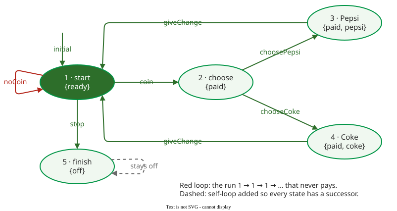

# Kripke Structures and LTL

A **Kripke structure** is the formal model a model checker explores: a set of states, the states a run may start in, the transitions between states, and a labelling that says which basic facts are true in each state . Temporal-logic properties are checked on the runs of this structure.

Formally it is a 4-tuple:

$$M = (S,\ I,\ R,\ L), \qquad I \subseteq S, \quad R \subseteq S \times S, \quad L : S \to 2^{AP}$$

$$S$$ is the set of states, $$I$$ the initial states, $$R$$ the transition relation, and $$L$$ maps each state to the set of **atomic propositions** (from the set $$AP$$) true in it. Every state must have at least one successor, so that every run is infinite .

## 1. Example: a vending machine as a Kripke structure

(Constructed example.) A customer inserts a coin, chooses a drink and receives a can. Building the model takes three steps.

1. **States.** $$S = \{1\ \text{start}, 2\ \text{choose}, 3\ \text{Pepsi}, 4\ \text{Coke}, 5\ \text{finish}\}$$, and the machine starts in $$I = \{1\}$$.
2. **Transitions.** From start the customer inserts no coin (1→1), a coin (1→2), or the machine stops (1→5); from choose, 2→3 or 2→4; after either drink the machine gives change (3→1, 4→1). Naming each transition by its action gives a **labelled transition system**; a Kripke structure drops the names and tells 2→3 from 2→4 by what is true in the target state.
3. **Labels.** With $$AP = \{\text{ready}, \text{paid}, \text{pepsi}, \text{coke}, \text{off}\}$$, where *paid* means a coin is in the machine and no change has yet been given: $$L(1) = \{\text{ready}\}$$, $$L(2) = \{\text{paid}\}$$, $$L(3) = \{\text{paid}, \text{pepsi}\}$$, $$L(4) = \{\text{paid}, \text{coke}\}$$, $$L(5) = \{\text{off}\}$$.

State 5 has no successor, so it gets the self-loop 5→5. The finished relation is $$R = \{(1,1), (1,2), (1,5), (2,3), (2,4), (3,1), (4,1), (5,5)\}$$.



_The vending machine as a Kripke structure; the action names on the arrows are for the reader, the checker sees only the labels. (Constructed example.)_

## 2. Checking LTL on the runs

A **path** is an infinite sequence of states $$s_0 s_1 s_2 \dots$$ in which each step is in $$R$$. A structure satisfies an LTL formula when **every** path from an initial state does . In SPIN's notation , `[]`, `<>`, `X` and `U` are G (always), F (eventually), X (next) and U (until), introduced on [Model Checking](model-checking.md); `!`, `||` and `->` are ¬, ∨ and ⇒. One property per operator, each checked with SPIN 6.5.2 for this page:

| Property (SPIN) | Reads | Result |
|---|---|---|
| `[] (pepsi -> X ready)` | after a Pepsi, the next state is start | holds: state 3's only successor is 1 |
| `[] ((pepsi || coke) -> paid)` | no drink without payment | holds in all five reachable states |
| `<> pepsi` | a Pepsi is eventually served | **fails** |
| `!(pepsi || coke) U paid` | no drink until someone pays, and someone does pay | **fails** |

The checker works differently per operator. **X** looks at the successors of each state. **G** visits every reachable state and tests the formula in each. **F** is the costly case: a counterexample is a path from an initial state, a finite prefix followed by a loop repeated forever, on which *p* is false in every state, prefix included; the property holds only if no such path exists. Here there is one, and SPIN reports it as an acceptance cycle:

```text
$ ./pan -a
pan:1: acceptance cycle (at depth 0)
$ spin -t -p pF.pml
  <<<<<START OF CYCLE>>>>>
  ...
  2:	proc  0 (Machine:1) pF.pml:12 (state 2)	[st = 1]
```

The counterexample is the path 1 → 1 → 1 → …, a customer who never inserts a coin. A liveness counterexample always has this shape: a finite prefix and a loop repeated forever.

The **until** property fails on the same path, and on 1 → 5 → 5 → …, because `p U q` demands that `q` eventually happens. The **weak until**, which allows `q` never to happen, holds; SPIN has no operator for it, so it was written `(p U q) || [] p` and passed. The fix for `<> pepsi` depends on what was meant: `[] (paid -> <> (pepsi || coke))`, "a customer who paid gets a drink", holds.

**Where the inputs come from.** In SPIN the states are the values of the model's variables, and each atomic proposition is a Boolean expression over them, such as `#define pepsi (st == 3)`. The transitions come from the design (a statechart or protocol specification) or, in tools such as Java PathFinder, from the program itself. The properties come from the requirements.

## When to use it — and when not

- Write the Kripke structure, at least on paper, whenever a property is stated over runs: it shows which propositions the property needs and whether each state has a successor.
- Do not draw it by hand for real programs; a checker such as SPIN builds it from the model, and the states number in millions ([Model Checking](model-checking.md)).

## Limitations

The verdict is about the model. This one has no coin values and no stock, so it says nothing about wrong change or an empty Coke slot. Liveness properties also fail on runs a person would dismiss, such as a machine that is never used; such a run needs a fairness assumption or a more precise property, not a code fix. LTL cannot say that something is *possible* ("some run serves a Pepsi"); that needs the branching-time logic CTL .

## How solid is this?

- **Where it comes from.** The definitions follow Clarke, Grumberg and Peled  and Pnueli's introduction of temporal logic for programs ; SPIN's operators are from the NASA guide . All six results were produced with SPIN 6.5.2 on a Promela version of the structure, each transition one indivisible step (`d_step`) so that `X` refers to the next machine state.
- **What we do not hold.** The book's text: the definitions are the standard ones and are stated from it without page references.

---

### References



---

{: .highlight }
**Disclaimer:** AI is used for text summarization, polishing and explaining. Authors have verified all facts and claims. In case of an error, feel free to file an issue.
