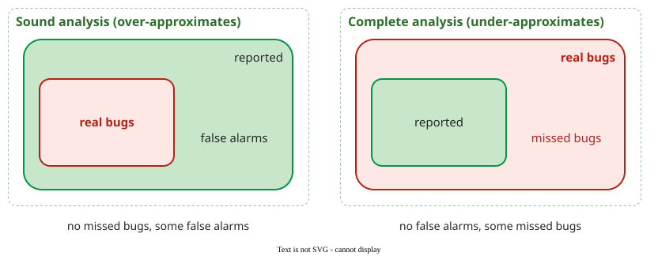

# Soundness and Completeness

A static analysis is **sound** for a property if it reports every violation that exists: it never misses a bug. It is **complete** if every report is a real violation: it never raises a false alarm. No useful analysis can be both, so every tool chooses which error it accepts.

## 1. Why no tool can be perfect

**Rice's theorem** (1953) shows that every non-trivial question about what a program does is undecidable: no algorithm answers it correctly for every program . "Can this division ever divide by zero?" is such a question. An analysis that always terminates must therefore approximate, and the approximation errs in one of two directions.

_A sound analysis over-approximates the program's behaviour, so its reports contain every real bug plus false alarms; a complete analysis under-approximates, so every report is real but some bugs are missed._ 

Each report, or silence, then falls into one of four cells:

| | Bug exists | No bug |
|---|---|---|
| **Reported** | true positive | false positive (false alarm) |
| **Not reported** | false negative (missed bug) | true negative |

**Precision** is the share of reports that are real: true positives divided by all reports. The [tools comparison](tools.md) uses it to rate real analyzers.

## 2. Example: one file, two kinds of error

The four tools run on the same 21-line Python file on the [Pattern, Type and Taint Checks](techniques.md) page show both errors at once. `mypy` reports that `user[1]` indexes a value that may be `None`. That report is real for mypy's property: the type says `Optional` and nothing guarantees the name exists. Whether the program would actually crash depends on the data; if every name looked up is known to exist, it never does, and the report is a false alarm for this program's behaviour. `pylint` reports an unused variable and says nothing about the SQL query built by string concatenation, a missed bug for security, because injection is not a property it checks.

Chess and West put the cost of each error plainly. A false positive costs the time to review it; a false negative costs the vulnerability itself plus "a false sense of security", because the tool made the code look fine .

## 3. Abstraction makes the question answerable

An analysis does not track real values. **Zero analysis**, which looks for divisions by zero and is the worked example on [Dataflow Analysis](dataflow.md), keeps only three abstract values per variable: zero, not zero, or maybe zero. For three 32-bit variables that replaces 296 concrete states with 33 = 27 abstract ones, few enough to examine every path. The loss of detail is exactly where false alarms come from: once two paths merge, "zero" and "not zero" become "maybe zero".

The same holds for every analysis: it is **attribute-specific**. It checks one quality attribute, such as division by zero, a data race or a buffer overflow, through one pattern that rules the error out, such as "every shared variable is accessed only while holding its lock" for races. Outside that pattern it says nothing, and some attributes, such as whether a screen is easy to use, have no such pattern. A practitioner rule of thumb for any tool: ask what it abstracts, what information that loses, and where its false alarms and missed bugs come from.

## 4. Which way tools lean

Verification tools aim at soundness for the property they check, under stated assumptions such as "no function pointers"; on large real code those assumptions rarely hold, so practitioners seldom require soundness. Bug finders aim the other way: few false positives, accepting more missed bugs. A bug finder whose every report comes with a feasible path is the kind the research literature calls complete . Google's analysis platform takes the bug-finder side on purpose: an analyzer whose findings developers mark "not useful" too often goes on probation and may be switched off ([Deploying Static Analysis](deployment.md)).

## When the distinction matters

- Read a clean report from a bug finder as "nothing found", never as "no bugs"; ask which properties the tool checks.
- Choose a sound checker when a missed bug is unacceptable and its assumptions hold for the code, as for a device driver's locking rules ([CEGAR](cegar.md)).
- Choose a precise bug finder for a large, changing code base where developers must trust every warning.

## How solid is this?

- **Where it comes from.** Rice's theorem is a mathematical result ; the trade-off and the practitioner's view of soundness are Chess and West's .
- **What is contested.** The words vary between authors: "complete" and "sound with respect to counterexamples" (Chess and West) both mean no false alarms here. Check the definition before comparing claims.

---

### References



---

{: .highlight }
**Disclaimer:** AI is used for text summarization, polishing and explaining. Authors have verified all facts and claims. In case of an error, feel free to file an issue.
