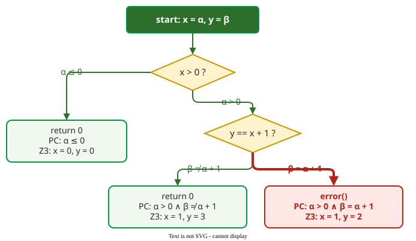

# Symbolic Execution

**Symbolic execution** runs a program on symbols instead of values: each input is an unknown, each branch adds a constraint, and a constraint solver turns the constraints of every path into a concrete test input that takes that path . It sits between static analysis, which reasons about paths, and testing, which produces runnable inputs.

## 1. Worked example: three paths, three tests

```c
int foo(int x, int y) {
    if (x > 0) {
        if (y == x + 1)
            error();        /* the target */
    }
    return 0;
}
```

The engine gives the unknown inputs names: x = α and y = β, so α and β stand for whatever values x and y will have. At `x > 0` it forks: one path assumes α ≤ 0, the other α > 0. The second path forks again at `y == x + 1`. Each path collects a **path condition (PC)**, the conjunction of the branch decisions along it. A solver checks whether each PC is satisfiable and, if so, gives a model, an input that satisfies it. Z3 5.3.2 returns:

```text
x <= 0                 sat   x=0, y=0
x > 0, y != x + 1      sat   x=1, y=3
x > 0, y == x + 1      sat   x=1, y=2
```



_The symbolic execution tree of `foo`: α and β are the unknown inputs x and y; three paths, three path conditions, three generated tests._ 

The input x = 1, y = 2 reaches `error()`. A random tester would need luck to hit y = x + 1; the solver derives it from the code.

## 2. Concolic execution

Solving every path is expensive, and code such as a hash function or a system call is hard to express as constraints. **Concolic** (concrete plus symbolic) execution runs the program on a real input, records the path condition of that run, negates one branch condition, and asks the solver for an input that takes the other side. The concrete run proves the current path feasible, so the solver is asked only about the flipped branch; that removes its largest bottleneck .

## 3. Evidence: KLEE on GNU Coreutils

KLEE, a symbolic execution tool for C, was run for about an hour on each of the 89 stand-alone programs of GNU Coreutils, the command-line utilities of Unix systems, and compared with the developers' own test suites, built up over fifteen years .

```vega-lite
{
  "$schema": "https://vega.github.io/schema/vega-lite/v5.json",
  "width": 420, "height": 170,
  "data": {"values": [
    {"m": "Total lines covered", "s": "KLEE tests", "v": 84.5},
    {"m": "Total lines covered", "s": "Developer tests", "v": 67.7},
    {"m": "Average per tool", "s": "KLEE tests", "v": 90.9},
    {"m": "Average per tool", "s": "Developer tests", "v": 68.4},
    {"m": "Median per tool", "s": "KLEE tests", "v": 94.7},
    {"m": "Median per tool", "s": "Developer tests", "v": 72.5}
  ]},
  "encoding": {
    "y": {"field": "m", "type": "nominal", "title": null, "sort": null, "axis": {"labelFontSize": 13}},
    "yOffset": {"field": "s", "sort": ["KLEE tests", "Developer tests"]},
    "x": {"field": "v", "type": "quantitative", "title": "Line coverage (%)", "scale": {"domain": [0, 100]}},
    "color": {"field": "s", "type": "nominal", "title": null, "sort": ["KLEE tests", "Developer tests"],
              "scale": {"range": ["#019546", "#9bbf9b"]}, "legend": {"orient": "bottom", "labelFontSize": 13}}
  },
  "layer": [
    {"mark": {"type": "bar"}},
    {"mark": {"type": "text", "align": "left", "dx": 4, "fontSize": 12}, "encoding": {"text": {"field": "v", "type": "quantitative"}}}
  ],
  "config": {"font": "Tahoma", "axis": {"titleFontSize": 13, "labelFontSize": 12}, "view": {"stroke": null}}
}
```

_Line coverage of the 89 Coreutils programs by KLEE's generated tests and by the developers' test suites._ 

KLEE's tests covered 84.5% of all Coreutils lines against the developers' 67.7%, the "16.8%" improvement the paper headlines, which is 16.8 percentage points. Applied as a bug finder to 452 programs with over 430,000 lines, it found 56 serious bugs, including three in Coreutils that had been missed for over fifteen years .

## 4. The limits

The number of paths grows exponentially with the branches: n independent `if` statements give up to 2<sup>n</sup> paths, and a loop over symbolic data multiplies them further. Bailey and Nicholas group the remedies into three families :

- **Scope reduction** analyses one function or module instead of the whole program.
- **Guidance heuristics** steer the search toward uncovered code or likely bugs.
- **Hybrid analysis** combines a fuzzer, a tool that runs the program on large numbers of random or mutated inputs, which covers easy paths quickly, with symbolic execution for the branches the fuzzer cannot pass.

The engines the survey covers include KLEE and SymCC for source code, angr and Triton for binaries, S2E for whole systems including kernels, and Driller, which pairs the widely used AFL fuzzer with angr . Constraints the solver handles badly (non-linear arithmetic, floating point) and the program's environment (files, network, libraries) are the other two limits; KLEE models the file system and command line to get around the second, and against path explosion it alternates two search heuristics: random path selection and a search that favours states likely to cover new code .

**Where the inputs come from.** KLEE runs on LLVM bitcode, so the program is compiled with `clang -emit-llvm`, and a small driver marks which variables are symbolic with `klee_make_symbolic`, much like a fuzzing harness. The output is a set of concrete test inputs, which can seed a fuzzer or become regression tests.

## When to use it — and when not

- Use it to generate tests for code with narrow conditions: parsers, protocol handlers, command-line tools.
- Avoid it for code dominated by the environment, deep loops or floating point, where paths explode or constraints cannot be solved; fuzzing or ordinary testing is cheaper there.

## How solid is this?

- **Where it comes from.** The Z3 output above was produced with Z3 5.3.2; the KLEE figures are from Cadar and colleagues' 2008 paper ; the taxonomy of remedies is from Bailey and Nicholas's survey .
- **What is contested.** KLEE's comparison is on Coreutils, which the authors chose because it is heavily tested; coverage gains on other code bases may differ.

---

### References



---

{: .highlight }
**Disclaimer:** AI is used for text summarization, polishing and explaining. Authors have verified all facts and claims. In case of an error, feel free to file an issue.
